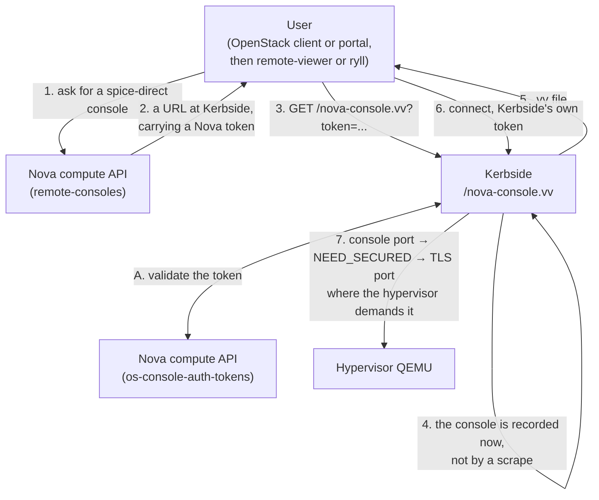

# Kerbside for OpenStack

Nova's `spice-direct` console type lets OpenStack users open a
native SPICE client, but leaves the proxy that client connects
to as someone else's job. Kerbside is that proxy, designed
alongside `spice-direct`, so the console URL Nova returns is a
Kerbside URL.

## Value proposition

Nova 2025.1 (Epoxy) added the `spice-direct` console type so
that users can open a native SPICE client instead of the HTML5
transcoding proxy. That console type did not arrive
independently of Kerbside. The Kerbside developers proposed it
to Nova as the upstream half of this deployment, and it was
refined and landed with the Nova team through the
[Nova specification](https://specs.openstack.org/openstack/nova-specs/specs/2025.1/implemented/libvirt-spice-direct-consoles.html)
process. What landed is deliberately general: any
protocol-aware proxy could answer it. But Kerbside is the proxy
it was designed alongside, and the two projects have moved
together since.

A native client has to connect to something,
and OpenStack is — wisely — unwilling to give a client network
a route to TCP ports on a hypervisor. So `spice-direct` does not
hand the user a hypervisor address at all. It hands out a URL
built from Nova's `[spice] spice_direct_proxy_base_url` with a
console auth token attached, and in a Kerbside deployment that
setting names Kerbside's `/nova-console.vv`.

Kerbside is therefore not an alternative to Nova's console
story. It is the half of it that Nova deliberately left to
someone else:

- **Kerbside is the console endpoint, not a bolt-on.** The two
  scraped deployments sit beside a console path the platform
  already had — oVirt's portal, Shaken Fist's own broker. Here
  Nova has nowhere else to point a native client, so there is
  no second path to keep in sync and nothing for a user to
  bypass Kerbside with. The console URL Nova returns *is* the
  Kerbside URL.
- **The SPICE firewall is on by default.** Kerbside terminates
  the client's connection, drives the SPICE link handshake
  itself, and classifies every framed message against a
  per-channel allowlist. See
  [proxy-architecture.md](/components/kerbside/proxy-architecture/).
- **Sessions are objects, not TCP flows.** Every proxied console
  is a row you can list over the REST API, with an audit trail,
  and can terminate in flight — which nothing else on this path
  can do once a token has been exchanged.
- **The hypervisors are never reachable from the client
  network.** Clients reach Kerbside; Kerbside reaches the
  compute nodes. This is the property OpenStack wanted in the
  first place, and it is what lets a compute node's console
  ports stay on the management network.
- **The backend leg is not subject-pinned on this path.** This
  is the one place this deployment is weaker than the two
  already documented, and it is better known now than
  discovered later. Nova's token validation answers with the
  instance uuid, the compute node's address, and the plaintext
  and TLS console ports — and nothing about the hypervisor's
  certificate. There is no subject for Kerbside to pin against,
  so the console it records carries none and the proxy relays
  that backend without host-subject enforcement. Both scraped
  deployments learn a subject from the platform during
  discovery; this one has no discovery and nothing to learn a
  subject from. What still holds: the backend leg escalates to
  TLS when the hypervisor demands it, verified against the CA
  you configure for the cloud where you configure one, and the
  firewall still inspects every message on it. And the
  *client-facing* leg is still pinned, by `PROXY_HOST_SUBJECT` —
  which is Kerbside's own certificate subject, written into the
  `.vv` file for the client to check. That is a different leg:
  client to Kerbside, not Kerbside to hypervisor. See the
  limitations table.
- **[One entry point across clouds.](/components/kerbside/use-cases/multi-cloud/)** A
  single Kerbside can broker OpenStack alongside oVirt and
  Shaken Fist sources; users keep one console entry point as
  workloads move.

Users get the SPICE features an HTML5 console cannot offer:
high-resolution and multi-monitor desktops, USB passthrough,
audio, and adaptive compression.

## How it works

Nothing is discovered in advance. There is no OpenStack source
driver in `kerbside/sources/`, and the maintenance loop's scrape
pass skips an entry of this type outright, so the discovery
interval that governs the oVirt and Shaken Fist sources does not
apply here at all. A console exists in Kerbside because a user
asked Nova for one, and not before.



**The request (1, 2).** Nova, not Kerbside, decides that a user
may have a console. A client asks for one at compute API
microversion 2.99 or later — `openstack console url show
--spice-direct <instance>` is the one-line form — and Nova
answers with a console of type `spice-direct`, protocol `spice`,
and a URL. That URL is `spice_direct_proxy_base_url` with a
freshly minted console auth token attached.

**The exchange (3, A, 4).** Following that URL lands on
Kerbside's `/nova-console.vv` endpoint, which is the whole of
the OpenStack implementation (`NovaToken` in `kerbside/api.py`).
Kerbside authenticates to Keystone as the service account you
configured for the cloud and asks Nova to validate the token it
was handed; which endpoints that needs is under **Network**
below. That is a live call per exchange, so it sits
between oVirt's per-session ticket and Shaken Fist's entirely
offline signature check: a Nova that is down means no *new*
consoles, while sessions already running are untouched. Where
several OpenStack clouds are configured, each is tried in turn,
and a token none of them recognises ends as a 404. Only a clean
"I do not know this token" moves on to the next cloud, though:
a cloud that errors — bad credentials, an unreachable Keystone,
a certificate problem — ends the whole request there, so a
broken cloud early in `sources.yaml` takes out console access
for every cloud listed after it.

The validation answer carries the instance uuid, the compute
node's address, and that console's plaintext and TLS ports.
Kerbside writes them into its console table at that moment,
creating the row if this instance has never been asked for
before and refreshing it if it has. This is the only thing that
ever creates an OpenStack console row.

**The client leg (5, 6).** The `.vv` file points at
`PUBLIC_FQDN` and Kerbside's own ports, carries Kerbside's CA
and, when `PROXY_HOST_SUBJECT` is set, Kerbside's own
certificate subject for the client to check. It carries a
short-lived Kerbside console token, which is what the client
presents on connect. The Nova token is used at the exchange and
goes no further: the client authenticates to *Kerbside*.

**The backend leg (7).** Kerbside dials the address Nova
reported — which is that compute node's
`[spice] server_proxyclient_address` — on the plaintext console
port. If the hypervisor answers the link handshake with
`NEED_SECURED`, Kerbside retries on the TLS port, verifying
against the CA configured for the cloud where one is configured
(`rust/kerbside-proxy/src/backend.rs`). Where none is, the proxy
passes no CA to the protocol crate, and `create_tls_connector`
in ryll's `shakenfist-spice-protocol` falls back to the public
web trust store with hostname verification — which an internal
hypervisor's certificate will not satisfy, so the escalation
fails rather than proceeding unverified. Whether that escalation
happens is the hypervisor's decision rather than Kerbside's:
Nova's `[spice] require_secure` turns it on, which in turn needs
TLS certificates for SPICE on every hypervisor.
Where qemu does not demand it the leg stays on the plaintext
port, so both ports have to be reachable. Either way Kerbside
presents an empty SPICE ticket on that leg — the field is sent,
with no ticket material in it — because Nova's validation
response carries none. The console port is guarded by where it
sits on the network, which is the assumption `spice-direct` is
built on and precisely why Kerbside has to be between it and the
user.

**No scrape, and therefore no reconciliation.** The pass that
removes consoles it can no longer see is scoped to the sources
it actually enumerated, and an OpenStack entry is skipped rather
than enumerated, so its consoles are retained indefinitely and
by design (see
[console-sources.md](/components/kerbside/console-sources/#what-happens-when-a-source-fails)).
A row for an instance that has since been deleted stays listed
until the cloud is removed from `sources.yaml` altogether. Nova
will not mint a token for an instance that no longer exists, so
the row is unreachable by the path this page describes — but it
is still in the console list, and the administrative `.vv`
download described under
[User interaction model](#user-interaction-model) will still
open it. That path mints a Kerbside console token from the
stored row without calling Nova at all, so nothing in it
notices the instance is gone.

By then the recorded address and ports may belong to something
else, because libvirt reuses console ports as instances come
and go. That is the reason to remove a decommissioned cloud
from `sources.yaml` rather than leave it configured and
ignored.

## How to set it up

Everything in this section applies however Kerbside is deployed:
[by hand](/components/kerbside/deployment/manual/), in a container, or as one of
the cloud's own services.
Kolla-Ansible can deploy it the last way, and its role then does
most of what follows for you:
[Deploying Kerbside with Kolla-Ansible](/components/kerbside/deployment/kolla-ansible/)
covers that route and where it stands upstream, and how a stock
Kolla-Ansible cloud sets the Nova options below for a Kerbside
deployed some other way.

### OpenStack side

**Nova.** Kerbside needs Nova 2025.1 (Epoxy) or newer, with SPICE
as the console type. Every option here is read by `nova-compute`
and by no other Nova service, so each belongs in the `nova.conf`
of every compute host, and setting them on the controllers alone
does nothing. None of them is reloaded at runtime: restart
`nova-compute` after changing them.

| Option | Default | Set it to |
|--------|---------|-----------|
| `[spice] enabled` | `false` | `true`. Without it Nova refuses every SPICE console request, and gives instances no SPICE display. |
| `[vnc] enabled` | `true` | `false`. Nova's own option help says VNC has to be disabled to get a SPICE console. |
| `[spice] spice_direct_proxy_base_url` | `http://127.0.0.1:13002/nova` | The full URL of Kerbside's exchange endpoint, as below. |
| `[spice] server_proxyclient_address` | `127.0.0.1` | The compute host's address on a network Kerbside can reach. Nova reports it for every console, so it is the address Kerbside dials. |
| `[spice] server_listen` | `127.0.0.1` | The same address. QEMU listens for SPICE there, so without it a routable `server_proxyclient_address` finds nothing listening. |

`spice_direct_proxy_base_url` is the setting that makes a
`spice-direct` request resolve to Kerbside. It takes the whole
URL of the exchange endpoint,
`https://<PUBLIC_FQDN>:<port>/nova-console.vv`, where `<port>` is
wherever clients reach Kerbside's API. That is 13002 in these
docs, but it is a gunicorn argument or a reverse proxy's port
rather than a Kerbside setting (see
[network-ports.md](/components/kerbside/network-ports/#ports-kerbside-listens-on)).
Nova appends `?token=` and the token to the value as it stands,
so nothing may follow `/nova-console.vv`. The form Nova's own
option help suggests, `http://host:port/nova`, is a path Kerbside
answers with a 404.

An unset `spice_direct_proxy_base_url` fails in a recognisable
way. The console request succeeds, and the URL Nova returns
begins `http://127.0.0.1:13002/nova?token=`, which sends the
client to its own loopback address. Nothing reaches Kerbside, so
Kerbside logs nothing. An unset `server_proxyclient_address` or
`server_listen` fails later, at SPICE connect, as **Network**
below describes.

Nova adds the SPICE display to an instance when it builds the
instance's libvirt domain, so an instance started while the cloud
used VNC has no SPICE console until Nova rebuilds its domain, for
example at a hard reboot. `[spice] require_secure` is the
hypervisor's demand for TLS on the backend leg (see
[How it works](#how-it-works)), and is yours to choose.
Kolla-Ansible sets `[spice] enabled`, `[vnc] enabled` and
`server_listen` itself when `nova_console` is `spice`, but not the
base URL, and sets `server_proxyclient_address` only while its
HTML5 proxy is on;
[A Kerbside in front of a stock Kolla-Ansible cloud](/components/kerbside/deployment/kolla-ansible/#a-kerbside-in-front-of-a-stock-kolla-ansible-cloud)
gives the override file for the rest.

Clients must speak compute API microversion 2.99 or later.
Earlier microversions reject the `spice-direct` console type
outright, which is the first thing to check if a console request
fails before Kerbside is ever involved.

**Guests.** The instance needs a SPICE-capable virtual display,
as it would for any SPICE console, and the guest wants
`qemu-guest-agent` and `spice-vdagent` installed — they are what
give you clipboard sharing, display resizing, and clean
resolution changes. Nova gives an instance the channel
`spice-vdagent` talks over only while `[spice] agent_enabled` is
on, which it is by default. Kerbside relays the agent channel; it
does not decode it.

**Account.** Kerbside validates console tokens minted for *other*
users' instances. Nova's policy for that call,
`os_compute_api:os-console-auth-tokens`, allows only an
administrator by default, so Kerbside's account needs the `admin`
role. Make it a service user, in the `service` project where
OpenStack's own services keep theirs, and make the group whose
members may log in to Kerbside's web UI and REST API:

```bash
openstack user create --domain default --project service \
    --password-prompt kerbside
openstack role add --project service --user kerbside admin
openstack group create --domain default kerbside
openstack group add user kerbside alice bob
```

`--project` on `user create` only sets the user's default
project; `role add` is what grants the role. `group add user`
takes the group first, then one or more users. This is the
account Kolla-Ansible's role makes for a Kerbside it deploys (see
[What it deploys](/components/kerbside/deployment/kolla-ansible/#what-it-deploys)
on the Kolla-Ansible page). One account serves both of
Kerbside's uses of Keystone, validating tokens and checking group
membership at login; [Kerbside side](#kerbside-side) says where
it goes.

Two things about the account are worth knowing before you rely
on it:

- **No least-privilege role has been built or tested.** Treat
  one as untried. Because Nova's default policy says admin, a
  narrower role would need a policy change on the cloud as well.
- **Logging in needs more than the group.** Kerbside logs a user
  in by asking Keystone for a token scoped to the `admin` project
  in the `default` domain, values fixed in `kerbside/api.py`
  rather than settings. A user in the `kerbside` group who has no
  role on that project, or who lives in another domain, is
  refused with a 401.

### Network

Kerbside needs direct L3 reachability to **every compute node's
SPICE console port range** — both the plaintext and TLS ports,
typically from 5900 upwards — at whatever address that node's
`server_proxyclient_address` names. QEMU has to be listening
there too, which is what `server_listen` sets.

This is the prerequisite most likely to be missed, and it fails
in a distinctive way on this path. The exchange itself only
needs Keystone and Nova, so a `.vv` file is produced and
downloads perfectly; the failure appears only when the SPICE
client tries to connect, one step later than an operator
watching the exchange would expect. Either option left at
`127.0.0.1` fails the same way.

Kerbside must also reach Keystone and Nova. Keystone
authentication goes to the `url` configured for the cloud, and
Nova is then found in the service catalogue on the source's
`interface`, which defaults to **internal**. That is the right
default: Kerbside is a control plane service, the validation is
an administrative service-to-service call like the ones Nova's
own console proxies make, and Kerbside already has to be on the
management network to reach the compute nodes. So set `url` to
the internal Keystone endpoint too, and Kerbside needs nothing
from the public edge at all. Set `interface: public` only where
Kerbside sits outside the cloud it brokers, as it may in a
[multi-cloud](/components/kerbside/use-cases/multi-cloud/) deployment.

Clients need to reach two things and only two things: Nova's
API, to ask for a console, and Kerbside, at the name
`spice_direct_proxy_base_url` uses, both to exchange the token
and to run the SPICE session. Nothing needs a route to a compute
node, which is the entire point.

### Kerbside side

Kerbside uses the account in two places, one for each use:

| File | What the account does there | Settings |
|------|-----------------------------|----------|
| `sources.yaml`, one `type: openstack` entry ([console-sources.md](/components/kerbside/console-sources/#openstack)) | Validates console tokens | `url` names Keystone; `username`, `password` and `project_name: service` are the account. The example at the end of that page is this account. |
| `kerbside.ini` ([configuration.md](/components/kerbside/configuration/#keystone-settings)) | Checks group membership at login | `keystone_auth_url` names Keystone; `keystone_service_auth_user`, `keystone_service_auth_password` and `keystone_service_auth_project = service` are the account; `keystone_access_group = kerbside` names the group. |

`keystone_service_auth_project` defaults to `admin`, not
`service`, so an account in `service` has to set it. Left at the
default, Kerbside authenticates the account against a project it
has no role on, and every login fails.

The `sources.yaml` entry names the Keystone endpoint and the
service account, and — because there is no discovery pass — that
is all Kerbside does with it until a token arrives. Two things
about it are worth knowing here rather than in the option
reference:

- **The CA you configure for the cloud is the hypervisor's, not
  the client's.** It is what the backend leg verifies against
  when a hypervisor escalates to TLS. Kerbside's own
  certificate, which the *client* verifies, is a separate
  setting entirely. Configuring only the second does not leave
  the backend leg unverified; it leaves it verifying against the
  public web trust store, which an internal hypervisor's
  certificate will not satisfy. A hypervisor that escalates then
  fails the handshake — see **The backend leg** above.
- **There is no discovery interval to tune, and no errored
  state to watch.** The entry is registered and appears in the
  administrative interface, and every scrape pass then skips it.
  It will never be marked errored by a failed scrape, because it
  is never scraped — a wrong credential or an unreachable
  Keystone surfaces at the first exchange, as a failed console
  request, not as a red source in the UI.

General settings, including `PUBLIC_FQDN`, Kerbside's own ports
and CA, and `PROXY_HOST_SUBJECT`, are in
[configuration.md](/components/kerbside/configuration/).

### A worked example

Two CI paths deploy Kerbside into a Kolla-Ansible cloud, both
with the role described in
[Deploying Kerbside with Kolla-Ansible](/components/kerbside/deployment/kolla-ansible/):
this repository's `openstack_matrix` lane, and the Kolla-Ansible
Zuul scenario jobs proposed upstream. They run overlapping but
different Tempest selections.

**Kerbside's own lane.** The `openstack_matrix` job in
`.github/workflows/functional-tests.yml` builds an all-in-one
Kolla-Ansible deployment from `kerbside-patches` on a Debian 13
Shaken Fist guest, with this checkout's Kerbside deployed into
it, then runs `kerbside-patches`' `tools/test-console` smoke
check followed by a curated Tempest subset from this
repository's `tempest-plugin/`.
[testing.md](/components/kerbside/testing/#tempest-tests-against-a-kolla-ansible-deployment)
is the authority on how it is built, including why the guest
distribution is load-bearing rather than incidental.

What the Tempest test proves is worth stating precisely, because
it is less than the other two use-case lanes prove.
`test_spice_console_via_kerbside` boots an instance, asks Nova
for a `spice-direct` console, follows the returned URL, parses
the `.vv` Kerbside serves, and completes a SPICE link handshake
against Kerbside over TLS using the CA embedded in that file.
That exercises the whole exchange — Nova's mint, the validation
callback, the console row, the `.vv` — and proves the front door
answers as SPICE. It stops there: it does not authenticate
through to a hypervisor console, so the backend leg is not
driven end to end the way the oVirt and Shaken Fist lanes drive
theirs. Nova's upstream `spice-direct` Tempest test is
deliberately left out of this lane's default selection, because
it bypasses Kerbside and connects straight to the libvirt console
port.

Two differences from a real deployment. The lane is all-in-one,
so the control plane, the single compute node and Kerbside share
a machine. And it runs once a night against `develop`, not on
pull requests — see the limitations table.

**The Kolla-Ansible scenario jobs.** The `kerbside-patches`
series proposes a `kerbside` scenario for Kolla-Ansible's own
Zuul CI, in three stacked changes whose review status is under
[Upstream status](/components/kerbside/deployment/kolla-ansible/#upstream-status)
on the Kolla-Ansible page:

- [988189](https://review.opendev.org/c/openstack/kolla-ansible/+/988189)
  adds non-voting, check-pipeline jobs on Debian trixie, Ubuntu
  noble and Rocky 10. Each builds the Kerbside and SPICE-enabled
  libvirt images, deploys an all-in-one cloud with
  `enable_kerbside` and `nova_console: spice`, and runs the
  default `.*smoke.*` Tempest set. That proves a Kolla-Ansible
  cloud with Kerbside enabled still passes smoke; it tests
  nothing SPICE-specific.
- [988913](https://review.opendev.org/c/openstack/kolla-ansible/+/988913)
  turns on `compute-feature-enabled.spice_console` and adds
  Nova's upstream
  `tempest.api.compute.admin.test_spice.SpiceDirectConsoleTestJSON`.
  That test is the one this repository's lane leaves out: it
  exchanges the token for the hypervisor's address itself and
  handshakes with the libvirt console port directly. Here it is
  useful for what it proves about the half Kerbside depends on,
  that the compute node's console is reachable at the address
  Nova reports, rather than about Kerbside.
- [989614](https://review.opendev.org/c/openstack/kolla-ansible/+/989614)
  installs this repository's `tempest-plugin/` from the `develop`
  branch and adds `test_spice_console_via_kerbside`, the same
  front-door test the lane above runs.

Together those cover both halves separately: Kerbside answering
as SPICE at the URL Nova hands out, and the hypervisor console
Kerbside would dial. Neither connects the two. No test in either
path yet authenticates through Kerbside to a hypervisor console.
The Kolla-Ansible jobs install the plugin from Kerbside's
`develop` rather than a release, so a plugin change reaches them
without a Kolla-Ansible change. They are all still under review,
and non-voting once merged. `kerbside-patches`' own GitHub CI
deploys the same role and runs `tools/test-console`, but not
Tempest.

## User interaction model

Kerbside is a proxy, not a portal. Something has to ask for a
console on the user's behalf and deliver the resulting `.vv`
file — the "broker" role described in the
[documentation index](/components/kerbside/index/). OpenStack is the case where
that something is already standard equipment:

- **Nova itself.** The intended path, and the reason this
  deployment needs no portal written for it. The user asks Nova
  for a console for an instance; Nova decides whether they may
  have it, using Keystone and its own project model, and mints
  the token. Kerbside never needs an opinion about who owns
  which instance. The one thing Nova does not do is deliver the
  `.vv`: it returns a URL, and something has to fetch it and
  hand the result to a SPICE client. A desktop with
  `remote-viewer` associated with `application/x-virt-viewer`
  does that by itself; a portal does it on the user's behalf.
- **Kerbside's own web UI and REST API**, which list consoles
  and offer a `.vv` download. They run under Kerbside's own
  authentication rather than Keystone's, so this is an
  administrative entry point rather than a user-facing one — and
  it is also where an operator inspects or terminates a live
  session. Note that for OpenStack the list contains only
  instances somebody has already opened a console on: an
  instance nobody has asked Nova about is not there to be
  listed.
- **Nova's HTML5 console**, which can be enabled alongside
  `spice-direct`. It bypasses Kerbside entirely and is not a
  session Kerbside can see, audit or terminate. Useful as a
  fallback; not the path the native client users are on.
- **[Bumblebee VDI](https://github.com/NeCTAR-RC/bumblebee).**
  Developed at the NeCTAR research cloud, and superficially
  similar to Kerbside in that it also makes it easier for a
  user to obtain a virtual desktop. It is not a competitor
  to Kerbside, though: it fills the broker role this section
  is enumerating, orchestrating the creation of virtual
  desktops and then access to them, so it sits where Nova
  sits here rather than where Kerbside does. It orchestrates
  HTML5 consoles exclusively, using Apache Guacamole as its
  own HTML5 proxy, so it misses SPICE's richer features and
  carries an HTML5 desktop's performance implications.

## Status and limitations

Kerbside is experimental overall. The OpenStack path is
exercised every night against a real Kolla-Ansible deployment,
which covers the Nova console request, the token exchange
including the validation callback, the console row created by
it, the `.vv` Kerbside serves, and a SPICE link handshake against
the proxy over TLS. The proposed
Kolla-Ansible scenario jobs would add the same test upstream,
alongside Nova's own test of the hypervisor console; see
[A worked example](#a-worked-example).

Not covered, and worth knowing before you deploy:

| Limitation | Detail |
|------------|--------|
| No backend host-subject pinning | Nova's token validation returns no certificate subject for the compute node, so the console Kerbside records carries none and the proxy relays that backend without host-subject enforcement. A redirected backend is then caught by CA verification, where a CA is configured and the hypervisor escalated to TLS, but never by identity. This is *not* `PROXY_HOST_SUBJECT`, which pins the client-to-Kerbside leg and is unaffected; the unpinned leg is Kerbside-to-hypervisor. Both the oVirt and Shaken Fist paths can pin this leg because their discovery learns a subject; this path has no discovery. |
| `openstack_matrix` is nightly-tier only | The lane builds container images and an all-in-one cloud, so it runs once a night against `develop` and on `workflow_dispatch`, never on a pull request or in the merge queue. An OpenStack regression therefore surfaces the morning after the change merges, as a `Nightly OpenStack lane failing` issue, unless the author dispatched the lane on the PR. The Shaken Fist and static equivalents are smoke-tier and catch the same class of regression per-PR. See [testing.md](/components/kerbside/testing/#ci-tiers). |
| The backend leg is not driven end to end in CI | The Kerbside Tempest test completes a SPICE link handshake against Kerbside but does not authenticate through to a hypervisor console, so the relay, the TLS escalation and the firewall are proven on this cloud's traffic only as far as the front door. The proposed Kolla-Ansible jobs also run Nova's test against the hypervisor console directly, which proves that side is reachable but still not the path between the two. They are driven end to end by the oVirt, Shaken Fist and direct-qemu lanes, against other sources. |
| No lane runs the front door outside Kolla-Ansible | Every OpenStack CI path deploys Kerbside with the Kolla-Ansible role ([Deploying Kerbside with Kolla-Ansible](/components/kerbside/deployment/kolla-ansible/)). No lane deploys Kerbside some other way in front of an OpenStack cloud, so the Nova settings and hand-made account under [How to set it up](#how-to-set-it-up) have been checked against Nova's and python-openstackclient's source, not run. |
| Least-privilege accounts untested | Only an account holding the `admin` role has been exercised: the Kolla-Ansible role's dedicated `kerbside` user has it. Nova's default policy for validating another user's console token, `os_compute_api:os-console-auth-tokens`, is admin-only, so a project-scoped account is not expected to work; no minimal role has been built. |
| Login is scoped to the `admin` project | Kerbside asks Keystone for a token scoped to the `admin` project in the `default` domain when a user logs in, and neither value is a setting. So only users in the `default` domain with a role on that project can log in, whatever groups they are in. Tracked as [#612](https://github.com/shakenfist/kerbside/issues/612). |
| Console rows are never reconciled | Nothing scrapes this cloud, so nothing ever removes a console it can no longer see. A row for a deleted instance stays listed until the cloud is removed from `sources.yaml`. Nova will not mint a token for it, so it is unreachable through the `spice-direct` path — but Kerbside's own administrative `.vv` download mints a token from the stored row without calling Nova, and will still open it. Since libvirt reuses console ports, the recorded address and ports may by then belong to a different instance, possibly another tenant's. Remove a decommissioned cloud from `sources.yaml` rather than leaving it configured. |
| Configured clouds share one token exchange | Every configured cloud is asked to validate tokens minted by the others, so each cloud's operators can observe tokens destined for their neighbours, and a cloud which fails for any reason other than cleanly disowning a token — bad credentials, an unreachable Keystone, a certificate error — denies console access to the clouds after it rather than being skipped. Order therefore matters (the token is offered to each configured cloud in file order until one validates it), and a cloud being taken out of service should be removed from the file rather than left to fail. How the exchange reaches that behaviour, and when several clouds behind one Kerbside is the right shape, are in [multi-cloud.md](/components/kerbside/use-cases/multi-cloud/). |
| Single-node deployments only, in testing | The lane is all-in-one, so one compute node. Multiple compute nodes should work — the address and ports come from the token validation on every exchange rather than from a cached inventory — but no lane covers them. |
| Certificate verification for the cloud | The Kolla-Ansible role in `kerbside-patches` sets `verify` to Kolla's `openstack_cacert` where one is configured, and leaves it on otherwise. A hand-written `sources.yaml` can still turn it off, and that costs more than it appears to: one session carries both the Keystone authentication and the Nova validation call, so the answer that decides a caller may reach a hypervisor console is then accepted over an unverified connection. A deployment with an internal CA wants `verify` pointed at that CA bundle rather than off. See [console-sources.md](/components/kerbside/console-sources/#openstack). |
| The exchange endpoint is unauthenticated and uncached | `/nova-console.vv` carries a Nova token instead of Kerbside credentials, so it has to be reachable by users without authenticating first. Every request re-reads `sources.yaml` and performs a fresh Keystone password authentication and Nova validation call for each configured cloud in turn, with no session reuse, caching or rate limiting. An unauthenticated caller can therefore drive repeated Keystone authentications, and exchange latency grows with the number of configured clouds. Rate limiting in front of Kerbside is a deployment concern. |
| Live migration during a session | Not characterised. The compute node's address and the console ports are captured at exchange time; an instance that migrates mid-session has not been tested. |
| Nova 2025.1 or newer only | No `spice-direct` console type exists before it, and no earlier release is tested. |

## See also

- [Console Sources](/components/kerbside/console-sources/#openstack) — the
  option reference for OpenStack sources, and the on-demand
  model in general
- [Configuration](/components/kerbside/configuration/) — proxy settings,
  including `PUBLIC_FQDN`, ports, the proxy CA, and
  `PROXY_HOST_SUBJECT`
- [Proxy Architecture](/components/kerbside/proxy-architecture/) — the SPICE
  firewall, the connection state machine, and the relay
- [Testing](/components/kerbside/testing/#tempest-tests-against-a-kolla-ansible-deployment)
  — the CI lanes, including the Kolla-Ansible lane described
  above
- [Kerbside for oVirt](/components/kerbside/use-cases/ovirt/),
  [Kerbside for Proxmox VE](/components/kerbside/use-cases/proxmox/),
  [Kerbside for Shaken Fist](/components/kerbside/use-cases/shakenfist/) and
  [Kerbside standalone](/components/kerbside/use-cases/standalone/) — the sibling
  deployment guides
- [Multi-cloud aggregation](/components/kerbside/use-cases/multi-cloud/) and
  [Placement topologies](/components/kerbside/use-cases/placement/) — the two topology
  pages: several sources behind one Kerbside, and several
  Kerbsides in front of one cloud
- [Nova specification](https://specs.openstack.org/openstack/nova-specs/specs/2025.1/implemented/libvirt-spice-direct-consoles.html)
  — the specification, proposed from the Kerbside work, that
  added the `spice-direct` console type to Nova in 2025.1
- [Deploying Kerbside with Kolla-Ansible](/components/kerbside/deployment/kolla-ansible/)
  — Kerbside as a Kolla control-plane service, its upstream
  status, and a stock Kolla-Ansible cloud's Nova pointed at a
  Kerbside deployed some other way
- [kerbside-patches](https://github.com/shakenfist/kerbside-patches)
  — the record of Kerbside's contributions to OpenStack: the
  Nova, client, Kolla and Kolla-Ansible changes, landed and
  in flight
