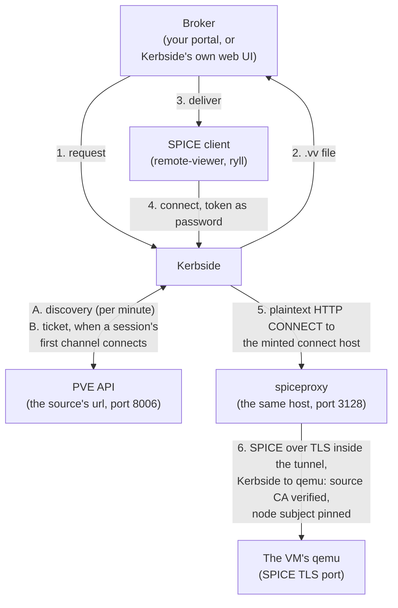

# Kerbside for Proxmox VE

Proxmox VE users want native SPICE desktops, the nodes should
not be reachable from the client network, and the bridge Proxmox
provides between the two is `spiceproxy`, an HTTP CONNECT relay
moving bytes it cannot see into. Kerbside puts a front door that
understands SPICE in front of it: it knows which sessions are
live, can end them, and firewalls what clients send.

## Value proposition

A Proxmox VE node runs `spiceproxy` on port 3128. A SPICE client
handed a `.vv` file by the PVE web interface connects to it, asks
for an HTTP CONNECT to the VM's SPICE server, and from then on
`spiceproxy` relays bytes. It is a layer 4 relay: it has no idea
a SPICE session is in progress, cannot tell you which sessions
are live, cannot end one, and cannot stop a client from sending
anything qemu will accept. It also means every user who opens a
console needs a PVE account and a route to a node.

Kerbside puts a protocol-aware front door before it:

- **The SPICE firewall is on by default.** Kerbside terminates
  the client's connection, drives the SPICE link handshake
  itself, and classifies every framed message against a
  per-channel allowlist. See
  [proxy-architecture.md](/components/kerbside/proxy-architecture/).
- **Sessions are objects, not TCP flows.** Every proxied console
  is a row you can list over the REST API, with an audit trail,
  and can terminate in flight. A SPICE session opens several
  channels, and how many depends on the client, so counting
  connections at `spiceproxy` does not count users.
- **The nodes need not be reachable from the client network.**
  Clients reach Kerbside; Kerbside reaches the PVE API and
  `spiceproxy`. Users need no route to a node and no PVE
  account: Kerbside holds one API token, with two privileges.
- **The SPICE session to qemu is TLS and pinned, because there is
  only one way in.** Kerbside reaches a Proxmox VM only through
  `spiceproxy`, so every backend connection is a tunnel: a
  plaintext HTTP CONNECT to `spiceproxy`, then a SPICE session
  that is TLS only inside it, never attempted in plaintext first.
  The CONNECT carries the ticket's signed connect host in the
  clear, so the network between Kerbside and the node should be
  one you trust. A tunnel without a node certificate subject is
  refused rather than relayed unpinned, and discovery lists no
  console on a node that has no such subject. The certificate is
  checked against the source's `ca_cert`, never against the CA
  the API's response names.
- **[One entry point across clouds.](/components/kerbside/use-cases/multi-cloud/)** A single
  Kerbside can broker Proxmox VE alongside oVirt, Shaken Fist and
  OpenStack sources; users keep one console entry point as
  workloads move.

Users get the SPICE features an HTML5 console cannot offer:
high-resolution and multi-monitor desktops, USB passthrough,
audio, and adaptive compression.

## How it works

Kerbside talks to the PVE API on one node to find consoles and to
acquire tickets, and reaches every VM through that same node's
`spiceproxy`. It never reads a PVE-generated `.vv` file.

**Discovery (A).** Once a minute the `type: proxmox` source
driver (`kerbside/sources/proxmox.py`) lists the cluster's
guests in one request, then reads the running configuration of
each candidate. A guest becomes a console only when it is a
running qemu VM, not a container or a template, with a SPICE
display and an SMBIOS UUID. Each node's SPICE certificate
subject is read once per scrape and recorded on that node's
consoles. The rules, and what a failed request does to the
source, are in
[Which VMs are listed](/components/kerbside/console-sources/#which-vms-are-listed).
A console's uuid joins the VM ID to the SMBIOS UUID, because
Proxmox reuses a deleted VM's ID; see
[Proxmox VE console uuid](/components/kerbside/console-sources/#proxmox-ve-console-uuid).

Discovery records no SPICE address or port for a console. There
is nothing for Kerbside to dial until a ticket names it.

**Ticket (B).** Downloading the `.vv` asks Proxmox for nothing.
When a session's first channel connects, Kerbside finds the VM's
current node, checks that the VM still has the SMBIOS UUID it was
discovered with, and asks the API's `spiceproxy` endpoint for
that VM for a ticket, naming the source's own host as the proxy.
The answer is a SPICE password, a signed connect host and a TLS
port, which the session's other channels share, as they do on
oVirt. Proxmox fixes the ticket's lifetime at 30 seconds, so a
channel arriving late mints a fresh one. The details, including
the reuse window and what a failed mint does, are in
[Proxmox VE console tickets](/components/kerbside/console-sources/#proxmox-ve-console-tickets).

Two consequences follow, as on oVirt. A `.vv` works for as long
as its Kerbside token lives, because the ticket does not exist
until the client connects. And the API is needed to connect, not
only to discover: a channel that needs a mint while the API is
unreachable is denied with `console ticket unavailable`.

**Two sessions on one VM.** qemu's SPICE server serves one client
at a time, so a second session on the same VM disconnects the
first. Minting a ticket changes the VM's SPICE password. Channels
already connected stay connected, but a Kerbside session that is
still opening channels on its own ticket will have them refused,
so a ticket minted elsewhere, such as by PVE's own console
button, can break a session that is still opening.

**The client leg (4).** The `.vv` points at `PUBLIC_FQDN` and
Kerbside's own ports, carries Kerbside's CA, and uses a
short-lived Kerbside token as the SPICE password. The client
authenticates to *Kerbside*; the Proxmox ticket never leaves the
server side.

**The backend leg (5, 6).** Kerbside's proxy connects to
`spiceproxy` in plaintext and asks it to CONNECT to the connect
host and TLS port the ticket named; that request, signed connect
host included, crosses the network in the clear. Inside the
tunnel the proxy runs the SPICE TLS handshake with qemu itself,
so `spiceproxy` relays a TLS stream it cannot read. The tunnel is
the only path to the VM, and the SPICE session inside it is TLS
only: there is no plaintext SPICE attempt and no `NEED_SECURED`
escalation. The proxy verifies qemu's certificate against the
source's `ca_cert`, the cluster CA that signs each node's
`pve-ssl.pem`, and pins the node subject discovery recorded; a
tunnel without that subject is refused before it is dialled. It
then authenticates with the Proxmox ticket and relays,
inspecting as it goes.

**Two relays, one of them protocol-aware.** Unlike oVirt, where
Kerbside dials the hypervisor and the engine's squid drops out,
`spiceproxy` stays in the path:
`client -> Kerbside -> spiceproxy -> qemu`. What changes is its
position. It is no longer the front door users reach, but a relay
behind Kerbside that carries Kerbside's TLS session to qemu.

There is no direct console for a Proxmox VM: a 30 second ticket
is too short for a file to be downloaded and opened, and minting
one for a client would change the SPICE password a proxied
session's next channel expects. See
[Proxmox VE has no direct consoles](/components/kerbside/console-sources/#proxmox-ve-has-no-direct-consoles).

## How to set it up

### Proxmox VE side

**Account.** Kerbside authenticates with a privilege-separated
API token, not a password. The token needs only `VM.Audit` and
`VM.Console` on `/vms`: the first to list VMs and read their
configuration, the second to mint a ticket. The role, user and
token that grant exactly that, and how a privilege-separated
token's privileges combine with its user's, are in
[Proxmox VE account](/components/kerbside/console-sources/#proxmox-ve-account).
The CI lane runs those commands as they are written there, with
the user renamed and `--output-format json` added where it reads
a command's output, so they are the tested ones.

**Guests.** Give each VM a SPICE display (`qxl`, or a `virtio`
one) and keep the SMBIOS UUID that `qm create` and the web
interface assign. The default `std` display has no SPICE server,
and such a VM is not listed. Install `spice-vdagent` in the guest
for clipboard sharing and display resizing, as for any SPICE
console. Kerbside relays the agent channel; it does not decode
it.

**`spiceproxy`.** Nothing to configure for Kerbside. Kerbside
asks each mint to name the source's own host as the proxy, so it
uses the `spiceproxy` on the node it already reaches for the
API. `spiceproxy` honours the same `ALLOW_FROM`, `DENY_FROM`,
`POLICY` and `LISTEN_IP` settings in `/etc/default/pveproxy` as
the API does, so an address restriction there applies to port
3128 too, and must admit Kerbside.

### Network

Kerbside needs to reach the host in the source's `url` on two
ports: 8006 for the API and 3128 for `spiceproxy`. Discovery
works over 8006 alone, so a firewall closing 3128 produces a
console list that looks healthy and connections that fail. A load
balancer in front of the API must forward both ports to one node.

The nodes' own names never need to resolve from Kerbside, but
the name in `url` must, and the node's certificate must have
been issued for it. Clients need to reach only Kerbside. See
[Proxmox VE network](/components/kerbside/console-sources/#proxmox-ve-network).

### Kerbside side

Add a `type: proxmox` entry to `sources.yaml`: the API `url` on
port 8006, the token's ID as `username` and its secret as
`password`, and the cluster CA as `ca_cert`. The option table is
in [Console Sources](/components/kerbside/console-sources/#proxmox-ve), and a
complete entry is in its
[example](/components/kerbside/console-sources/#example-sourcesyaml).

Two things are worth checking first when a source comes up
errored:

- **`ca_cert` is the cluster CA, inline PEM, not a path.** It is
  `/etc/pve/pve-root-ca.pem` on any node, and Kerbside uses it
  for the API as well as for each VM's SPICE server. An API
  served under a certificate from some other CA, such as one
  issued through ACME, fails that check.
- **`username` is the token ID, `user@realm!tokenid`.**
  Kerbside always presents it as an API token, so a password
  login is not supported.

General settings, including `PUBLIC_FQDN` and the proxy's own
ports and CA, are in [configuration.md](/components/kerbside/configuration/).

### A worked example

`.github/workflows/proxmox-functional.yml` builds a single-node
Proxmox VE 9 with `shakenfist/actions`'
`deploy-proxmox-on-shakenfist` action and deploys Kerbside
against it. Kerbside runs on the lane's self-hosted runner,
off-box from PVE, and reaches the node by name on 8006 and 3128
only; the lane's own scripts reach the node separately to set it
up. The runner-side scripts are in `tools/proxmox-e2e/` (see
`tools/proxmox-e2e/README.md`):

- `prepare-node.sh` runs the account commands from
  `docs/console-sources.md` on the node, so a documentation edit
  that breaks them fails the lane, and creates guests that
  discovery should skip;
- `deploy-kerbside.sh` and `gen-sources.py` install Kerbside and
  the proxy wheel built from the checkout, and write a
  `sources.yaml` holding only the documented token;
- `check-privileges.py` shows that each of the two privileges is
  needed, not only sufficient;
- `drive-console.py` drives real SPICE sessions with ryll through
  Kerbside's proxy and `spiceproxy`, counts mints in PVE's own
  access log, and asserts on the proxy's log lines.

One green run,
[40805221046](https://github.com/shakenfist/kerbside/actions/runs/40805221046),
showed against a real PVE 9 node that:

- the documented token held exactly `VM.Audit` and `VM.Console`
  on the guest and nothing outside `/vms`, tokens lacking either
  privilege were refused, and the documented one could not stop
  the VM;
- discovery listed the one SPICE guest and skipped a `std`
  display, a VM with no SMBIOS UUID, a stopped VM and a template;
- a session's channels shared one mint, counted by PVE;
- every backend connection went only through `spiceproxy`, over
  TLS, and every certificate check matched a pinned subject
  equal to the console's;
- a session outlived its ticket and its Kerbside token;
- a second session displaced the first, and a ticket minted while
  it was held left it connected;
- a REST terminate dropped the session.

## User interaction model

Kerbside is a proxy, not a portal. Something has to ask it for a
console on the user's behalf and deliver the resulting `.vv`
file — the "broker" role described in the
[documentation index](/components/kerbside/index/). For Proxmox VE there is no
integrated broker today, so the options are:

- **Kerbside's own web UI**, which lists consoles and offers the
  `.vv` download. Adequate for small deployments and for
  administrators, though its interactive login is Keystone-only
  today ([#300](https://github.com/shakenfist/kerbside/issues/300)).
- **Your own portal**, calling Kerbside's REST API. This is the
  intended production shape: the portal decides who may see
  which VM, then asks Kerbside for the file.
- **The PVE web interface's own console button**, which bypasses
  Kerbside entirely. It asks the API for a SPICE ticket as the
  logged-in user and hands the browser a `.vv` pointing at the
  `spiceproxy` of the host in the browser's address bar, so the
  user connects without Kerbside, which neither sees nor audits
  the session. That mint also changes the VM's SPICE password
  under any Kerbside session still opening channels.

Kerbside is therefore the only way in exactly when nobody else
can mint a ticket, and minting needs `VM.Console`. To route every
SPICE console through Kerbside, give `VM.Console` to Kerbside's
token and to no user or other token. Several built-in roles
include it, `PVEVMUser`, `PVEVMAdmin`, `PVEAdmin` and
`Administrator` among them, and `root@pam` holds every
privilege, so check what your users already hold: anyone with
one of those on a VM keeps the button. The same privilege gates the
web interface's noVNC and xterm.js consoles for a VM, so a user
without it has no VM console there at all.

## Status and limitations

Kerbside is experimental overall. The Proxmox VE source is
exercised end to end by the `proxmox-functional` lane, nightly
and on `workflow_dispatch`, and as an advisory check on pull
requests that touch the Proxmox path; pull requests from forks
skip it. It is not in the merge
queue and not a required check, so a change that breaks it can
merge, and the next nightly files a
`Nightly proxmox lane failing` issue. See
[the Proxmox lane](/components/kerbside/testing/#the-proxmox-end-to-end-lane).

Not covered, and worth knowing before you deploy:

| Limitation | Detail |
|------------|--------|
| One node tested | The lane runs a single PVE 9 node. A cluster, where `spiceproxy` on the API host relays to VMs on other nodes, has not been tested. |
| Proxmox VE 9 only | No other version is tested. |
| Live migration during a session | Not tested; expected from the code to break briefly. When a VM migrates, its next mint finds the new node, but its console keeps the old node's subject until the next scrape, so for up to a minute the backend connection fails its subject check. See [Which VMs are listed](/components/kerbside/console-sources/#which-vms-are-listed). |
| Ticket lifetime | Set by Proxmox, not Kerbside: 30 seconds from the mint, whatever `CONSOLE_TOKEN_DURATION` says. A channel connecting after the reuse window mints again, which changes the VM's SPICE password. |
| No direct consoles | `/console/direct` answers 409 for a Proxmox console. Every console is proxied. |
| One client per VM | A second session on a VM displaces the first, as qemu's SPICE server does for any client. |
| API certificate from another CA | One `ca_cert` checks both the API and the SPICE servers, so an API certificate issued by any CA other than the cluster's, such as an ACME one, is not supported. |
| SPICE VMs only | Containers and VMs without a SPICE display are not listed, and PVE's noVNC and terminal consoles are not brokered. |
| API availability | The API is called when a session connects, so an API that is down stops new sessions connecting, not only discovery. Channels already connected are unaffected. |

## See also

- [Console Sources](/components/kerbside/console-sources/#proxmox-ve) — the
  option reference for `type: proxmox`, the account, the
  network, discovery and tickets
- [Configuration](/components/kerbside/configuration/) — proxy settings,
  including `PUBLIC_FQDN`, ports, and the proxy CA
- [Proxy Architecture](/components/kerbside/proxy-architecture/) — the SPICE
  firewall, the connection state machine, and the relay
- [Testing](/components/kerbside/testing/#the-proxmox-end-to-end-lane) — the CI
  lanes, including the Proxmox end-to-end lane described above
- [Kerbside for oVirt](/components/kerbside/use-cases/ovirt/),
  [Kerbside for Shaken Fist](/components/kerbside/use-cases/shakenfist/),
  [Kerbside for OpenStack](/components/kerbside/use-cases/openstack/) and
  [Kerbside standalone](/components/kerbside/use-cases/standalone/) — the sibling
  deployment guides
- [Multi-cloud aggregation](/components/kerbside/use-cases/multi-cloud/) and
  [Placement topologies](/components/kerbside/use-cases/placement/) — the two topology
  pages: several sources behind one Kerbside, and several
  Kerbsides in front of one cloud
