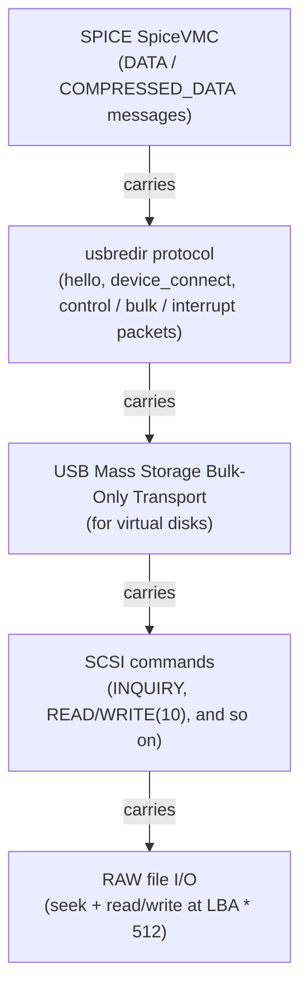
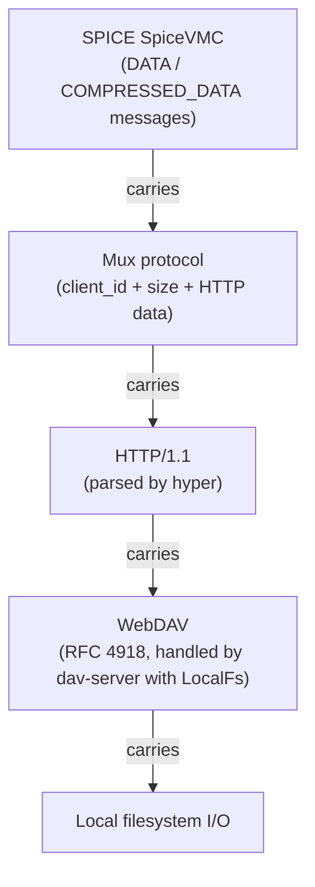
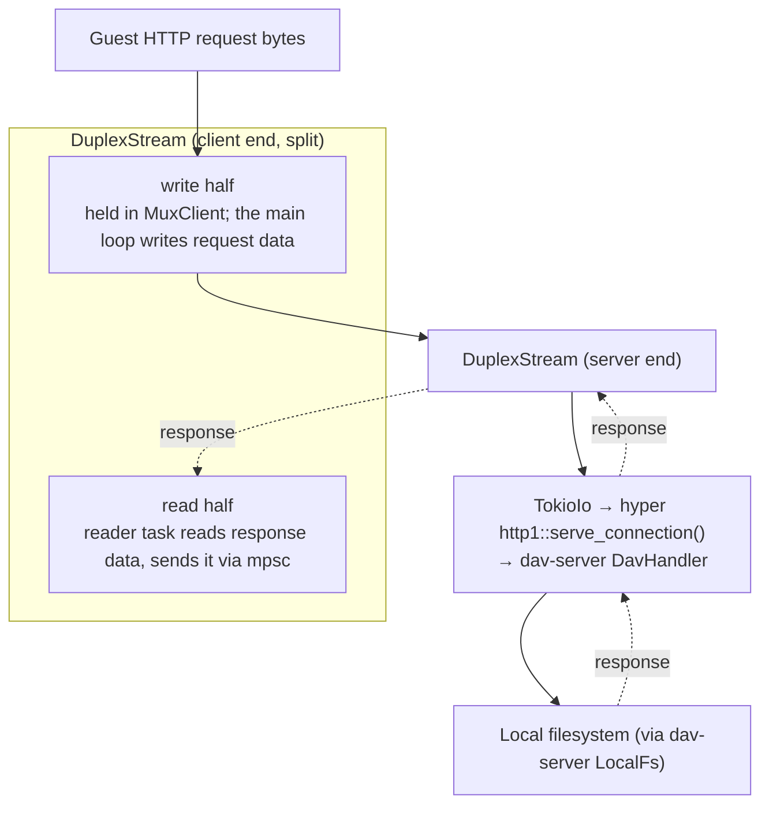

# Device redirection

Device redirection shares peripherals and data between the local machine
and the guest: USB devices over the usbredir channel, either as physical
pass-through on Linux or as virtual mass storage devices everywhere;
folder sharing over WebDAV; and clipboard text delivered as synthetic
keystrokes for guests without vdagent.

## USB Redirection

USB device redirection uses the SPICE usbredir channel (type 9) to
forward USB devices to the remote VM. The implementation spans
several protocol layers:



### Device backends

The `UsbDeviceBackend` trait (`shakenfist-spice-renderer/src/usb/mod.rs`)
abstracts over device types. The `DeviceBackend` enum provides
non-object-safe dispatch:

- **RealDevice** (`shakenfist-spice-renderer/src/usb/real.rs`): Physical USB
  device via the `nusb` crate. Linux only (`#[cfg(target_os = "linux")]`).
  Detaches kernel drivers, claims interfaces, forwards
  control/bulk/interrupt transfers. On non-Linux platforms, only virtual
  devices are available.
- **VirtualMsc** (`shakenfist-spice-renderer/src/usb/virtual_msc.rs`):
  Emulated USB mass storage device backed by a RAW disk image. Implements
  BOT protocol (CBW/CSW) and 8 SCSI commands. Reports as a USB 2.0 High
  Speed removable disk.

### Channel handler flow

1. Channel connects, sends usbredir hello with capabilities.
2. Server responds with hello.
3. If `--usb-disk` is configured, auto-connects after hello.
4. Device attachment sends `ep_info`, `interface_info`, `device_connect`.
5. Server sends lifecycle messages (`set_configuration`, `reset`, etc.)
   and data transfers (`control_packet`, `bulk_packet`).
6. Interrupt endpoints use background tokio polling tasks.
7. Disconnection aborts polling tasks and sends `device_disconnect`.

### Design notes

Why the USB stack is shaped the way it is. The retired
[USB redirection plan](https://github.com/shakenfist/ryll/blob/d0938ee6ca7f5f03d1d70952f26d8902a47cf4b1/docs/plans/PLAN-usb-redir.md)
holds the original step-by-step text, as frozen history.

**The server cannot tell a real device from a virtual one.** The usbredir
channel is opaque to QEMU: it only sees descriptors, lifecycle messages and
transfers. That is what lets a RAW image be presented as a USB drive with no
host hardware, and it is why the channel handler holds no device-type-specific
logic. Everything device-specific sits behind `UsbDeviceBackend`.

**Layering and where each piece lives.** The usbredir wire format (message
structs, `UsbredirParser`, capability and status constants) is the
transport-agnostic `shakenfist-spice-usbredir` crate; it does no I/O.
SpiceVMC framing, the hello exchange, device lifecycle and transfer dispatch
are in `shakenfist-spice-renderer/src/channels/usbredir.rs`. SpiceVMC has only
two channel-specific messages (`SPICEVMC_DATA` 101 and
`SPICEVMC_COMPRESSED_DATA` 102) and the constants are named for SpiceVMC
rather than usbredir because the port and WebDAV channels share them. The
usbredir channel is captured as `usbredir.pcap` on port 10009 (10000 plus the
channel type).

**Why an enum rather than `Box<dyn UsbDeviceBackend>`.** The trait's async
methods return `impl Future`, which is not object-safe. `async-trait` or boxed
futures would have fixed that at the cost of an allocation per call and a
noisier trait; with exactly two implementations, the `DeviceBackend` enum
delegating to the active variant is zero-overhead and keeps the trait plain.
Backends are driven through `&mut self`: the handler owns one backend at a
time and serialises its calls, so a backend never has to cope with concurrent
transfers.

**Two kinds of failure, kept apart.** Transfer methods return
`TransferResult`, carrying a usbredir `Status` (stall, timeout, cancelled,
and so on), rather than `Result<Vec<u8>>`. A Rust `Err` means the backend
itself failed (a file I/O error); a `TransferResult` with `Stall` means the
USB transfer was rejected in the ordinary way and the guest is told so.
Collapsing the two would turn an ordinary stall into a channel error.

**Capabilities and IDs.** ryll advertises only `connect_device_version`,
`device_disconnect_ack` and `ep_info_max_packet_size`. It does not advertise
64-bit IDs, 32-bit bulk lengths, bulk streams, buffered bulk receiving or the
filter capability, so the header is always the 12-byte, 32-bit-ID form
QEMU's `usb-redir` defaults to. Bulk length is still computed as
`(length_high << 16) | length` so a server that sends the high half is not
misread. Isochronous packets and the bulk-stream message types are not
implemented; the parser surfaces them as unknown messages. The lifecycle
messages that carry a server-chosen ID have that ID echoed back; only data
packets need a correlation ID of their own.

**LZ4 is receive-only.** The usbredir channel advertises
`SPICEVMC_CAP_DATA_COMPRESS_LZ4` and decompresses
`SPICEVMC_COMPRESSED_DATA` with `lz4_flex`, but never compresses what it
sends. The size the server claims for decompression is capped at 64 MiB, and
a bulk request over 16 MiB is answered with `Inval`, because both lengths are
attacker-controlled input from the server.

**Endpoint numbering.** usbredir numbers endpoints 0-31 flat, 0-15 as OUT and
16-31 as IN, where USB addresses use bit 7 for direction (0x00-0x0F OUT,
0x80-0x8F IN). `usbredir_ep_to_usb` and `usb_ep_to_usbredir` in
`usb/mod.rs` are the only place the two schemes meet; getting this wrong
sends an IN request to the OUT endpoint of the same number.

**Real devices (`nusb`).** `nusb` was chosen over `rusb` because it is pure
Rust and async, fitting the tokio model, and needs no libusb, which would
add a C build dependency per packaging target. A kernel driver (typically
`usb-storage` for a flash drive) usually owns the device already, so
`RealDevice` uses `detach_and_claim_interface`; passthrough would otherwise
fail with the interface busy. Hot-plug (`nusb::watch_devices`) is not used:
enumeration happens when the USB panel opens and on its Refresh button, which
is sufficient for a manually driven session.

**Interrupt transfers are push, not request/response.** The server sends
`start_interrupt_receiving` once and the client then sends `interrupt_packet`
messages unsolicited until `stop_interrupt_receiving`, unlike control and
bulk, where each server request has one reply. Each active endpoint therefore
runs as a spawned polling task (submit, await completion, forward, resubmit)
whose handle the channel keeps in `interrupt_handles` and aborts on stop or
disconnect. The tasks cannot call the send path directly because it needs
`&mut self`, so they hand data back over an mpsc channel that the channel's
`select!` loop drains. The virtual mass storage device has no interrupt
endpoint; the trait default refuses interrupt requests, and a future virtual
HID device would implement them in its own backend.

**The virtual mass storage device.**

- It reports as a USB 2.0 High Speed device because that works with any
  controller (EHCI or xHCI), with the Linux Foundation vendor ID `0x1d6b`
  (the ID used for virtual USB devices) and product ID `0x0104`, and "ryll" in
  the SCSI vendor and product strings so it is recognisable in a guest.
- Sectors are 512 bytes and the device is always LUN 0. A RAW image is
  byte-addressable, so sector N is byte offset N x 512 and no partition table
  or filesystem is parsed: the guest does that, as for a physical drive.
- It implements the eight commands Linux and Windows guests need: TEST UNIT
  READY, REQUEST SENSE, INQUIRY, MODE SENSE(6), PREVENT ALLOW MEDIUM REMOVAL,
  READ CAPACITY(10), READ(10) and WRITE(10); any other opcode gets CHECK
  CONDITION with ILLEGAL REQUEST. READ/WRITE(16) and SYNCHRONIZE CACHE are
  absent; add them only if a guest turns out to need them.
- There is no caching layer; the host page cache does that work.
- Read-write is the default; `--usb-disk-ro` makes WRITE(10) fail with a
  WRITE PROTECTED sense and sets the write-protect bit in MODE SENSE.
- Only RAW images are supported. qcow2, VMDK and VHD would each need a
  format-specific I/O layer behind the SCSI handler and are deliberately out.
- Because the server drives transfers, BOT is simpler than the textbook
  state machine: a bulk OUT carrying a CBW selects the command, and the
  following bulk IN requests receive either its data phase or the CSW.

**Auto-connect versus the command channel.** `--usb-disk` images are connected
by the channel handler itself once the server hello arrives, rather than by
the app sending a command, because the usbredir channel is spawned inside
`run_connection()` on a different thread from the GUI and plumbing a sender
back was avoided for the CLI case. Interactive connect and disconnect use the
`UsbCommand` channel described under GUI Components below
(see also "USB panel uses identity-based commands" in
[design-decisions.md](/components/ryll/design-decisions/)).

**Known gaps.** `cancel_data_packet` is acknowledged in the log but not
acted on ([#781](https://github.com/shakenfist/ryll/issues/781)), so an in-flight transfer
cannot be cancelled by the server. One device is redirected per usbredir channel and no filter or auto-connect
policy exists.

### CLI usage

```bash
ryll --file conn.vv --usb-disk /path/to/image.raw       # read-write
ryll --file conn.vv --usb-disk-ro /path/to/image.raw     # read-only
```

See the [configuration guide](/components/ryll/configuration/) for details. Use
`make test-qemu-usb` to start a QEMU instance with USB redirection
enabled.

### GUI Components

The USB panel is a right-side panel toggled by Menu → USB,
rendered alongside the traffic viewer panel (both use `egui::Panel::right`
with different IDs).

**State tracking on `UsbPanel`** (`ryll/src/app/ui/usb_panel.rs`, held by
`RyllApp`):

- `tx` — mpsc sender to the UsbredirChannel, created in `RyllApp::new()`
  and threaded through `run_connection()`; installed on the panel by
  `UsbPanel::reset_for_session`. Mirrors the `input_tx` pattern.
- `channel_ready` — set when `UsbChannelReady` event arrives, cleared on
  usbredir channel disconnect.
- `connecting` / `disconnecting` — operation in progress flags, cleared
  on success/failure events.
- `device_description` — set by `UsbDeviceConnected`, cleared by
  `UsbDeviceDisconnected` and channel disconnect.
- `connected_at` — timestamp for the elapsed connection timer.
- `available_devices` — enumerated device list, refreshed on panel open
  and via Refresh button.
- `virtual_disks` — session-scoped virtual disk paths from CLI flags and
  runtime additions.

**Command flow:**

The GUI sends identity-based `UsbCommand` variants (`ConnectPhysical { bus,
address }` (Linux only), `ConnectVirtualDisk { path, read_only }`,
`DisconnectDevice`) via the panel's `tx`. The channel handler does
async device lookup and open in its tokio context, sending
`UsbDeviceConnected`, `UsbDeviceDisconnected`, or
`UsbConnectFailed` events back to the app. If a device is already connected
when a connect command arrives, the handler disconnects it first.

**File picker:**

The "Add Disk..." button spawns `rfd::FileDialog` on a background thread. The
result is polled via `std::sync::mpsc::try_recv()` each frame. Selected files
are validated (regular file, >= 512 bytes) and added to the session's virtual
disk list.

**Bug report integration:**

USB errors show a "Report this as a bug" button that opens the bug report
dialog pre-populated with `BugReportType::Usb`, which captures the usbredir
channel's pcap traffic. Generic channel errors (displayed in the central
panel) also offer a bug report button pre-populated with
`BugReportType::Connection`.

### Why the USB panel is shaped this way

These are constraints and rejected alternatives behind the panel; the
[plan that built it](https://github.com/shakenfist/ryll/blob/8cf54b550713b2f65c6397b3ab4bde7b31817f84/docs/plans/PLAN-usb-ui.md)
(retired) holds the phase-by-phase history.

- **One device, one usbredir channel.** SPICE carries one redirected
  device per usbredir channel. A server may advertise several channels,
  but the session opens only the first and skips the rest (the command
  receiver is `take()`n once), so the panel manages one device at a time
  and disables Connect while the channel is not ready. Supporting
  several simultaneous redirections would need a command sender per
  channel and per-channel panel state; it was deferred, not rejected.
- **A panel, not a modal dialog.** It stays open while the user works in
  the guest and shows live status, as the Traffic viewer does. The status
  bar's `USB: ...` label is kept as a glance indicator; the panel adds
  the management detail. Both are driven by `usb_device_description`.
- **Enumeration is on demand, never per frame.** `enumerate_devices()`
  calls `nusb::list_devices()`, which is synchronous (under about 100 ms
  in practice), so the panel enumerates on first open and on Refresh. It
  deliberately does not clear the list when the panel closes: re-listing
  on every open would stall the render loop more often than slightly
  stale data with a Refresh button costs. A timer or the `nusb` hotplug
  watcher was weighed and deferred as added complexity; Refresh is the
  contract.
- **The GUI sends identity, the channel opens the device.** `nusb`
  device handles cannot cross the command channel, and opening is async
  while the render loop is not. `ConnectPhysical { bus, address }`
  therefore makes the handler re-enumerate and find the device again. A
  device unplugged between listing and clicking Connect produces a
  `UsbConnectFailed("Device not found ... may have been unplugged")`
  rather than a silent mismatch. This is why `enumerate_physical()` must
  report `busnum()` in `bus`: it originally stored `device_address()` in
  both fields, which would have made the re-lookup match the wrong device
  or none. `bus` stays a `u8` rather than the string `bus_id()` because
  physical pass-through is Linux only; revisit the type if another
  platform gains it.
- **Failure must always have a way out.** `UsbConnectFailed` exists so the
  panel can never sit in "Connecting..." with no event to clear it, and a
  `Disconnected` event for the usbredir channel resets all panel state
  (ready flag, connected device, in-progress flags) so a dropped channel
  does not leave a stale "Ready". A connect while a device is attached
  (for example after a `--usb-disk` auto-connect) disconnects the old
  device first.
- **No double-queued commands.** The in-progress flags disable every
  button until the matching event arrives, so at most one command is in
  flight; a full command channel is reported as an error rather than
  waited on.
- **A native file picker, not a typed path.** The panel is GUI only
  (headless users have `--usb-disk`), so a typed path would be a poor
  experience for the only people who see it. `rfd` is used without its
  `gtk3` feature (the build container has no GTK3 headers), so on Linux
  the dialog depends on a desktop portal service at run time; without
  one it does not open and the CLI flags remain. The blocking
  `FileDialog` runs on its own thread and the result is polled with
  `try_recv()` each frame.
- **Host permissions are not diagnosed.** An empty or failed enumeration
  is shown as it is; the panel does not guess at udev rules or container
  pass-through.
- **Known gap.** The connected row is matched by comparing the backend's
  `description()` with the device's `label()`. They are equal for virtual
  disks but not for physical devices (`vid:pid` against the full label),
  so a connected physical device is not highlighted and offers no
  Disconnect button in the list. Tracked in
  [#775](https://github.com/shakenfist/ryll/issues/775).

## WebDAV Folder Sharing

WebDAV folder sharing uses the SPICE WebDAV channel (type 11) to export a
local directory to the guest VM. Like usbredir, it uses the SpiceVMC transport
(`SPICEVMC_DATA` / `SPICEVMC_COMPRESSED_DATA` messages). The guest's
`spice-webdavd` daemon issues HTTP WebDAV requests through the channel;
ryll runs an embedded WebDAV server that fulfils them against the local
filesystem.

### Protocol layers



### Mux protocol

The WebDAV channel multiplexes multiple concurrent HTTP clients over a
single byte stream. Each frame is:

```
client_id:  i64 LE  (8 bytes) — identifies the HTTP client
data_size:  u16 LE  (2 bytes) — payload size (0 = disconnect)
data:       [u8]    (data_size bytes) — raw HTTP bytes
```

The `MuxDemuxer` (`shakenfist-spice-renderer/src/webdav/mux.rs`) accumulates
bytes and extracts complete frames, handling frames that span VMC messages
or are packed together.

### Per-client architecture

Each mux client gets a `tokio::io::DuplexStream` pair:



Response data flows back through an `mpsc::Sender<MuxResponse>` from
the per-client reader task to the main `run()` loop, which muxes the
responses back to the guest. This is the same pattern used by usbredir's
interrupt polling tasks.

### Server lifecycle

The `WebdavServer` (`shakenfist-spice-renderer/src/webdav/server.rs`) wraps
`dav-server::DavHandler` with `LocalFs` and is cheaply cloneable (inner
`Arc`). It is created when
a `ShareDirectory` command arrives from the UI or `--share-dir` is
specified on the CLI, and destroyed on `StopSharing`. Read-only mode uses
`DavMethodSet::WEBDAV_RO` to restrict allowed HTTP methods.

### CLI usage

```bash
ryll --file conn.vv --share-dir /path/to/dir          # read-write
ryll --file conn.vv --share-dir /path/to/dir --share-dir-ro  # read-only
```

See the [configuration guide](/components/ryll/configuration/) for details. Use
`make test-qemu-webdav` to start a QEMU instance with WebDAV enabled.

### GUI Components

The Folders panel is a right-side panel toggled by
Menu → Folders. It mirrors the USB panel structure:
channel status indicator, active
share display with elapsed timer, error display with auto-clear, read-only
checkbox, and native directory picker via `rfd::FileDialog::pick_folder`.

### Why folder sharing is shaped this way

These are the constraints and rejected alternatives behind the feature;
the [plan that built it](https://github.com/shakenfist/ryll/blob/8634fe4e378c7b2b33aca59b3ae907f8a97d2798/docs/plans/PLAN-webdav.md)
(retired) holds the phase-by-phase history.

- **WebDAV through the SPICE channel, not a hypervisor share.** The shared
  files live on the client machine, which is usually not the one hosting
  the VM, so virtio-fs, virtio-9p and NFS exports (all of which need
  host-side access to the files) cannot do it. Tunnelling WebDAV through
  the SPICE session works across proxies and network hops. Compared with
  usbredir's mass-storage disk it gives file-level access, with no
  guest-side formatting or block-device mount; the guest needs only
  `spice-webdavd` and `davfs2`.
- **Channel type 11, over the SpiceVMC transport.** QEMU's SPICE server
  recognises the port name `org.spice-space.webdav.0` and presents it as
  channel type 11 (`Webdav`), carrying the same `SPICEVMC_DATA` and
  `SPICEVMC_COMPRESSED_DATA` messages as usbredir. The generic Port
  channel (type 10) is not opened; the session links it as "not
  supported". Like usbredir, only the first WebDAV channel is opened.
- **`dav-server` plus `hyper`, not `httparse` and hand-written replies.**
  `spice-webdavd` uses the whole WebDAV method set (OPTIONS, PROPFIND,
  GET, PUT, DELETE, MKCOL, MOVE, COPY, PROPPATCH, LOCK, UNLOCK) and
  HTTP/1.1 framing (chunked transfer, content length, keep-alive); doing
  that by hand is substantial and easy to get subtly wrong. `dav-server`
  works on plain `http` request and response types, so it does not care
  that there is no socket; `hyper` is used only to frame HTTP over a
  `tokio::io::DuplexStream`. No phodav or libsoup, so no C dependency.
- **Read-only is enforced by the server's method set.** `--share-dir-ro`
  and the panel's checkbox build the handler with `DavMethodSet::WEBDAV_RO`,
  so write methods never reach the filesystem backend (the tests accept
  either 403 or 405). The default is read-write, as in spice-gtk; the
  checkbox and flag exist because a read-write share lets the guest
  modify the user's local files.
- **One shared directory.** As in spice-gtk. Several could be offered as
  subdirectories of a virtual root; that was deferred, not rejected.
- **The mux stream has no message boundaries.** A frame may span several
  VMC messages and several frames may arrive in one, so `MuxDemuxer`
  accumulates bytes and extracts complete frames rather than assuming one
  message per frame. A zero-length frame closes a client, and one for an
  unknown client is ignored as a stale close.
- **One bad client does not take the channel down.** Each mux client has
  its own server task and reader task; an error in one is logged and that
  client is closed with a mux close frame. Responses reach the main loop
  over a bounded channel (the same shape as usbredir's interrupt polling),
  so a slow SPICE write applies backpressure instead of buffering without
  limit. Stopping the share, or the channel closing, aborts every client.
- **The Folders panel is its own side panel** with its own state, beside
  the USB and Traffic panels rather than exclusive with them.
- **The kerbside proxy** needed changes to pass the port and WebDAV
  channels through; those live in the kerbside repository (its issue 570,
  closed).
- **Known gaps.** `send_compressed_data` in the WebDAV channel is dead
  code and, if called, would build a payload the receiver could not read
  ([#777](https://github.com/shakenfist/ryll/issues/777)). No test drives mux frames
  through the channel to a served file; the server and the mux framing
  are tested separately ([#776](https://github.com/shakenfist/ryll/issues/776)).
  There is no automated test with a real guest mounting the share through
  `spice-webdavd` and `davfs2`; `make test-qemu-webdav` is for doing it by
  hand.


## Paste-as-Keystrokes

The inputs channel includes a cooperative paste state machine for
typing text into guests that lack a vdagent clipboard channel.
Characters are translated to US-QWERTY AT scancodes via
`char_to_scancode()` and `translate_paste()` (both in `inputs.rs`),
capped at 4096 characters per paste.

The state machine (`PasteState`) runs as a conditional third arm in
the inputs channel's `tokio::select!` loop. A `tokio::time::sleep_until`
future fires on schedule; each firing sends one sub-step (press or
release) and yields back to the loop so the other two arms (server
reads and UI input events) remain responsive.

Per-character event sequence:
1. If shifted: KeyDown(Left Shift)
2. KeyDown(scancode)
3. Sleep half the inter-character delay
4. KeyUp(scancode)
5. If shifted: KeyUp(Left Shift)
6. Sleep the remaining half

At paste start, held modifier keys (Ctrl, Shift, Alt) are released
and saved; at paste end they are restored. Translation errors
(non-ASCII characters) emit `ChannelEvent::PasteFailed` and cause
a non-zero exit in headless mode. A paste that arrives while another
is still typing is refused with a `PasteFailed` of kind `InProgress`
before anything is typed; the GUI shows that one as a notification
rather than the paste-error dialog, since nothing needs fixing.

CLI flags: `--enable-paste-as-keystrokes` (master gate),
`--paste-text TEXT` (headless trigger, implies enable; refused without
`--headless`),
`--paste-char-delay-ms N` (default 16ms).

GUI surface: When enabled, a "Paste" entry appears in the hamburger
menu with "Ctrl+Alt+V" shortcut text. The entry is disabled (greyed
out) when vdagent is connected, with a tooltip explaining to use
normal Ctrl+V. The Ctrl+Alt+V shortcut is detected before
`handle_input()` to prevent the V keypress from reaching the guest.
Off macOS egui-winit reports that press as `Event::Paste`, not as a
key press, so `paste_shortcut_pressed()` in `ryll/src/input_egui.rs`
accepts either. Once the paste starts, `HeldKeys::withhold_paste_release()`
keeps the V release that follows from reaching the guest too.
Pre-validation via `translate_paste()` catches unrepresentable
characters and shows an error dialog listing up to three sample
codepoints. The clipboard is read via `arboard::Clipboard` (lazily
initialised in `RyllApp::clipboard()`, separate from the
`MainChannel` instance).


### Why paste-as-keystrokes is shaped this way

Paste-as-keystrokes exists for guests that cannot run a vdagent at all:
the uncalibrated-sextant UEFI test binary (a `no_std` program with no
kernel, userspace or filesystem, which needs a bootloader password
typed into it), BIOS dialogs and very early boot screens.
`remote-viewer` has no equivalent fallback of its own; its clipboard
menu relies on vdagent end to end. It is not a replacement for the
vdagent clipboard path, which is faster, preserves Unicode and
round-trips. The rest of the design follows from that.

- **Opt-in, never automatic.** Nothing is rendered or bound unless
  `--enable-paste-as-keystrokes` (or `--paste-text`, which implies it)
  was passed, and the menu entry and shortcut are inert while a vdagent
  is connected, so an operator cannot bypass the faster path by
  mistake. Ryll does not route `Ctrl+V` through paste-as-keystrokes when
  no agent is present: that would need hysteresis for an agent that
  drops mid-session or announces its capabilities late, and a quietly
  re-routed `Ctrl+V` is a footgun in guests where `Ctrl+V` already
  means something.
- **Hard-coded US-QWERTY.** AT scancodes are physical, not semantic:
  "paste `Z`" means shift plus the key in the QWERTY `Z` position, not
  Unicode `U+005A`, so a guest with another kernel keymap sees other
  characters. This is the same constraint as `xdotool --key`, accepted
  because the guests this serves are under our control, and the
  translator reuses the input path's scancode table rather than keeping
  a second layout table. There is no `--paste-layout`; adding one means
  per-layout tables.
- **All or nothing validation.** The whole string is validated before
  any key is sent, and one unmappable character refuses the paste. The
  load-bearing use is a password at a bootloader prompt, where skipping
  a character silently would burn retries with no diagnostic. Hence
  `translate_paste()` returns an error rather than a partial result,
  and the GUI shows a dialog, headless exits non-zero, and nothing is
  sent. The GUI validates and the channel validates again: the channel
  must stay safe whatever a caller hands it, and the second pass is
  free.
- **Cap with no override.** A paste is truncated, with a `warn!` naming
  the requested and typed counts, at 4096 characters, about a minute at
  the default delay. This is a way to paste a password or a command
  line, not a text-input method, and no flag raises it.
- **Pacing.** The default of 16 ms between characters (about 60
  characters a second) is well inside any keyboard buffer. Each
  character holds its key down for half of that, rather than sending
  press and release together, because a BIOS or bootloader that polls
  key state once per frame can miss a pair that arrives in one TCP
  segment. Pacing runs as a timer arm in the `select!` loop (see
  "Paste-as-keystrokes: cooperative state machine in the select!
  loop" in [design-decisions.md](/components/ryll/design-decisions/)) so a
  minute-long paste does not stop the channel
  serving the server or live input.
- **Modifiers are released, then restored.** The trigger gesture is
  usually `Ctrl+Alt+V`, and typing with Ctrl or Alt down produces
  control sequences, so the channel lifts held modifiers before the
  first character and re-presses them afterwards to keep the guest's
  view of them in step with the host's.
- **`Ctrl+Alt+V`, on every platform.** `Ctrl+Shift+V` is the paste
  binding of xterm, gnome-terminal, alacritty and VS Code's terminal,
  while `Ctrl+Alt+V` is unbound in the common editors and terminals.
  The Windows convention that Ctrl+Alt is AltGr does not apply,
  because egui reports the modifier flags directly. Ryll uses the same
  chord on macOS even though `Cmd+Shift+V` would be more native;
  Linux is the primary platform and there is no macOS-specific
  binding.
- **Completion reports elapsed time, not a skip count.** Because
  validation is all or nothing, a successful paste typed every
  character, so `PasteCompleted` carries the character count and the
  elapsed milliseconds, which tell an operator whether the sequence
  took about what the configured delay predicts.

The original design is in [PLAN-paste-as-keystrokes.md](https://github.com/shakenfist/ryll/blob/e38dfdd2619fc0917310a2c94fc0fcc33e6be044/docs/plans/PLAN-paste-as-keystrokes.md).
