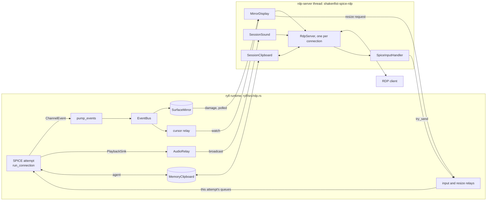

# RDP mode internals

How `ryll --rdp` serves a live SPICE session to a stock RDP client: the
server runner that owns the listener, the per-connection IronRDP servers
and the takeover between them, the display, input, clipboard and audio
handlers that connect IronRDP to the session, and the supervisor in ryll
that keeps the RDP side up while SPICE reconnects.

This is the developer-facing companion to the
[`--rdp` operator guide](/components/ryll/rdp-frontend/), which covers running it, and to
[Session lifecycle](/components/ryll/session-lifecycle/#rdp-mode), which covers what an
operator sees when SPICE is lost, when ryll exits and when a second
client takes over. Neither is repeated here. Each section below says what
a part does, what it hands to whom, and the invariant a change to it must
keep.

The RDP side is IronRDP's `ironrdp-server`. This page was checked against
the release the crate pins. It pins IronRDP to one minor release on
purpose, because every minor release so far has changed the server API;
the version and the reasoning are recorded beside the dependency in
[`shakenfist-spice-rdp/Cargo.toml`](https://github.com/shakenfist/ryll/blob/develop/shakenfist-spice-rdp/Cargo.toml).
Several invariants below exist because of how that release behaves, so an
upgrade means re-reading them against the new source. "The pinned release"
below means that one.

## Shape

The work is split between two crates and two threads.

- `shakenfist-spice-rdp` is the library: it runs IronRDP and adapts it to
  a SPICE session. It does not depend on the ryll binary, so a gateway
  could serve RDP from SPICE sessions without it.
- `ryll/src/rdp.rs` is `run_rdp`, the `--rdp` mode itself. It builds the
  SPICE side the way `--web` does (event bus, surface mirror, optional
  control socket), hands the library a `SessionHandles`, and supervises
  SPICE reconnects behind those handles.

IronRDP's `RdpServer` is not `Send`, so it cannot live on ryll's
multi-thread runtime. The library runs it on an OS thread of its own,
named `rdp-server`, with a current-thread runtime and a `LocalSet`. The
two sides meet only through the `Send` channels and shared state in
`SessionHandles`.

## The public surface (`lib.rs`)

`SessionHandles` is everything the RDP side needs from one SPICE session:
the surface mirror, an input sender, the SPICE mouse mode as a watch, a
resize sender, the cursor state as a watch (from `spawn_cursor_relay`),
a `spice_up` watch, and optionally a `MemoryClipboard` and an
`AudioRelay`. `serve` takes an `RdpConfig` and returns an
`RdpServerHandle` that can `shutdown`, `join` with a timeout, and be
awaited through `stopped`.

A `SessionProvider` chooses which session an authenticated client is
served. ryll's provider is `SingleSession` (`auth.rs`): one session, one
username and password, the domain ignored because mstsc always fills one
in and FreeRDP may not. Both comparisons run in constant time and both
always run.

`SessionSlot` is how the handlers find their session. IronRDP fixes a
connection's handlers when the server is built, before any credentials
have been seen, so each handler holds a slot rather than a session and
reads it on every use. An emptied slot stops every handler at once.

**Invariants.** Every field of `SessionHandles` is `Send` and works across
runtimes. The library never installs a rustls crypto provider; the
embedder does (`ryll/src/main.rs` installs `ring`'s), and
`TlsIdentity::acceptor` fails with a message saying so if none is
installed.

## The server runner (`server.rs`)

IronRDP's own accept loop (`RdpServer::run`) serves one connection at a
time and accepts no other until it ends, so a second client could never
take a session over. The runner therefore owns the listener and drives
each connection through IronRDP's per-connection entry point,
`run_connection`, as a local task in a `JoinSet`.

- **Startup.** `serve` resolves everything that can fail (the TLS
  acceptor, and for NLA the provider's session) on the caller's thread,
  then spawns the server thread and blocks until it reports the bound
  address or the bind error. With no port configured it probes 3389
  and falls back to a free port.
- **One connection, one server.** `new_connection` builds a fresh
  `SessionSlot`, input handler, display handler, clipboard factory, sound
  factory and `RdpServer` for every accepted client. Each server has its
  own event channel, so nothing a leaving connection queued (a clipboard
  message, a wave) can reach the next.
- **The handshake place.** A semaphore of one permit bounds the time
  between accept and authentication. The accept loop takes the permit
  before it accepts, so other clients wait unaccepted in the listen
  backlog (1024, as IronRDP's listener uses). `serve_connection` gives the
  permit back when the client authenticates, leaves, times out
  (`DEFAULT_HANDSHAKE_TIMEOUT`, 30 seconds) or the server stops.
- **Security modes.** In TLS mode the server gets no credentials of its
  own, because IronRDP's built-in check compares the domain too; a
  `ProviderValidator` (`auth.rs`) asks the provider instead and fills the
  slot with the session it returns. In NLA mode CredSSP needs the
  plaintext pair, so the server is given the configured credentials and
  the provider is asked once, at startup, for the session every NLA
  client is served; each connection's slot is filled when its server is
  built.
- **Stopping.** `shutdown` raises a watch that the accept loop and every
  connection select on. The loop closes the listener, a connection still
  in its handshake is dropped, and a served connection is sent
  `ServerEvent::Quit` and given `QUIT_GRACE` (5 seconds) to end before it
  is dropped.

**Invariants.** Nothing that is not `Send` leaves the server thread. Only
one client is ever between accept and authentication. A connection's
server, handlers and slot are never shared with another connection.

## Authentication and takeover (`server.rs`, `display.rs`)

The runner learns that a client has authenticated from the display
handler. IronRDP calls `RdpServerDisplay::updates` for the first time
once the connection sequence is complete, which is after the TLS-mode
credential check or NLA's CredSSP exchange and before any pixels are
sent. `MirrorDisplay::when_authenticated` holds a one-shot hook that the
first `updates` call fires; later calls, one per reactivation after a
resize, do not. `size` is no signal: IronRDP asks for the desktop size
before the client has presented anything.

The hook calls `Connection::take_over`. It records the session the
connection took, and looks in the shared `Served` list for a connection
already serving the *same* session (compared with `Arc::ptr_eq`). If there
is one, that connection loses it: `Connection::lose` clears its slot,
releases the keys and buttons its client held, and raises its
`taken_over` watch, which makes `serve_connection` send it a `Quit`.
Clients of different sessions never disturb one another, and a client
that fails authentication never reaches the hook, so it leaves the
served client alone.

When any connection ends, `Connection::end` clears its slot, removes it
from `Served`, and releases what its client still held to the session it
served. The session is kept apart from the slot so that a connection
whose slot a takeover emptied can still release input to it.

**Invariants.**

- Takeover happens on the first `updates` call and nowhere earlier,
  and only between connections serving the same session.
- A slot is filled once per connection. The pinned release runs the
  credential validator once per connection (a reactivation carries no
  credentials), and the held-input record below relies on one connection
  serving one session.
- Losing a session clears the slot before anything else, so from that
  moment the old connection forwards no input and takes no damage.

## The display handler (`display.rs`)

`MirrorDisplay` is IronRDP's display handler; each `updates` call returns
a `MirrorUpdates` stream. The stream reads a framebuffer rather than
queueing bitmaps: IronRDP asks for the next update only once it has
encoded and written the last, so while a client is behind, damage
accumulates in the mirror and the next take reads the pixels as they are
by then. Nothing grows while a slow client catches up, and pixels a later
draw replaced are never sent.

`next_update` polls every 16 ms (`DAMAGE_POLL_INTERVAL`). The mirror
offers no wake-up when it applies a draw, and a subscription to the event
bus cannot be ordered after the mirror has applied an event, so polling
is the reliable signal. Each poll reads the session's cursor and liveness
watches (`poll_session`), then takes the mirror lock and runs
`poll_mirror` or, during an outage, `poll_outage`.

**Cancellation safety.** IronRDP's trait requires `next_update` to lose
nothing if it is dropped at an await, because it runs in a
`tokio::select!` beside the connection's PDU and event loops. The only
awaits are the interval tick and the mirror lock, and both come before
anything is taken; the take and the queueing happen together in a
synchronous function, and whatever was taken waits in `self.pending` for
the next call. In the pinned release a losing branch ends that client loop
and drops the stream with it, so the next stream's whole-surface send would
mask a lapse, but the contract is IronRDP's and a change must keep it. The
mirror lock is held only for the synchronous step, so the SPICE side is
never kept waiting on an encode or a network write. The stream never
returns `None`, which IronRDP treats as the end of the display and
disconnects the client.

**Seeding.** IronRDP seeds its framebuffer only from a bitmap covering the
whole desktop, and without one re-encodes every later bitmap in full. So
the first bitmap of every stream, and the first after every resize, is
the whole surface (`seeded` tracks this), and the damage recorded up to
it is discarded as covered. After that, each poll sends one bitmap per
damaged rectangle, sliced from a single copy of their bounding box.

**Sizes.** The server is built with `with_honor_client_desktop_size`, so
the client is first told the size it asked for, and
`request_initial_size` asks the guest for that size (through the
session's resize sender). A shared `ClientSize` record holds what the
client was last told. When the surface differs, the stream sends
`DisplayUpdate::Resize`, which IronRDP carries out by deactivating and
reactivating the connection. Two details follow from IronRDP's handling
of that:

- No resize is sent within `FIRST_RESIZE_GRACE` (2 seconds) of accept.
  IronRDP starts the dynamic-channel transport only on a connection's
  first activation and drops client PDUs other than the capability
  confirm while reactivating, so a resize during the dynamic-channel
  handshake loses it for the whole connection: no monitor layouts, and no
  FreeRDP Advanced Input. During the grace period only pointer updates
  are sent.
- Only the first capability exchange of a connection asks the guest for
  a size; later ones echo the size the stream resized to. Likewise
  `request_layout` ignores a layout equal to the size the client already
  has, which is the client's echo of a resize, not a request.

`request_layout` must never wait: IronRDP calls it on a blocking thread
with the display handler's lock held. It uses `try_send` and drops a
request the queue cannot take, since the client's next layout supersedes
it.

**The outage path.** While the session's `spice_up` watch is `false`,
`poll_outage` sends the last frame once at half brightness, as one
whole-surface bitmap, resizing first (subject to the same grace period)
if the surface is another size. It takes `&SurfaceMirror`: it reads the
pixels and leaves the damage where it is. When `spice_up` turns `true`
again, or changes at all between two polls (an outage too short to see),
`seeded` is cleared and the stream sends the whole surface, which may now
be another session's. With no surface in the mirror the client keeps what
it shows.

**The cursor.** IronRDP has no path to the client for pointer shapes other
than the display stream, so the stream carries them: on each poll it
sends the cursor watch's state if it has changed, and a new stream sends
it first, because a reactivated client starts from its default pointer.

**Invariants.** `next_update` loses nothing when dropped at an await. The
outage path never takes damage from the mirror. The first bitmap after a
new stream, a resize or an outage is the whole surface. No resize is sent
within the grace period of accept.

## The cursor relay (`cursor.rs`)

`spawn_cursor_relay` folds the bus's `CursorShape` and `CursorPosition`
events into a `watch` of `CursorState`, changing it only when the shape or
the visibility does, so the visibility report that comes with every
pointer move wakes no one. A lagging relay loses nothing that matters,
because the watch holds whole states. `rdp_pointer` converts a decoded
SPICE cursor (top-down, straight-alpha RGBA) to IronRDP's
`RGBAPointer` (bottom-up BGRA), scaling it down to at most 96 pixels a
side because IronRDP does not advertise the Large Pointer capability.

**Invariant.** The relay subscribes to the bus before the SPICE session is
spawned, because the first shape arrives during session setup and a
broadcast receiver sees only what is sent after it exists.

## The input handler and back-pressure (`input.rs`)

`SpiceInputHandler` turns RDP keyboard and mouse events into the
renderer's `InputEvent`s. IronRDP calls it synchronously: from the
connection task for the standard input PDUs, and from a `spawn_blocking`
thread for FreeRDP's Advanced Input channel. So it never waits. Events go
out with `try_send`; a relative move in client mouse mode needs the
surface size and reads it with `try_lock` on the mirror. An event that
cannot be queued (full or closed queue, empty slot, busy mirror) is
dropped and counted, and a full or closed queue is logged once.

The pressure that reaches it comes from ryll's relays (see
[The supervisor](#the-supervisor-ryllsrcrdprs)): the handler's queue holds
256 events, and the relay forwarding it into the current attempt's queue
awaits space there. When the guest's inputs channel falls behind, the
attempt's queue fills, the relay blocks, the handler's queue fills, and
the handler starts dropping. Nothing upstream ever blocks IronRDP.

`HeldInput` records the keys and buttons a client holds, so that a client
that vanishes mid-press, or is taken over, does not leave the guest
holding them. A press is recorded whether or not it was queued, and a
release is forgotten only once it is queued, so a release the queue
dropped is sent again when the connection ends. `end_connection` returns
the releases and bumps a connection counter under the same lock, and the
handler resets its pointer and wheel state when the counter or the
session changes, so the next client starts clean.

Unicode key events are dropped with a warning logged once: SPICE carries
scancodes only, and turning a code point into scancodes needs the guest's
keyboard layout, which the client does not send. Side buttons and
horizontal wheel movement are dropped the same way. Wheel units are
accumulated into whole notches of 120.

**Invariants.** No handler method blocks or awaits. The held-key record
is per connection and assumes the connection serves one session; a
provider that switched sessions within a connection would have to release
to the old one first.

## The clipboard (`clipboard.rs`)

IronRDP builds a `SessionClipboard` backend per connection from the
`ClipboardFactory`. The backend talks back by sending `ClipboardMessage`s
on the server's event channel, and IronRDP applies them with `?`: a
message the channel refuses ends the whole connection. The channel refuses
paste requests and data responses until it is Ready, so the sender is
held as `gate::Unready`, which offers no way to send, until `on_ready`
turns it into `gate::Ready`. The type system, not each send site, keeps
the rule.

Client copies are fetched at once and stored as host text in the
session's `MemoryClipboard`, CRLF turned to LF, because the main channel
reads host text synchronously and cannot ask for it later. Text over the
agent's one-message limit (100 MiB) is dropped. Guest copies made after
the channel is Ready are offered as `CF_UNICODETEXT` by a task on the
server's runtime and read only when the client asks; a guest copy of the
text the client already holds is not offered again. Only byte counts are
logged.

**Invariant.** Nothing is sent before the channel is Ready.

## Audio (`audio.rs`)

`AudioRelay` is a `PlaybackSink` that ryll gives the SPICE session as its
playback output. It opens no device and publishes what it is given on a
16-item broadcast channel, copying only the codec some connection plays
(Opus packets, or decoded and raw PCM), and dropping everything while no
client listens.

IronRDP builds a `SessionSound` per connection. It offers Opus and then
PCM, both 48 kHz stereo, and takes the first the client accepts; nothing
resamples, so a SPICE stream of another shape is not played. On
`RdpsndServerHandler::start` it subscribes to the relay and spawns a
forwarder that turns items into waves: each Opus packet unchanged, and
PCM gathered into waves of at least 20 ms, because IronRDP keeps only the
last four waves of a batch that queued while the connection was busy. As
with the clipboard, the event sender is gated (`gate::Unstarted` until
`start`), because IronRDP applies waves with `?` and refuses them before a
format is chosen. `stop` aborts the forwarder and ends its subscription.

**Invariants.** No wave is sent before `start`. Neither volume nor Close
is ever sent: SPICE gives ryll no volume to pass on, and a volume change
the client did not ask for ends the connection.

## The TLS identity (`tls.rs`)

`TlsIdentity` is a PEM certificate and key loaded through IronRDP's
`TlsIdentityCtx`, or a self-signed certificate generated with `rcgen` for
the life of the process. It keeps the leaf's public key separately,
because CredSSP binds NLA to it, and its SHA-256 fingerprint in the
colon-separated form RDP clients display. Its `Debug` output shows the
fingerprint only.

## The supervisor (`ryll/src/rdp.rs`)

`run_rdp` loads or generates the certificate and binds any control socket
before it starts a runtime, then starts the RDP server before it dials
SPICE, so an unbindable port or an unusable certificate fails the launch
with nothing to tear down. The address, username, password and
certificate fingerprint go to stdout with `println!`, never through
`tracing`, so the password stays out of `/tmp/ryll.log` (written with
`-v`) and anything that collects ryll's tracing output. It is still on
stdout, as ryll's console log lines are, and a service manager may capture
that: the [operator guide](/components/ryll/rdp-frontend/#service-mode)
says what that means under systemd.

The RDP server and the control socket hold one `SessionHandles` for the
whole run, but `run_connection` consumes its channels, so every SPICE
attempt needs new ones. `SessionLink` joins the two.

- **Per-attempt channels.** `SpiceAttempts::run` gives each attempt its
  own event, input and resize channels and its own `SessionState`. The
  USB and WebDAV command channels are created closed, since an RDP client
  cannot drive them; disks and a share given on the command line are
  still passed to every attempt. Paste is off.
- **Input and resize.** The fixed queues the RDP handlers and the control
  socket share are drained by two `relay` tasks, which forward to
  whichever attempt the link's route watch names and drop (counting)
  while it names none. They do not queue for a session that does not
  exist yet. The first attempt is routed from the start, so a client that
  connected before SPICE did still has its desktop size reach the guest;
  later attempts are routed once their session begins.
- **Watches.** `forward_watch` copies each attempt's mouse mode and agent
  state into the fixed watches the handlers read.
- **Events.** `pump_events` passes the attempt's events to the one event
  bus in order. At the attempt's `SessionInitialized`, before forwarding
  it, `SessionLink::session_began` clears every surface from the mirror
  and routes input to the attempt. At the first `SurfaceCreated` or
  `ImageReady` after that, once forwarded, `surface_arrived` sets
  `spice_up`, which ends the display handler's outage path.
- **Outage.** When an attempt ends, `session_ended` drops the routes,
  marks the agent and the control socket's `status` down, and clears
  `spice_up`, so the client is shown the darkened frame.

`supervise` runs the attempts with the GUI's retry rules from
`ryll/src/reconnect_policy.rs`;
[Session lifecycle](/components/ryll/session-lifecycle/#when-spice-is-lost) gives them.
On the way out `run_rdp` stops the RDP server first and joins it off the
runtime's threads with a two-second limit, then cancels the renderer and
the supervisor, cancels the control socket (which unlinks its socket
file), and aborts the relays and bus tasks.

**Invariants.**

- Each attempt has its own channels, and the RDP side holds only the
  fixed ends, so it never needs rebuilding across a reconnect.
- The mirror is cleared before the new session's first event reaches the
  bus, so no surface of the old session lingers beside the new one's. This
  relies on the old attempt's events having drained through the bus
  during the backoff, at least a second.
- Input made while no session exists is dropped, never replayed.
- The RDP server is stopped before the SPICE side is torn down.

## Tests

`shakenfist-spice-rdp/tests/loopback.rs` drives `serve` with IronRDP's own
client over loopback: the handshake, display updates, the cursor shape,
the resize, keyboard input, clipboard both ways, audio in both codecs,
takeover, wrong passwords over TLS and NLA, the handshake timeout, and a
stop with clients connected. The unit tests beside each module cover the
display handler under paused time, the input mapping and held-input
record, and the supervisor's retry, routing and mirror-clearing rules in
`ryll/src/rdp.rs`. The end-to-end check against a real FreeRDP client is
the CI smoke lane, described in [CI](/components/ryll/ci/#the-rdp-smoke-lane).
