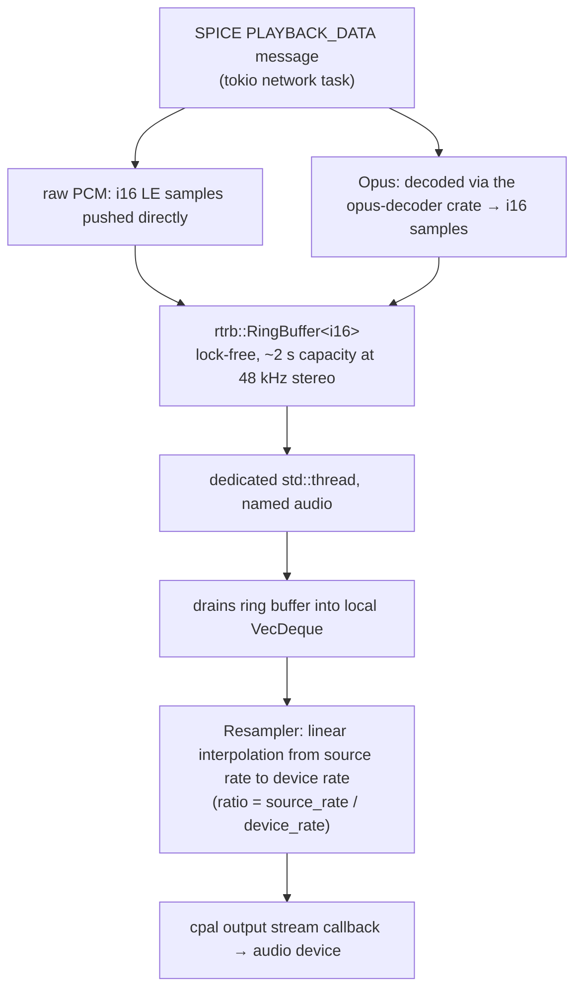

# Rendering and audio pipeline

The rendering and audio pipeline turns decoded SPICE surfaces into pixels
on a screen. This page covers that path in both GUI and headless modes,
how the window is sized and how multiple monitors are handled, how audio
playback is driven, and how user-facing notifications are raised.

## Display Rendering

### GUI Mode (egui)

Ryll uses **immediate mode rendering** via egui. `RyllApp` splits its
per-frame work across eframe's two entry points:

```rust
// Before every frame, and on its own while the window is hidden:
fn logic(&mut self, ctx: &egui::Context, _frame: &mut eframe::Frame) {
    // Process incoming events (new images, cursor updates), then
    // advance timers: reconnect, notifications, bug reports.
    self.process_events();
}

// Only when the window is drawn:
fn ui(&mut self, ui: &mut egui::Ui, _frame: &mut eframe::Frame) {
    // For each mirrored surface, fetch its cached texture and draw
    for (key, surface) in &mut self.surfaces.surfaces {
        let texture = self.textures.texture(ui.ctx(), *key, surface);  // Upload pixels if dirty
        ui.image(texture, size);                                        // Draw texture
    }
}
```

The split matters when the window is minimised or occluded, including
under the macOS lock screen. eframe then runs no egui pass and never calls
`ui`, but it still answers each repaint request from the event bridge with
a `logic`-only pass. Draining in `logic` keeps the bounded event queue
moving, so the renderer's channels never back up behind a hidden window.
Surfaces are updated in place, so this costs no extra memory (issue #444).

No objects accumulate - the surface pixel buffer is updated in place, and the
texture is re-uploaded each frame when dirty.

Each pass's `process_events` drains the `ChannelEvent`
channel and dispatches image / fill / copy-bits /
invert / chroma / alpha events into the corresponding
`DisplaySurface` helper. Every mode applies these draw ops through
`SurfaceMirror::apply_event`; the GUI reacts to the `DrawOutcome` it
returns for auto-fit, frame counting and texture invalidation. See the [draw-op coverage
table](/components/ryll/spice-protocol/#draw-op-coverage) for the full
mapping from opcode to event to surface method.

### Headless Mode

In headless mode, the egui/eframe code is bypassed entirely:

```rust
// Just run tokio runtime
tokio::runtime::Runtime::new()?.block_on(async {
    run_connection(config, event_tx, input_rx).await
});

// Process events without rendering
loop {
    match event_rx.recv().await {
        ChannelEvent::ImageReady { .. } => stats.frames += 1,
        // ... track stats, no rendering
    }
}
```

### Control surface (headless control socket)

Headless mode optionally exposes a Unix-domain control socket via the
`--control-socket <path>` CLI flag, which lets an external harness
drive the session and observe draw activity. The flag is only valid
when `--headless` is also present.

The wire contract and ryll's implementation of it — module layout,
the single-client accept model, and the broadcast-bus and
drop-oldest backpressure path that carries events to a client — are
both documented in
[control-socket-protocol.md](/components/ryll/control-socket-protocol/).

## Damage tracking

Each `DisplaySurface` records where draws landed, alongside its dirty
flag, for consumers that re-encode only what changed.
`DamageRegion` (`shakenfist-spice-renderer/src/display/damage.rs`)
holds the rectangles written since the consumer last called
`take_damage()`; `damage()` peeks without clearing.

- Every draw op that writes pixels records the rectangle it wrote,
  after clamping to the surface and the clip list. `copy_bits`
  records only its destination: the source is read, not changed.
  A new or resized surface starts fully damaged.
- A rectangle inside one already held is dropped, and two merge when
  their bounding box covers no more pixels than the two do
  separately. Past `MAX_DAMAGE_RECTS` (32) the region collapses to its
  bounding box. The region only ever grows, so it over-reports but
  never misses a changed pixel.
- Damage and the dirty flag are independent: `consume_dirty()` leaves
  the damage alone and `take_damage()` leaves the dirty flag alone,
  so a whole-frame consumer (the encoder) and a damage consumer can
  share a surface.
- If the `EventBus` mirror lags and misses events, it resyncs its
  surface list from the forwarder's `SurfaceLedger`, so a missed
  surface create or destroy is repaired at once, and marks every
  surface fully damaged so damage consumers resend whole surfaces.
  That keeps a consumer from trusting a partial damage region, but it
  does not restore the missed pixels: those recover only as the guest
  redraws.

## Stream teardown

The display channel keeps its video streams in one map keyed by stream
id. `STREAM_DESTROY` removes one entry; `STREAM_DESTROY_ALL` (opcode
126, empty body, sent by the server typically just before a resolution
change or surface reconfiguration) clears the map, as spice-gtk's
`clear_streams` does, retiring each stream so its final counters
survive in the diagnostics. It deliberately stops there. Surfaces are
owned by the `SURFACE_DESTROY` family and the image and GLZ caches by
their own invalidation messages, and the protocol does not promise that
a stream teardown implies either, so folding them in would invent
semantics. Until the opcode was handled it was counted as the protocol
gap `display:hexdump:126`, which dominated `--pedantic` reports, and
stale stream entries lingered across every resolution change.

## Cursor

The GUI draws the guest's cursor itself, as an overlay on the
surface (`draw_cursor_overlay` in `ryll/src/app/ui/cursor.rs`). The
cursor channel decodes each shape to RGBA, caches it by `unique_id`
(bounded; see [the SPICE protocol notes](/components/ryll/spice-protocol/)) and
emits `ChannelEvent::CursorShape`; position and visibility arrive as
`CursorPosition` events. The decoder and the formats it accepts are
in [features](/components/ryll/features/).

- **A foreground painter layer, not a widget.** The overlay is
  painted on its own layer so it takes no input: clicks reach the
  surface beneath it. Its texture uses nearest-neighbour filtering,
  because cursors are a few dozen pixels and linear filtering
  blurs the edges.
- **Placement** is the surface's top-left plus the cursor position
  minus the shape's hot spot, so the point a click lands on is the
  hot spot. The surface is drawn at native size, so no scaling is
  applied.
- **Who owns the position depends on the mouse mode.** In server
  mode (1) the guest is the authority and the overlay follows the
  position the cursor channel reports. In client mode (2) the host
  pointer drives it, from the last pointer position, because waiting
  for the guest to echo each move would make the cursor lag. The
  guest's shape is drawn in both modes: in client mode the guest
  may still ask for a custom shape.
- **The host cursor is hidden over the surface** (`hide_host_cursor`),
  as virt-viewer does, so there is one cursor rather than two. It
  is not hidden during region selection, where the crosshair
  shows. The test must be whether the surface contains the pointer:
  egui's `wants_pointer_input()` is always true over the central
  panel, and using it left two cursors showing
  ([#526](https://github.com/shakenfist/ryll/issues/526)).
- **Until the guest sends a shape, a built-in arrow is drawn,** so
  a connected session never has an invisible pointer.

## Screenshots and the stats-bar sparklines

F8 and Menu → Screenshot save the display surfaces as PNGs
(`ryll/src/app/screenshots.rs`), reusing the bug report's PNG
encoder.

- **One PNG per surface, not the largest or the one under the
  pointer.** A bug report wants a single image and picks the largest
  surface; a screenshot keeps every head, and the dialog still
  returns a single path to derive the names from. With one surface
  the file is written to the chosen path as it is. With several,
  only the last extension is stripped and `-1.png`, `-2.png` are
  appended, ordered by the `(channel_id, surface_id)` key so the
  numbering is stable between runs.
- **The dialog is the whole interface.** The default name is
  `ryll-screenshot-<timestamp>.png` from `bugreport::filename_timestamp`
  (already filename-safe, and the project avoids the `chrono`
  crate). Cancelling does nothing, and neither an empty session nor
  a write failure panics: both raise a notification.
- **Headless has no F8, and no `--screenshot-on-exit` flag.** The
  control socket's `screenshot` verb returns PNG or raw RGBA for any
  live surface, one call per surface, and `--capture` records the
  session as `display.mp4`, so a flag writing one PNG at exit would
  be a third way to do the same thing.

The sparklines in the stats bar (`ui/stats_bar.rs`) draw 80x12 pixel
bars from a 60-sample history. Bandwidth is sampled once a second;
`LatencyTracker` (`app/stats.rs`) is event-driven, recording a
sample in milliseconds when its event arrives, and draws nothing
until it has two. Both scale to the largest sample in the visible
window rather than to a fixed bound, which keeps one code shape
for every sparkline at the cost that a quiet stretch looks as
dramatic as a busy one; read the number beside the graph for the
value.

## Multi-Monitor Support

Ryll supports multiple monitors via the `--monitors N` CLI option.
Each monitor gets its own display channel, and the main channel
sends a `VDAgentMonitorsConfig` message to the guest via the VDI
port agent infrastructure to inform it of the desired monitor
layout.

Surfaces are isolated by a `(display_channel_id, surface_id)`
tuple so that draw operations from different display channels
target the correct surface even when surface IDs overlap across
channels. This prevents cross-channel surface corruption in
multi-head configurations.

## Window sizing

The ryll window auto-fits to the guest display surface.
On every primary `SURFACE_CREATE` (and on the
`ImageReady` auto-create fallback for surface 0), the
event-handling path queues a viewport resize via
`pending_resize`. `RyllApp::update` consumes the pending
value, runs the pure `compute_auto_resize` decision
helper, and — if the helper returns Some — issues a
`ViewportCommand::InnerSize` to ask egui to make the
window match the surface. The aligned target is also
seeded into `last_sent_resize` so the next frame's
`maybe_send_monitors_resize` dedupes and we do not echo
our own resize back to the guest as a fresh
`VDAgentMonitorsConfig`.

The reverse direction — user drags the ryll window —
runs each frame in `maybe_send_monitors_resize`. The
viewport's inner-rect size is reduced by
`STATS_BAR_HEIGHT` (zero when maximised or fullscreen),
8-pixel aligned, and clamped to a floor of 8 on each
axis via `compute_outgoing_resize`. The result is sent
to the guest as a `VDAgentMonitorsConfig` if it differs
from `last_sent_resize`. The guest may honour the hint
exactly, pick the closest supported mode, or decline —
whatever resolution the guest actually chooses comes back
as a fresh `SURFACE_CREATE`, and the auto-fit pipeline
above re-syncs the window.

Three short-circuits keep the loop stable:

* `compute_auto_resize` returns None when the viewport is
  maximised or fullscreen; the surface renders at native
  size inside the available area rather than fighting
  egui for the inner size.
* `compute_auto_resize` dedupes against `last_auto_resize`
  so a no-op resize event does not refire the
  `ViewportCommand` every frame.
* `compute_outgoing_resize` plus `last_sent_resize`
  dedupes the outgoing side, so an auto-fit's seeded
  target does not bounce back to the guest as if the
  user had just dragged the window.

Both decision helpers are pure functions and are
unit-tested in `ryll/src/app/resize.rs`'s `tests` module.

The auto-fit can be turned off with the
`Obey guest size hints` checkbox in the hamburger menu
(or the `--no-obey-guest-size` CLI flag at launch).
With the toggle off, the window stays where the user put
it and the surface renders at native pixel size inside
it — overflowing it or leaving empty space as the
dimensions require. The toggle is a session-level preference and
is **not** reset across a reconnect.

Every primary-surface mode change is also surfaced as an
Info notification ("Display resolution: WxH") through the
existing notification panel, debounced by
`RESOLUTION_NOTIFY_DEBOUNCE` (500 ms) so a burst of
events — boot probes that step `640×480 → 800×600 →
1024×768` over a second, or a drag-resize that steps
through dozens of 8-pixel-aligned sizes — collapses to a
single entry carrying the latest resolution. The
debounce is on top of the 30-second
`NOTIFICATION_DEDUP_WINDOW` from
`ryll/src/notifications.rs`, which folds same-resolution
repeats into a `count++` on the existing entry. The
decision is in the pure
`resolution_notification_due` helper next to the
window-fit helpers, and is unit-tested alongside them.

`pending_resize` is only set when the affected surface
key is `(display_channel_id == 0, surface_id == 0)`
(centralised as `is_primary_surface`), so a secondary
monitor's surface event cannot resize the primary
window.

Both auto-fit arms additionally refuse to honour
`SurfaceCreated` dimensions above
`MAX_AUTO_FIT_DIMENSION` (16384 px per axis,
`GL_MAX_TEXTURE_SIZE` on common hardware). A hostile
SPICE server can announce
`SurfaceCreated { width: u32::MAX, height: u32::MAX }`;
without the bound, ryll would forward that as
`ViewportCommand::InnerSize` (platform-dependent
behaviour, possibly large internal allocations) and
emit a notification carrying the absurd value. The cap
is checked at the trigger sites by
`auto_fit_size_acceptable`, which is unit-tested with
the other pure helpers; rejected sizes log a `warn!`
and leave the SPICE renderer's own surface bookkeeping
untouched.

### Why the window follows every guest size

The window used to be fitted once, on the session's first
surface. A guest that probes display modes while it boots (a
test guest walks `640x480`, `800x600`, then `1024x768`) left the
window at the first probe's size around a surface drawn at its
native size, so it showed 20% too wide or too narrow. A one-shot
fit is the wrong policy, and not only for boot probes: when a user
drags the window to a size the guest will not accept, the guest
reverts, and the window has to follow it back. So the default is
to honour every primary surface, as virt-viewer does, and the
`Obey guest size hints` toggle is the escape hatch for a fixed
window (a fixed-size recording, or a guest that flaps between
modes on its own), not a replacement for the default.

- **Dedupe against the last size asked for, not the live window.**
  `compute_auto_resize` compares with `last_auto_resize`, the size
  of the last `InnerSize` command, because egui's reported inner
  size can lag a frame behind a command and would refire it. This
  mirrors `last_sent_resize` on the outgoing side.
  `last_auto_resize` is cleared on reconnect, so a guest that comes
  back at another resolution re-fits the window; `obey_guest_size`
  is not.
- **A toggled-off session discards the resize, rather than
  queueing it.** `pending_resize` is consumed whether or not the
  toggle is on, so turning it on later cannot apply a surface size
  from minutes before.
- **The window is exactly the surface in logical pixels.**
  `InnerSize` takes logical pixels and the surface image is drawn
  at its native size in the same units, so the mapping is 1:1. On a
  HiDPI display the window is larger than the surface in physical
  pixels and the GPU resamples; that is expected.
- **There is no scaling.** When the window cannot match the surface
  (toggle off, maximised, fullscreen) the surface is drawn at
  native size and overflows or leaves empty space, rather than
  being scaled or letterboxed to fit. That would be a separate
  feature, tracked as [#778](https://github.com/shakenfist/ryll/issues/778);
  [ryll#308](https://github.com/shakenfist/ryll/issues/308) is the
  same question for web mode.
- **The first surface of a session notifies too.**
  `last_notified_resolution` starts empty, so the notification
  doubles as a "connected at WxH" confirmation, which shows the mode
  a guest came up in before it starts walking through others, and
  suppressing it would need a hook on connect or another flag. A
  reconnect clears it, so a new session announces itself again.
- **Debounce on top of dedup, and re-armed by every event.**
  The notification store's 30-second dedup folds repeats of one
  message, but `Display resolution: 1024x768` and
  `Display resolution: 800x600` are different messages, so a burst
  of distinct modes needs the 500 ms debounce as well. Each primary
  surface event re-arms it, so a `1024 -> 800 -> 1024` burst emits
  the last value rather than the first, and the check against the
  last value announced runs when the debounce expires, so a guest
  re-confirming the mode it is already in stays silent. The
  pending value and its timestamp are one `Option`, so the state
  where only one is set cannot be represented. The message carries
  only the final resolution; a "from X to Y after N changes" form
  would need a counter and was left out.
- **The helpers are pure on purpose.** `compute_auto_resize`,
  `compute_outgoing_resize` and `resolution_notification_due` take
  their inputs, including the clock, as arguments, and
  `round_trip_no_echo` and `round_trip_guest_overrides_request`
  compose the first two to prove that an auto-fit is not echoed back
  to the guest, and that the state settles when the guest picks a
  different size from the one requested.

## Audio Playback Pipeline

SPICE audio data arrives on the **Playback channel** (type 5) as
`PLAYBACK_DATA` messages containing a 4-byte multimedia timestamp
followed by encoded audio. The codec is negotiated via `PLAYBACK_MODE`
(raw PCM = 1, Opus = 3).



This is the local-output path (`PlaybackOutput::Local`, which needs
the renderer's `audio` feature). With `PlaybackOutput::Sink`, as in
`--web` mode, no ring buffer or audio thread exists: the channel still
decodes Opus, to keep its counters meaningful, and hands the audio to
a `PlaybackSink`.

The tokio network task is the **producer**: it decodes incoming audio
and pushes i16 samples into the ring buffer via `rtrb::Producer<i16>`.
Back-pressure is applied by dropping samples when the ring buffer is
full (the server is sending faster than the device can consume).

The audio thread is the **consumer**: it owns the `cpal` output stream
and the `Resampler`. The cpal callback drains the ring buffer into a
local `VecDeque` and calls `Resampler::next_frame()` to produce
resampled output at the device's native sample rate. The resampler
uses linear interpolation and handles underruns silently (outputs
silence).

Volume control (`VolumeControl`) is shared between the UI thread and
the audio thread via `Arc<VolumeControl>`, using atomic operations to
avoid locking in the cpal real-time callback.

The audio thread is spawned on `PLAYBACK_START` and stopped (joined)
on `PLAYBACK_STOP` or channel disconnect.

Between those, the audio thread keeps an output stream alive rather
than giving up on the first error. Opening a stream can fail (no
device), and a running stream can die (the device is unplugged, its
sample rate changes, the audio server restarts). In either case the
thread drops the stream, discards the stale audio queued in the ring
buffer, and opens a new stream on the current default device, retrying
with a doubling backoff from 1 to 30 seconds. Only a stream that has
played for 10 seconds resets the backoff and ends the failure streak, so
a device that dies straight after opening is retried quietly rather
than every second. cpal reports a default-device change that it
handled by itself as `DeviceChanged`, which is recorded but needs no
rebuild. Xruns arrive on the device's real-time thread, so they are
counted in an atomic rather than logged.

The audio thread has no async context, so it reports these transitions
over a `std::sync::mpsc` channel. The playback channel drains it on
every turn of its read loop, folds the events into the playback
snapshot, and raises notifications when output is lost, restored or
moved to another device. A routine start on `PLAYBACK_START` is
silent. In `--web` mode those notifications are suppressed, because
the operator hears audio through the browser rather than the host's
speakers. A DATA packet whose negotiated codec is neither raw PCM nor
Opus is counted and registered as a protocol gap, rather than dropped
silently.


## Notifications

Ryll surfaces four categories of operator-relevant events through a
unified in-memory store and a single GUI surface:

1. **Protocol gaps** — distinct `warn_once!` keys registered in
   `shakenfist-spice-protocol/src/logging.rs`. Each new key produces
   one Warn-severity Gap entry via the gap observer registered in
   `notifications.rs`.

2. **SPICE_MSG_NOTIFY** — opcode 7 messages parsed on every channel
   handler; each is pushed as a Spice-source entry tagged with the
   receiving channel and the SPICE `what` enum value.

3. **Internal status** — bug-report writer success/failure,
   screenshot Ok/Err/no-surface, paste-completed.

4. **Connection events** — `NotificationSource::Connection`, pushed
   through `RyllApp::push_connection_event`: connected, connection
   lost, each reconnect attempt and its failure, the auto-reconnect
   giving up (one entry per modal variant), a manual reconnect, a
   channel error, a secondary channel dropping, and the guest agent
   coming and going. Before this a bug report's `notifications.json`
   showed nothing of the transitions around a failure. The events
   share the store's 30 s dedup window rather than a fold rule of
   their own, so a flapping link collapses to one entry with a count,
   while per-attempt messages carry the attempt number so they stay
   distinct. A critical-channel disconnect is one entry, not two: the
   text the modal shows is the entry. The giving-up entry is pushed
   in addition to the modal, because a modal is easily dismissed
   without being read and the bell keeps the record. A secondary
   channel dropping is Info, since only its own feature is lost. The
   panel has no per-source filter.

The store (`ryll/src/notifications.rs`) is a 500-entry
`VecDeque<NotificationEntry>` behind `Arc<Mutex<NotificationStore>>`.
Pushes apply a 30-second deduplication window: identical
`(source, severity, message, visibility)` tuples within the window
fold into the most recent entry's `count`, incrementing the `[N×]`
suffix the side panel renders.

The bell glyph in the status-bar right-edge cluster tints by the
highest-severity unread entry's colour (default text colour for Info,
amber for Warn, muted red for Error). Low-visibility SPICE entries are
excluded from the bell colour calculation — they record but do not
flash.
Clicking the bell toggles a right-side Notifications panel that lists
entries newest first; closing the panel marks every visible entry
read.

The `register_gap_observer` hook in
`shakenfist-spice-protocol/src/logging.rs` supports multiple
observers, so the `--pedantic` zip writer and the notifications
observer coexist independently.

Bug-report zips include a `notifications.json` with the full store
snapshot at submit time, alongside the existing `metadata.json`,
`session.json`, `channel-state.json`, and `runtime-metrics.json`.
Operators handing zips to third parties should be aware that
notification messages can include server-side text such as
hostnames, paths, and error strings.


### Why notifications are shaped this way

The store replaced three unrelated surfaces: a `Gaps: N` badge with a
popup, a five-second status string beside the Report button that left
no scrollback, and `SPICE_MSG_NOTIFY` messages, which fell through to
the per-channel unknown-message log and were then lost. virt-viewer does
not surface server notifications either, so QEMU's "channel is
insecure" warnings are something ryll shows that it does not.

- **One producer boundary.** Every status the old status string
  carried (bug-report success and failure, screenshot success, failure
  and "no display surface yet", paste completion) became a store push,
  because deleting the string would otherwise have silenced them. Each
  push sits beside the `info!`, `warn!` or `error!` line it always had,
  so `--verbose` and headless output lost nothing when the surface
  moved. Producers ignore a poisoned store lock rather than panic: a
  poisoned lock means the GUI thread already died holding it, and a
  producer must not amplify that. The bug-report writer likewise writes
  an empty `notifications.json` rather than fail the report.
- **Channels emit, the host stores.** The store lives in `ryll`, so the
  renderer crate cannot push into it. Each channel emits
  `ChannelEvent::Notification` and the host's event drain pushes the
  entry; `NotificationEntry` and `NotificationSource` live in the
  renderer crate, and the serde derives that `bugreport.rs` relies on
  sit on the protocol crate's `ChannelType`, `NotifySeverity` and
  `SpiceVisibility` rather than on shims in `ryll` that would duplicate
  the channel-name table.
- **`NOTIFY` is handled on every channel.** The opcode is common to
  all channels, but QEMU sends them on the main channel only: against
  `make test-qemu` (`disable-ticketing=on,plaintext-channel=all`,
  checked 2026-04-26) one notification arrives per affected channel,
  all on main, with the affected channel named in the message text
  ("keyboard channel is insecure"). The other channels' arms cost one
  duplicated block each and are there for servers that do notify on
  them, such as the Kerbside proxy. The arms are deliberately copies,
  as `SET_ACK` and `PING` are, not a shared helper.
- **The wire decode is forgiving about values and strict about
  length.** An unknown severity decodes as `Info`, so a misbehaving
  server's message is shown rather than dropped. An unknown visibility
  decodes as `None`, and `None` flashes the bell, the conservative
  reading. A body shorter than its declared length is an error, and
  non-UTF-8 text is replaced rather than rejected.
- **Severity is the protocol's, not a parallel enum.** The store uses
  `NotifySeverity` directly (Info < Warn < Error by declaration order,
  so "highest wins" is `max`), so there is no conversion at the SPICE
  boundary and no second enum to drift.
- **Deduplication keeps the channel.** The fold key is
  `(source, severity, message, visibility)`, and for a SPICE entry the
  source includes the channel and the `what` value, so the same warning
  on two channels stays two entries: the operator needs to know which
  channels are insecure, and the cost is bounded at one entry per
  channel type. A fold bumps `count`, refreshes the time and marks the
  entry unread again. Different visibility does not fold. The time
  distance is absolute, so an entry stamped earlier than its
  predecessor (clock skew) still folds, and a zero window disables
  folding. Entries are stamped with the local clock, not the message's
  own `time_stamp`, so the window behaves the same whatever the server's
  clock says.
- **Ids are never recycled.** They count up from 1 and survive
  `clear()`, so a control that still holds an id from before *Clear all*
  gets a clean miss from `mark_read` or `remove` and cannot hit an
  unrelated new entry.
- **One shared cap.** Five hundred entries cover any realistic rate:
  `NOTIFY` messages arrive a handful per session and bug reports are
  manual. Low-visibility entries count toward it like any other.
- **The bell tells you what needs attention, the panel what happened.**
  Low-visibility entries are recorded and shown but never tint the bell
  (`highest_bell_severity` skips them; `highest_unread_severity` does
  not), because the protocol means low as informational. The tint is on
  the bell glyph rather than a separate dot, which would need painter
  overlay code for little gain. Closing the panel, not opening it, marks
  everything read, so the operator sees what was unread when they open
  it and the bell clears when they are done.
- **Connection events were left out at first** because disconnects
  already had their own status, and scope was the reason; they became
  the `Connection` source later, so the exclusion is not a rule.

The original design is in [PLAN-notifications.md](https://github.com/shakenfist/ryll/blob/277fd835a365fe057f291f3b0dbc1c3f39061df1/docs/plans/PLAN-notifications.md).
