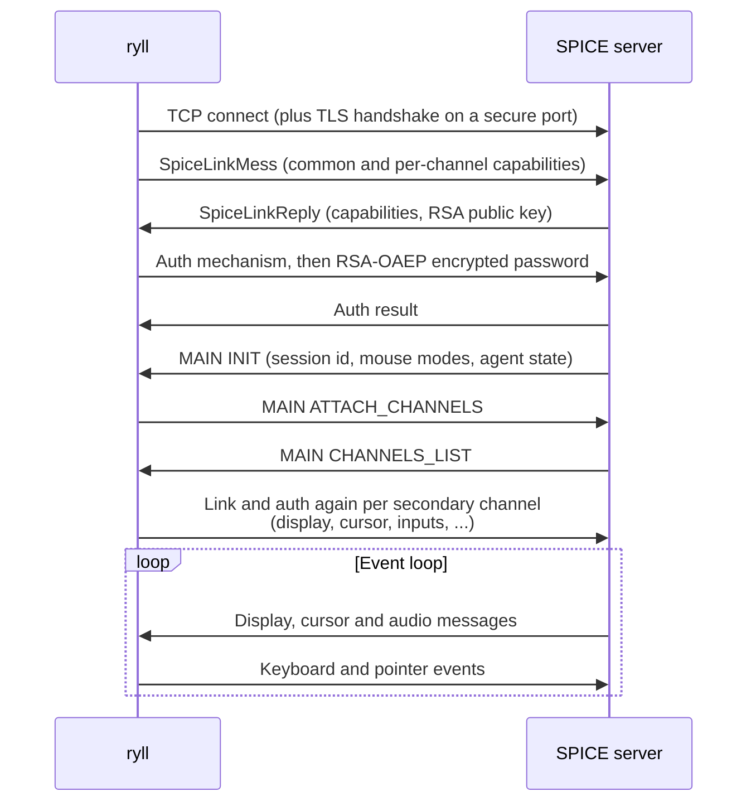

# SPICE protocol handling

This page describes how ryll speaks SPICE on the wire: the channel model
and handshake, mouse-mode negotiation, the image encodings it decodes, the
display channel capabilities it advertises, and the keyboard scancode
mapping. See [Architecture](https://github.com/shakenfist/ryll/blob/develop/ARCHITECTURE.md) for where these pieces
sit in the crate layout.

## SPICE Protocol

### Connection Sequence

### Link capabilities

The link message carries two capability arrays, common and
per-channel, each a list of 32-bit words (word `n` holds bits
`32n` to `32n+31`). By default `perform_link` and
`SpiceClient::connect_channel` advertise ryll's own set: one
common word (`AUTH_SELECTION | AUTH_SPICE | MINI_HEADER`) and one
channel word chosen by channel type (see
[Display Channel Capabilities](#display-channel-capabilities)).

The main channel advertises `SEMI_SEAMLESS_MIGRATE`,
`AGENT_CONNECTED_TOKENS` and `SEAMLESS_MIGRATE`. With
`AGENT_CONNECTED_TOKENS`, the server sends `AGENT_CONNECTED_TOKENS`
instead of `AGENT_CONNECTED` when the guest agent (re)connects, carrying
a fresh agent token window. spice-server resets its token accounting
whenever the agent detaches, so ryll adopts that window rather than
keeping its old count, which could leave both ends waiting on each
other. Channels without their own default (inputs, cursor and the rest)
still advertise the word they always have, without
`AGENT_CONNECTED_TOKENS`, because capability bits mean different things
on each channel type. Playback has its own word, `DEFAULT_PLAYBACK`,
which is `PLAYBACK_OPUS` alone. Ryll plays only Opus and raw PCM, so it
does not offer `PLAYBACK_CELT_0_5_1`; a server with no Opus falls back to
raw PCM, which needs no cap. It does not advertise `PLAYBACK_VOLUME`
either, so a server sends it no `VOLUME` or `MUTE`.

A proxy that must forward a real client's capabilities to the
server instead uses `perform_link_with_caps`, or
`SpiceClient::connect_channel_with_caps`, which take the common
and channel words as slices, sent verbatim, and return the
server's `SpiceLinkReply` so the caller can see what the server
offers. Two common capabilities are mandatory on this path. The
server decides whether to expect an auth mechanism selector, and
whether to frame messages with the mini header, from what the
*client advertised*, and this crate only speaks the
selector-then-ticket auth exchange and the mini header. So
advertised caps missing `AUTH_SELECTION` or `MINI_HEADER` are
refused before anything is sent (as are more than 16 words in
either array, the limit ryll's own parsers accept).

The server's reply lists the capabilities it supports, not the
intersection with what was advertised. A reply must list
`AUTH_SELECTION`, `MINI_HEADER` and `AUTH_SPICE` (a server with
SASL enabled offers `AUTH_SASL` instead, and refuses SPICE ticket
auth, which is the only mechanism this crate implements), or it
fails `SpiceLinkReply::check_client_requirements`, which
`connect_channel_with_caps` (and so `connect_channel`) runs before
authenticating. Both refusals are a typed
`LinkError::MissingRequiredCaps` naming what is missing.

### Message Format

All SPICE messages use a 6-byte mini-header, immediately followed
by the payload:

| Offset | Size | Field |
|---|---|---|
| 0 | 2 | `message_type` (u16 LE) |
| 2 | 4 | `message_size` (u32 LE) |
| 6 | `message_size` | payload |

### Channel Types

| Channel | Purpose | Message Examples |
|---------|---------|------------------|
| Main (1) | Session control | init, channels_list, ping/pong |
| Display (2) | Graphics | surface_create, draw_fill, draw_copy, draw_blackness, draw_whiteness, draw_invers, copy_bits, draw_opaque, draw_blend, draw_transparent, draw_alpha_blend, mark |
| Inputs (3) | User input | key_down, key_up, mouse_position, mouse_motion (see "Mouse-Mode Negotiation" below) |
| Cursor (4) | Pointer | cursor_set, cursor_move, cursor_hide |
| Playback (5) | Audio playback | playback_start, playback_data, playback_mode, playback_stop |
| Usbredir (9) | USB redirection | vmc_data, vmc_compressed_data (SpiceVMC transport) |
| WebDAV (11) | Folder sharing | vmc_data, vmc_compressed_data (SpiceVMC transport), port_init, port_event |

### Mouse-Mode Negotiation

The SPICE server can drive input dispatch in either of two
mouse modes, and which mode is in effect changes how ryll
sends pointer events:

- **SERVER mode (1, "relative")** — the server expects
  `MOUSE_MOTION` messages with `(dx, dy)` deltas. Common
  on minimal setups without a guest agent.
- **CLIENT mode (2, "absolute")** — the server expects
  `MOUSE_POSITION` messages with `(x, y)` in screen
  coordinates. Required for the cursor to track a
  windowed client cleanly. CLIENT is what ryll asks for
  whenever the server says it is supported.

#### Wire format

Both directions use 16-bit fields, even though the
in-memory C struct is `u32` — `spice.proto` declares
`mouse_mode` as `flags16`, and the marshaller narrows it
on the wire. Misreading the wire as `u32` produces
nonsense values like 131075 (`0x00020003` for
supported=3 / current=2) which fail every mode check.

| Direction | Message | Payload |
|-----------|---------|---------|
| Server → client | `MAIN_MOUSE_MODE` (`SpiceMsgMainMouseMode`) | Two little-endian u16: `supported_modes`, then `current_mode` |
| Client → server | `MAIN_MOUSE_MODE_REQUEST` (`SpiceMsgcMainMouseModeRequest`) | One little-endian u16: requested mode flags |

`parse_mouse_mode_payload` and
`build_mouse_mode_request_payload` in
[`main_channel.rs`](https://github.com/shakenfist/ryll/blob/develop/shakenfist-spice-renderer/src/channels/main_channel.rs)
own the read and write sides; both have unit tests next
to them.

#### Negotiation flow

1. **At session INIT**, the server announces both
   `supported_modes` (a bitmask) and `current_mode`. Ryll
   calls `maybe_request_client_mouse_mode`, which sends a
   `MOUSE_MODE_REQUEST(CLIENT)` if CLIENT is supported but
   not current.
2. **On any subsequent `MAIN_MOUSE_MODE`** — typically
   triggered by guest events such as a guest reboot
   (which often reverts the server to SERVER/relative
   while the agent reattaches) — ryll re-evaluates the
   same predicate. This is the recovery path that keeps
   absolute pointer events working without a manual
   reconnect.

#### Request-loop guard

`MainChannel::mouse_mode_request_pending` tracks whether
a `MOUSE_MODE_REQUEST` is outstanding.
`maybe_request_client_mouse_mode` skips sending if this
flag is already set, and the flag clears when a
subsequent `MAIN_MOUSE_MODE` arrives announcing
`current_mode == CLIENT`. This caps outbound requests at
one per round trip, so a flappy or buggy server that
never honours the request cannot amplify its
`MAIN_MOUSE_MODE` traffic into a storm of client-side
requests.

The predicate `should_request_client_mouse_mode` and the
encoder `build_mouse_mode_request_payload` are pure
functions with their own tests — three branches and a
byte-shape assertion respectively — so a regression in
either the negotiation logic or the wire format fails
loudly during `cargo test`.

#### Agent flow control and stall detection

Each `AGENT_DATA` chunk the client sends costs one agent token. MAIN_INIT
grants `REDS_AGENT_WINDOW_SIZE` (10), and spice-server returns them in
batches of `REDS_TOKENS_TO_SEND` (5) as the guest consumes the data, or at
once for data the server consumes itself. ryll queues agent messages
(`channels/agent_queue.rs`), sends one chunk per token, and never abandons
a message part-way: spice-server reassembles messages by byte count and
disconnects a client whose next message overruns the one it is still
expecting.

A client at zero tokens with messages queued has at least six chunks the
guest has not read, so the main channel treats 5 seconds of that as a
stalled agent. Replies are not used for this. On QXL guests spice-server
diverts `VD_AGENT_MONITORS_CONFIG` to the display device
(`agent-msg-filter.c`, `reds_on_main_agent_monitors_config`), so the agent
never sees it and never sends `VD_AGENT_REPLY`. Reply counts and lags are
still recorded on `MainSnapshot` as passive diagnostics, next to the token
and queue fields; the "Guest agent diagnostics" section in
[troubleshooting.md](/components/ryll/troubleshooting/) explains each one.

#### Display size requests

Every frontend asks for a display size the same way: it puts the size
on the main channel's resize queue (the GUI when its window changes,
web mode for the browser's viewport, and the control socket's `resize`
verb). The main channel waits for 200 ms of quiet so that a drag
reaches the guest as the size it ended on, then sends a
`VD_AGENT_MONITORS_CONFIG`. If the agent is not connected, or ryll has
not yet announced its capabilities to it, the size is held, and sent
once the agent connects or the guest announces its own capabilities,
which is when spice-gtk sends its display configuration too. A size
equal to the last one sent is not sent again.

The GUI also tells the main channel when it has fitted its window to
a new guest surface, as a size the guest already has rather than one
it asks for. That sends nothing: the main channel records the size as
the agent's and drops any size it was still holding. Otherwise a
guest that booted without its agent would, when the agent started, be
resized to the window's size from before the fit, away from the size
it chose.

#### Guest agent message reassembly

The other direction is split the same way. A guest agent message is a
20-byte `VDAgentMessage` header followed by `size` bytes of body, and
spice-server forwards guest agent data in `AGENT_DATA` messages of at most
`VD_AGENT_MAX_DATA_SIZE` (2048) bytes. A guest clipboard copy larger than
about 2 KB therefore arrives as several `AGENT_DATA`s, and only the first
carries the header. The main channel feeds every `AGENT_DATA` body to an
`AgentReassembler` (`messages::agent_stream` in the protocol crate), which
hands back each message once all of its bytes are in.

The reassembler treats the bodies as one byte stream, as spice-gtk does: a
header may be split between two `AGENT_DATA`s, and one `AGENT_DATA` may
carry the end of one message and the start of the next. spice-server never
does either, because its own filter (`agent-msg-filter.c`) starts every
message on an `AGENT_DATA` boundary, but other servers may. Because the
server is untrusted, the reassembler also differs from spice-gtk in three
ways:

- **Size cap.** A message whose header declares a body over
  `MAX_AGENT_MESSAGE_SIZE` is not buffered. That cap is spice-gtk's default
  `max-clipboard` (100 MiB) plus 4 KiB for the clipboard headers in front
  of the data, so any clipboard spice-gtk accepts, ryll accepts too. The
  oversized message's bytes are counted off and dropped as they arrive, as
  spice-server's filter discards a message it will not forward, so the
  message after it is still found. ryll logs the drop once per session
  (`main:agent_data:oversized`).
- **No allocation from the header alone.** A message's buffer grows as its
  bytes arrive, so a header claiming a large body costs nothing until the
  data behind it does.
- **Protocol check.** A header whose `protocol` is not `VD_AGENT_PROTOCOL`
  means the stream is out of step; spice-server forwards nothing else. The
  rest of that `AGENT_DATA` is dropped and reassembly restarts at the next
  one, where spice-server starts a message (`main:agent_data:bad_protocol`).

A message cut short when the agent goes away must not be completed by the
next agent's data, so `AGENT_DISCONNECTED`, `AGENT_CONNECTED` and
`AGENT_CONNECTED_TOKENS` all reset the reassembler. A reconnect builds a new
main channel, and with it a new reassembler.

## Server role

The protocol crate serves both ends of the wire: ryll uses it as a client,
and the kerbside SPICE proxy uses its link handshake to speak to clients as
a server. The message types a server sends or receives therefore have both
a reader and a writer, whichever direction ryll itself needs: the common
and main channel messages, the vdagent messages, the cursor and inputs
channels, the display channel's surfaces, monitors config, streams and
`DRAW_COPY`, and the playback channel's `START`, `MODE`, `DATA`, `VOLUME`,
`MUTE` and `LATENCY`. They implement `WireType` (or `ClipboardWireType`),
and each is tested against itself and against hand-written bytes laid out
from spice.proto. The other draw operations (`SpiceFill`, `SpiceOpaque`,
`SpiceTransparent`, `SpiceAlphaBlend`, `SpiceBlackness` and the brushes)
still have readers only, since only a client parses them.

`DRAW_COPY` is the one message whose layout is not a flat sequence of
fields. Its image and mask are reached through offsets, which are measured
from the start of the message body (the mini header is excluded) and are
zero for a null pointer. The writer lays out the fixed fields first, then
the source image, then the mask, as spice-server does. `DrawCopy` stores
its images already demarshalled rather than as raw offsets, and the reader
and the writer share one layout function, so a value read from any accepted
layout writes out in the canonical one and reads back unchanged. Image
types the crate does not model are carried as an opaque payload bounded by
the next pointee.

### Encoding images (server role)

A server that sends image data can build the `BinaryData` bodies with the
compression crate's `encode` feature, which is not on by default. It has
two encoders, `encode_spice_lz4` and `encode_spice_jpeg`, and both take a
`Bgrx`: a borrowed 32-bit B,G,R,X image with a row stride, such as an X11
ZPixmap at depth 24. Each returns the body of a `BinaryData` (the bytes
after `data_size`), to be wrapped as `ImagePayload::Lz4` or
`ImagePayload::Jpeg`. The LZ4 body follows the framing described under
[Wire format differences](#wire-format-differences).

- The encoded result can be larger than the raw pixels. As spice-server
  does, send an uncompressed BITMAP instead when it is.
- Send LZ4 only to a client that advertises the LZ4 display capability
  (cap 5).
- A JPEG's dimensions must equal the image descriptor's; spice-common
  asserts it. `encode_spice_jpeg` encodes exactly the `Bgrx` dimensions,
  so describe the image with the same width and height.

## Image Types and Compression

SPICE uses several image types for display updates. The type is
specified in the `ImageDescriptor` that precedes each image's data.
Values from `spice-protocol/spice/enums.h`:

| Type | Name             | Status in ryll |
|-----:|------------------|----------------|
|    0 | Pixmap           | Supported (BitmapData header + raw BGRX/RGBA) |
|    1 | Quic             | Supported (Golomb-coded wavelet compression) |
|  100 | LZ_PLT           | Not implemented |
|  101 | LZ_RGB           | Supported |
|  102 | GLZ_RGB          | Supported (with cross-frame dictionary) |
|  103 | FromCache        | Supported (image cache lookup) |
|  104 | Surface          | Not implemented |
|  105 | Jpeg             | Supported (per-platform JPEG decoder) |
|  106 | FromCacheLossless| Supported (image cache lookup) |
|  107 | ZlibGlzRgb      | Supported (zlib-wrapped GLZ) |
|  108 | JpegAlpha        | Not implemented |
|  109 | LZ4              | Supported (dependent LZ4 blocks) |

Streaming video codecs (MJPEG and H.264) are handled separately: they are not
`ImageType`s but delivered via `STREAM_DATA` / `STREAM_DATA_SIZED` messages.
The codec type byte in the stream header selects the decoder. At `STREAM_CREATE`,
`shakenfist_spice_compression::video::for_stream(codec_type, jpeg_decoder)`
constructs a boxed `VideoDecoder` stored on `StreamState`. Each `STREAM_DATA`
packet is dispatched through `stream.video_decoder.decode(packet)` regardless
of codec — the per-codec logic lives in the impl, not the dispatch.

A decoded frame is painted at the top-left corner of its dest rect (the
`STREAM_DATA_SIZED` dest, else the stream's) as soon as it arrives. A frame
larger than the dest, such as an H.264 frame rounded up to whole macroblocks,
is cropped to the dest's size, keeping its top-left corner. Ryll does not
scale frames, and ignores the stream's clip and its `TOP_DOWN` flag.

Currently supported codec types:
- `1` (MJPEG): decoded by `MJpegVideoDecoder`, which wraps the
  platform-optimised JPEG backend and maintains a DHT cache for frames
  that omit the Huffman tables after the first. The backend selection is
  described below.
- `3` (H.264): decoded via `H264VideoDecoder` using the openh264 software
  decoder. H.264 is typically more bandwidth-efficient than MJPEG for
  sustained video playback, but H.264 from spice-server's GStreamer
  encoder does not decode yet
  ([#398](https://github.com/shakenfist/ryll/issues/398)).

**Which codec a server picks.** Each display channel advertises
`CODEC_MJPEG` and `CODEC_H264`, and at link-up sends
`PREFERRED_VIDEO_CODEC_TYPE` listing MJPEG then H.264.
`--experimental-h264` reverses that order. `--no-h264` drops both the
capability and H.264 from the list (see [configuration.md](/components/ryll/configuration/)).

A server that encodes only H.264, such as andris, streams H.264 whenever
the capability is there, whatever the order. spice-server still streams
MJPEG to ryll by default, which keeps #398 out of the way. Its
behaviour, read from spice-server's `server/` sources, is this:

- `dcc_update_preferred_video_codecs` (`dcc.cpp`) sorts the server's own
  codec list by the client's preference.
- `dcc_create_video_encoder` (`video-stream.cpp`) walks that sorted list.
  It skips codecs whose capability the client did not advertise, and
  takes the first whose encoder starts. If none starts, it falls back
  to its built-in MJPEG encoder, provided the client has `CODEC_MJPEG`.
- The default list (`default_video_codecs` in `reds.cpp`) is
  `spice:mjpeg;gstreamer:mjpeg;gstreamer:h264;gstreamer:vp8;gstreamer:vp9`.
  Sorted with MJPEG first, the built-in `spice:mjpeg` comes first, and
  it always starts.

Two cases still reach H.264 from spice-server, and with it #398:

- **A server whose codec list has no MJPEG.** The preference only
  reorders the list; it never removes anything from it. Without
  `CODEC_H264` spice-server would skip H.264 and fall back to its
  built-in MJPEG encoder, so `--no-h264` restores MJPEG. The one such
  list QEMU sets is for `-spice gl=on` with a network port
  (`ui/spice-core.c`): `gstreamer:h264`, or the GStreamer codec named by
  `video-codec`. That remote-GL stream carries the whole display, and
  only a GStreamer encoder can encode it (`encode_dmabuf`, used by
  `red_marshall_gl_draw_stream` in `dcc-send.cpp`), so the built-in
  fallback never served it. `--no-h264` does not help there, but
  `video-codec=mjpeg` does.
- **The streaming-agent path.** spice-server's stream channel
  (`stream_channel_get_supported_codecs` in `stream-channel.cpp`) offers
  the guest's spice-streaming-agent every codec all clients have the
  capability for. It stores the client's preference but never uses it,
  so the agent may choose H.264. `--no-h264` keeps it on MJPEG.

**JPEG decoder selection** (used by `MJpegVideoDecoder`) runs once per
display channel at startup and selects the fastest available backend:
- **macOS**: ImageIO (uses Apple Silicon's dedicated media block when available)
- **Windows**: WIC (uses hardware codec support where available)
- **Linux**: VA-API (hardware-accelerated JPEG via libva, probed at runtime
  via dlopen; gracefully unavailable on systems without VA-API drivers)
- **Fallback**: libjpeg-turbo via the `mozjpeg` crate (vendored, no runtime
  dependency), then pure-Rust `jpeg-decoder` crate as a last resort

The active decoder backend name is exposed in the channel snapshot as
`mjpeg_decoder_backend` (from `video_decoder.name()`) so bug reports identify
which path was used. Aggregate decode-duration statistics (min/max/mean) are
tracked per display channel and included in bug reports for performance analysis.

### Wire format differences

- **LZ_RGB and GLZ_RGB**: preceded by a 4-byte `data_size` (u32 LE),
  then the LZ/GLZ stream with its own big-endian header.
- **ZLIB_GLZ_RGB**: preceded by `glz_data_size` (u32 LE) +
  `compressed_size` (u32 LE), then zlib-compressed GLZ data.
- **LZ4**: preceded by a 4-byte `data_size` (u32 LE), as a
  `BinaryData` (the `LZ4` case of spice.proto's `Image`). Its data
  starts with a 1-byte top-down flag and a 1-byte
  `SPICE_BITMAP_FMT_*` value, then one or more LZ4 blocks, each with a
  4-byte big-endian length prefix.
- **Pixmap**: preceded by a `BitmapData` header (format u8, flags u8,
  x u32, y u32, stride u32), then the palette reference, then raw pixel
  rows. The palette reference is a 4-byte `palette_addr` normally,
  making the header 18 bytes. When `PAL_FROM_CACHE` is set in the flags
  it is instead a u64 palette id, making the header 22 bytes
  (the `pal` switch in spice.proto's `BitmapData`). ryll draws only
  32-bit bitmaps, which carry no palette. Only 32-bit formats (BGRX=8,
  RGBA=9) are supported. The `top_down` flag (bit 2 of flags) controls
  row ordering.
- **JPEG**: preceded by a 4-byte `data_size` (u32 LE), then a standard
  JPEG stream. Decoded by the per-platform JPEG decoder that
  `best_for_platform()` in the compression crate's `jpeg` module
  selects (see "JPEG decoder selection" above), which returns RGBA.
- **FromCache** and **FromCacheLossless**: no data at all after the
  descriptor; `image_id` names a previously cached decompressed image.
  spice-server marshals a draw's source image after its fixed fields
  and before any mask, so on a draw without a mask the descriptor ends
  the message. The server sends FromCacheLossless instead of FromCache
  when JPEG is enabled and the cached copy is lossless.

### Image cache flags

The descriptor's `flags` byte controls the client's image cache, which
holds decoded non-GLZ images keyed by `image_id` (GLZ images go to the
GLZ dictionary instead):

- **CACHE_ME** (bit 0): cache this image after decoding it.
- **HIGH_BITS_SET** (bit 1): not used by ryll.
- **CACHE_REPLACE_ME** (bit 2): overwrite the entry already cached under
  this id. spice-server sets it, instead of CACHE_ME, when it resends a
  lossy cached image losslessly so a later FromCacheLossless finds the
  lossless pixels.

spice-server only caches images whose guest driver asked for it with
`QXL_IMAGE_CACHE`. The Linux KMS qxl driver never does, so Linux guests
on that driver produce no cache hits; Xorg's `xf86-video-qxl` and the
Windows QXL drivers do.

### Compression algorithms

**GLZ** -- Dictionary-based compression that can reference pixels from
previous images (cross-frame). The GLZ decompressor maintains a cache
of decompressed images keyed by `image_id`. Cross-frame references
use `image_dist` to compute the source image ID. Each GLZ header
includes a `win_head_dist` field that defines the reference window
size; after decompressing an image, the display channel evicts all
cached images whose id falls below `image_id - win_head_dist`. In
multi-monitor configurations, the GLZ dictionary is shared across
all display channels via a `GlzDictionary` struct (in the
`shakenfist-spice-compression` crate) that wraps the image HashMap
with a `tokio::sync::Notify`. When one channel inserts a decoded
image, any other channel waiting on a cross-frame reference to
that image is woken immediately instead of polling. Non-GLZ images
are only cached when the server sets `IMAGE_FLAGS_CACHE_ME` in the
image descriptor; GLZ images are always cached since they form the
cross-frame reference dictionary. Server-initiated invalidation
(`INVALIDATE_LIST`, `INVAL_ALL_PIXMAPS`) clears both the per-channel
image cache and the shared GLZ dictionary.

**LZ** — Simpler variant that only references pixels within the
current image. No cross-frame dependencies.

**ZLIB_GLZ_RGB** — GLZ data compressed with zlib for additional
bandwidth savings. Common for incremental updates from QEMU/KVM
through kerbside.

**LZ4** — Fast byte-oriented compression, which spice-server sends
only to a client whose `PREFERRED_COMPRESSION` asks for exactly LZ4.
The image is a `BinaryData` (the `LZ4` case of spice.proto's
`Image`), so a 4-byte little-endian `data_size` follows the
descriptor. Its data is:

- a top-down byte: 1 when the first decoded row is the top row, 0
  when it is the bottom row (ryll treats any nonzero value as 1);
- a `SPICE_BITMAP_FMT_*` byte (the `SpiceBitmapFmt` enum in
  spice-protocol's `enums.h`): 6 is 16-bit x555, a little-endian u16
  per pixel; 7 is 24-bit B,G,R; 8 is 32-bit B,G,R,X; and 9 is
  B,G,R,A. ryll refuses any other value;
- one or more blocks, each a **big-endian** u32 length followed by
  one raw LZ4 block, with no frame header and no checksum.

The blocks are not independent. spice-common decodes them in order
with one LZ4 stream decoder into one buffer, so a block may refer
back into the output of the blocks before it, up to LZ4's 64 KiB
window. ryll decodes each block with the preceding output as its
dictionary into one buffer of `height` rows of `width` pixels, with
no row padding, and then converts it to RGBA. Alpha is kept only for
format 9; the 16-bit format widens each 5-bit channel to 8 bits by
repeating its top bits. The framing was confirmed against captures
of spice-server 0.15.2: every LZ4 image decoded this way matched the
guest's screen exactly. The fixtures and the capture method are in
[the compression crate's test
fixtures](https://github.com/shakenfist/ryll/blob/develop/shakenfist-spice-compression/tests/fixtures/lz4/README.md).

Decoding is all-or-nothing, and stricter than spice-common in two
places: the blocks must decode to exactly the image's size, and a
block length that runs past the data is refused. A payload with no
blocks, a truncated block or length, an unknown format, or a block
that fails to decompress is rejected outright and the frame is
dropped. It is not painted. An earlier implementation returned the
rows it had managed to decode with the remainder left as zeros,
which rendered as a partial image above a black band and gave the
caller no way to tell a short frame from a genuinely dark one. Since
a client cannot distinguish a server bug from a hostile server
truncating deliberately, the safe reading of a partial image is that
it is not an image.

**QUIC** -- SPICE's proprietary image codec based on the SFALIC
algorithm (Simple Fast Adaptive Lossless Image Compression). Not
to be confused with the IETF QUIC network protocol. Each colour
channel (R, G, B, and optionally A) is coded independently with
adaptive Golomb coding. The decoder is a pure-Rust port of the
canonical C implementation in `spice-common/common/quic.c` — no
pre-existing Rust crate provides SPICE QUIC decoding (the
`spice-client` crate on crates.io only handles JPEG/PNG, and
`spice-client-glib` wraps the C library via FFI). The decoder
clamps Golomb coding parameters to safe bounds to prevent panics
on malformed data. QUIC images are preceded by a 4-byte
`data_size` (u32 LE), then a QUIC header containing the image
dimensions, version (major=0, minor=1), and codec type.

All decompressors output RGBA pixels (BGRX/BGRA/BGR on the wire
is converted to RGBA with alpha=255 for opaque formats).

### Decode limits

The image dimensions come from the server, so every image decoder
(QUIC, LZ, GLZ, zlib-GLZ, LZ4, JPEG, H.264/video, pixmap and
cursor) refuses an image over a shared per-side and total-pixel cap
before allocating its RGBA output. The constants
(`MAX_IMAGE_DIMENSION` and `MAX_IMAGE_PIXELS`) and the `rgba_len`
size helper live in the [`limits`
module](https://github.com/shakenfist/ryll/blob/develop/shakenfist-spice-compression/src/limits.rs)
of `shakenfist-spice-compression`. A refused image is dropped and
not painted, in the same way as a truncated LZ4 image above.

Decoders that wrap a codec library (H.264, and the WIC and ImageIO
JPEG backends) only learn the dimensions once the library has parsed
the frame. For the JPEG backends ryll's RGBA output is still capped,
but the library's own intermediate buffers are bounded only by its
own limits. The zlib layer of `ZLIB_GLZ_RGB` is inflated against a
bound slightly above the RGBA size, because a GLZ stream can be a
little larger than the pixels it decodes to.

## Display Channel Capabilities

During the link handshake, ryll advertises per-channel capability flags
to the server. The display channel capabilities are particularly
important:

| Flag | Bit | Effect |
|------|----:|--------|
| SIZED_STREAM | 0 | Streaming video support |
| MONITORS_CONFIG | 1 | Multi-monitor configuration |
| COMPOSITE | 2 | Compositing operations (DRAW_COMPOSITE opcode 318) |
| A8_SURFACE | 3 | Alpha-only surface support |
| STREAM_REPORT | 4 | Streaming video diagnostics (stream lifecycle notifications) |
| LZ4_COMPRESSION | 5 | LZ4-compressed image payloads (fallback from Zlib) |
| PREF_COMPRESSION | 6 | Client preference messaging for image compression algorithm |
| MULTI_CODEC | 8 | Multiple video codec support in streaming |
| CODEC_MJPEG | 9 | MJPEG video codec for streaming |
| CODEC_H264 | 11 | H.264 video codec for streaming. Dropped by `--no-h264`; see "Which codec a server picks" above |
| PREF_VIDEO_CODEC_TYPE | 12 | Client preference messaging for video codec selection |

Without **COMPOSITE**, the guest QXL driver falls back to a slow
software rendering path that produces only `draw_copy` messages with
Pixmap images. With it, the driver uses hardware-accelerated
compositing and sends compressed image types (GLZ, LZ, JPEG). This
was the root cause of an earlier issue where keyboard input appeared
to have no effect -- the server was rendering via the slow path and
flooding the client with uncompressed data.

The correct display server opcodes are:
- `SURFACE_CREATE` = 314 (not 1, as some references suggest)
- `MONITORS_CONFIG` = 317
- `DRAW_COMPOSITE` = 318

### Draw-op coverage

The display channel handles the full set of
`DRAW_*` / `COPY_BITS` opcodes that modern QXL emits in
practice. Each opcode parses through a protocol struct in
`shakenfist-spice-protocol`, runs through a per-op
`decode_*` classifier (a
pure free function that returns an `Outcome` enum), and
emits a typed `ChannelEvent` that the app-side handler
turns into a `DisplaySurface` mutation.

| Opcode | Status | Channel event | Surface helper |
|--------|--------|---------------|----------------|
| `COPY_BITS` (104) | implemented | `CopyBits` | `copy_bits` (snapshot-safe for overlap) |
| `DRAW_FILL` (302) | implemented | `FillRect` | `fill_rect` |
| `DRAW_OPAQUE` (303) | implemented | `ImageReady` | `blit` |
| `DRAW_COPY` (304) | implemented | `ImageReady` | `blit` |
| `DRAW_BLEND` (305) | implemented | `ImageReady` | `blit` |
| `DRAW_BLACKNESS` (306) | implemented | `FillRect` (colour `[0,0,0,255]`) | `fill_rect` |
| `DRAW_WHITENESS` (307) | implemented | `FillRect` (colour `[255,255,255,255]`) | `fill_rect` |
| `DRAW_INVERS` (308) | implemented | `Invert` | `invert_rect` |
| `DRAW_ROP3` (309) | warn-once | — | — |
| `DRAW_STROKE` (310) | warn-once | — | — |
| `DRAW_TEXT` (311) | warn-once | — | — |
| `DRAW_TRANSPARENT` (312) | implemented | `ImageReadyChroma` | `blit_chroma` (chroma-key) |
| `DRAW_ALPHA_BLEND` (313) | implemented | `ImageReadyAlpha` | `blit_alpha` (constant-alpha source-over) |
| `DRAW_COMPOSITE` (318) | warn-once | — | — |

Implemented ops silently ignore a handful of sub-features
that modern QXL rarely uses (non-`SPICE_ROPD_OP_PUT`
rops, non-solid brushes in `DRAW_FILL`/`DRAW_OPAQUE`,
non-null `SpiceQMask`). Each such fallback fires a
`warn_once!` with a stable registry key (see
STYLEGUIDE.md §"warn_once for protocol gaps" for the
convention) so the fallback is visible exactly once per
session. The `--pedantic` mode and always-visible
`Gaps: N` status-bar counter surface these the moment
they happen. See the pedantic-mode entry below.

### Clip rectangles

A draw's `RECTS` clip is a list of rectangles whose union is
the area the draw may touch. The message size is the only
bound on the count, and the rectangles may overlap, repeat
or reach outside the destination. `DRAW_COPY`, `DRAW_BLEND`,
`DRAW_FILL`, `DRAW_BLACKNESS`, `DRAW_WHITENESS`,
`DRAW_INVERS` and `COPY_BITS` reduce the clip the way
spice-common's canvas does (`canvas_clip_pixman()` builds a
pixman region and intersects it with the destination): each
rectangle is clamped to the destination, empty and duplicate
ones are dropped, and their union is taken as disjoint
rectangles. A draw therefore touches each destination pixel
at most once however many rectangles the server sends, so a
hostile server can no longer turn one message into millions
of full-size copies, and an overlap is not inverted twice. A
`RECTS` clip with no rectangles, or none that meet the
destination, draws nothing.

Neither spice-common nor spice-gtk caps the count, so ryll
sets its own: a clip that needs more than 1024 rectangles
(`MAX_CLIP_RECTS`), as distinct rectangles or in its union,
is refused. The draw is skipped and a `warn_once!` fires
under `display:decode_failure:<op>:clip_too_complex`. A real
clip is the visible part of a drawable after others have
covered it, usually a handful of rectangles. The code is in
[`display/clip.rs`](https://github.com/shakenfist/ryll/blob/develop/shakenfist-spice-renderer/src/display/clip.rs).

`DRAW_OPAQUE`, `DRAW_TRANSPARENT` and `DRAW_ALPHA_BLEND`
ignore the clip and draw the whole destination.

### Colour byte-order convention

All SPICE colour fields (brush colours, chroma keys, etc.)
are BGRX on the wire: a `u32` read little-endian gives
bytes `[B, G, R, X]`. `DisplaySurface` stores pixels as
RGBA. **The BGRX → RGBA conversion happens in the channel
handler, not in the surface helpers** — surfaces trust
their inputs. This means:

* `FillRect.colour`, `ImageReadyChroma.chroma_rgba`, and
  every `ImageReady*.pixels` buffer is RGBA by the time
  it reaches the app-side handler.
* The conversion idiom at the channel site is:
  `[r, g, b, a] = [(c>>16)&0xff, (c>>8)&0xff, c&0xff, 0xff]`
  where `c` is the wire `u32`. Decoded image pixels are
  byte-swapped (when the source format isn't already
  RGBA) at decode time in `decode_image_and_emit`.

### `--pedantic` mode and the warn_once registry

Every protocol gap — truly-unknown opcode, known-but-
unimplemented opcode, ignored sub-feature on an
implemented op, recoverable decode failure — is
registered in the process-global warn_once registry
defined in
[shakenfist-spice-protocol/src/logging.rs](https://github.com/shakenfist/ryll/blob/develop/shakenfist-spice-protocol/src/logging.rs).
Each call site holds a stable `&'static str` key shaped
`"<channel>:<kind>:<detail>"`; the registry fires
`tracing::warn!` exactly once per key per session.

The registry has a subscribe-and-replay hook
(`register_gap_observer`). `--pedantic` mode registers
an observer that writes one bug-report zip per new gap
into `--pedantic-dir` (default `./ryll-pedantic-reports/`,
capped at 50 zips per session). The observer runs inside
the app constructor (`RyllApp::new` for the GUI,
`run_headless` for headless) so the zips capture live
`TrafficBuffers` and `ChannelSnapshots` at the moment
the gap fires.

The always-visible `Gaps: N` button in the bottom status
panel polls `warn_once_count()` each frame; clicking opens
a floating window listing every fired key. The counter
works without `--pedantic` — `--pedantic` only adds the
bug-report-per-gap automation on top.

## Keyboard Scancodes

Ryll maps egui key events to AT keyboard scancodes for the SPICE protocol.
Keys in the navigation cluster (arrow keys, Home, End, Insert, Delete,
PageUp, PageDown) require the E0 extended prefix to distinguish them from
their numpad equivalents. These are encoded in the u32 scancode field as
`(scancode << 8) | 0xE0`, matching spice-gtk's `spice_make_scancode()`.
The mapping table uses the 0x1xx convention internally (bit 8 set = extended).
