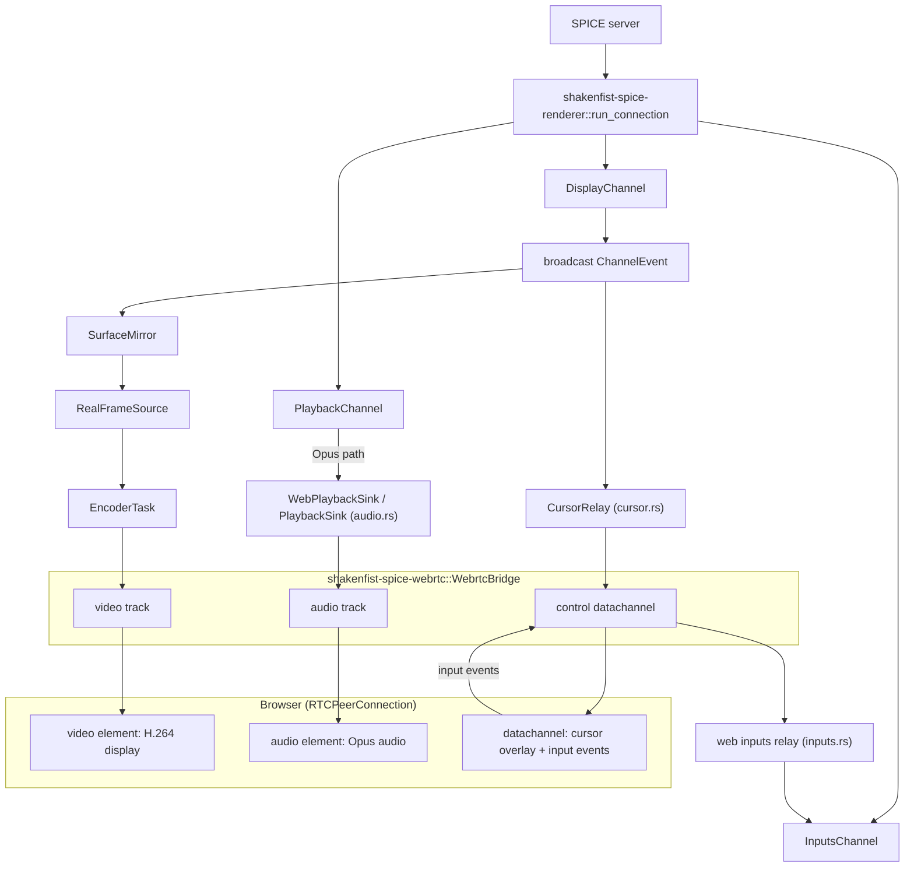

# Web mode internals

How `ryll --web` turns a live SPICE session into something a browser can
consume: the H.264 encoder pipeline, the WebRTC bridge, the four real-data
relays that connect them to the SPICE channels, and the lifecycle and
packaging concerns around them.

This is the developer-facing companion to the
[`--web` operator guide](/components/ryll/web-frontend/), which covers running the thing.
See [Architecture](https://github.com/shakenfist/ryll/blob/develop/ARCHITECTURE.md) for where these crates sit overall.

## Why it is shaped this way

The reasons below were settled when the mode was planned (May 2026)
and each still constrains the code. The plan that recorded them is
retired; [the plans index](/components/ryll/plans/index/) links its final text.

### Why a WebRTC transcoder rather than a browser SPICE client

The mode exists so a desktop can be reached from any browser without
a third-party stack in the way (the operator ran Kasm Workspaces,
which transcodes RDP through Apache Guacamole). Four ways to get
there were weighed:

- **Guacamole.** It speaks RDP, VNC, SSH, telnet and Kubernetes
  consoles but not SPICE, and had no upstream interest in adding it
  when this was assessed. Adding SPICE means a new protocol module in
  Java for the `guacd` daemon: roughly the scope of this mode, in a
  stack the operator did not otherwise run.
- **spice-html5.** The existing JavaScript SPICE client implemented
  only a subset of the protocol when assessed: no audio or Opus, LZ4,
  QUIC or modern draw operations such as `DRAW_COMPOSITE`, marginal
  cursor handling, no USB redirection. Bringing it to parity would
  reimplement in JavaScript what the renderer already does in Rust,
  and still run the heavy decode inside a browser tab.
- **VNC.** noVNC is mature, but VNC has no audio, USB redirection or
  shared folders, and the desktops already speak SPICE.
- **RDP via xrdp.** This was the path being replaced. Using SPICE end
  to end, so ryll's own stack drives the whole session, was the
  point.

So the renderer decodes once, in Rust, and the browser is sent a
video stream. WebRTC carries it because it is the one primitive that
gives low-latency video, low-latency audio and a low-latency return
path for input (the control datachannel) together. The deployment
assumed was a trusted LAN or VPN, where host candidates suffice;
`--web-ice-server` takes STUN or TURN URLs for anything else.

### Why H.264 through openh264, and what was checked first

openh264 was already in the tree for `--capture`, so the encoder
reused a known lifecycle rather than adding a codec. The choice was
tested *before* the transport was built on it, because a codec the
RTP payloader cannot packetise would have invalidated the encoder:
`shakenfist-spice-renderer/tests/webrtc_h264_smoke.rs` feeds the
encoder's Annex-B output through webrtc-rs's `H264Payloader` and
asserts it is accepted, with SPS and PPS bundled into a STAP-A packet
ahead of the IDR slice (RFC 6184). VP8 through `vpx-encode` was the
fallback had that failed; it did not, and no VP8 path exists. A
browser that negotiates no H.264 is
[#311](https://github.com/shakenfist/ryll/issues/311).

### Encode in the same process, on a dirty-driven clock

Encoder and transport share one process, so the encoder reads the
framebuffer from the session's `SurfaceMirror` directly instead of
across a socket. Multi-tenancy (one encoder feeding many transports)
was not a goal, and nothing in the code assumes it.

Frame pacing is a 30 fps cap with encode-on-dirty: a tick with no
dirty surface produces no frame, a keyframe is forced on first attach
and on reconnect, and a tick that overruns its budget skips the next
one rather than catching up. "Dirty" is the whole-surface flag; the
encoder re-encodes the primary surface rather than a damaged region.
The renderer now tracks damage per rectangle (`DamageRegion`, which
the RDP frontend consumes), but nothing measured a gain from feeding
it to openh264, which already codes unchanged areas cheaply as
P-frames.

The planning estimate was that a 1080p30 openh264 encode costs about
half a core under load, with hardware encoders (NVENC, QSV, VAAPI) the
answer if that proved too much rather than a cleverer software
encoder. That figure was an estimate, not a measurement; no hardware
encoder exists.

### One encoder and one bridge per viewer

`POST /offer` replaces the existing bridge, stops the encoder and
starts a new one (`EncoderInfra::restart`), so a viewer always gets a
fresh SPS/PPS and an IDR with no encoder state carried across. The
alternative was one long-lived encoder writing to a
`tokio::sync::broadcast` channel with each bridge subscribing, which
would avoid the restart on reconnect but needs a broadcast stage and
a harder-to-test state machine; it was rejected for a single-viewer
mode and is the shape to reach for first if multi-viewer ever lands.

The order inside `post_offer` is part of the design: close the old
bridge *before* restarting the encoder. The old bridge's video pump
holds the receiving end of the frame channel, and the encoder task
exits when that receiver is dropped, so restarting first would wait
on a task the old bridge is keeping alive. `restart` reads the
primary surface's size first and fails with a 503 if there is none
yet, so a browser that arrives before SPICE session-init finishes
retries instead of disturbing a working pipeline. The primary
surface is `(channel 0, surface 0)` where present, else the
lowest-keyed surface; the browser gets one video track, and
multi-monitor means one track per surface.

### The signalling server

The server is plain axum, embedded: the shell is `include_str!`-ed
into the binary so there is no directory to ship beside it.

- **Token.** A random 32-byte token, hex-encoded, is generated at
  launch and required as `?token=` on every route, compared in
  constant time. It is printed to stdout, so a service's journal is
  where the operator finds it; structured logs carry only an
  eight-character prefix, so the token does not reach a log
  pipeline. `index.html` substitutes it into the subresource URLs,
  since a browser does not carry a page's query string to the
  script and stylesheet it loads. It is stable for the process's
  life and does not rotate on reconnect.
- **Rate limit.** At most one accepted offer per second, answered
  with 429. Every offer builds a peer connection and a UDP socket per
  interface address, so the token alone is not enough to bound what a
  client can make the host allocate. An offer that fails after its
  bridge exists closes that bridge before returning, because on
  webrtc-rs 0.20 dropping one detaches the driver rather than
  stopping it, and a client posting malformed SDP in a loop would
  otherwise accumulate sockets and tasks.
- **Plain HTTP by default.** The browser only *receives* media, and
  `RTCPeerConnection`, keyboard and pointer events all work in
  non-secure contexts, so the default needs no certificate. The cost
  is features that demand a secure context: the async clipboard API,
  and Pointer Lock on Chrome (Firefox did not require one when this
  was planned; that was not re-verified). Pointer Lock is what would
  end server-mode pointer drift (see the web frontend guide's
  troubleshooting). Neither is implemented; native TLS (below)
  removes the obstacle without making either mandatory.

### The browser owns its keyboard table

The browser maps `KeyboardEvent.code` to an AT scancode itself and
sends the scancode over the control datachannel; the Rust side relays
it. This is deliberately *not* an extension of the renderer's
`char_to_scancode()`, which maps characters for paste-as-keystrokes
and answers a different question. `app.js`'s table is a hand-written
port of `scancode_for_logical_key` in the renderer's `inputs.rs`,
kept in the same order so changes replay, and nothing generates it or
checks it against the Rust table
([#792](https://github.com/shakenfist/ryll/issues/792)). Extended keys are
written in logical form with the `0xE0` prefix in the high byte (Up
arrow is `0xE048`) and converted to wire form by `make_scancode()`; a
page that encoded wire values itself once left every extended key
dead.

The pointer travels as coordinates normalised to the video's rendered
area, corrected for letterboxing from `videoWidth`/`videoHeight`
rather than the element's bounding rect, and denormalised against the
primary surface on the Rust side. The cursor is a datachannel-driven
`` overlay rather than part of the video, so its latency is the
datachannel's round trip and not the encoder pipeline's.

### The substrate is a library and each frontend adapts to it

Web mode could only exist because the SPICE substrate was extracted
from the `ryll` binary into `shakenfist-spice-renderer`, so that the
web frontend is a third consumer of one library rather than a second
copy of the channel handlers. Four choices made that extraction
work, and each is a constraint on code that touches it now:

- **Pixels and textures are split, with no trait between them.**
  `DisplaySurface` exposes pixels and a dirty flag, and each frontend
  builds its own representation: the GUI's `TextureCache`
  (`ryll/src/display_gui.rs`) for egui, the H.264 encoder's input for
  web. A `TextureSink` trait the renderer calls was weighed and
  rejected as indirection over three concrete consumers that each
  want something different.
- **Keys pivot through a neutral type.** `LogicalKey` and
  `scancode_for_logical_key` are the renderer's; the egui frontend
  adapts `egui::Key` to them in `ryll/src/input_egui.rs`. The point
  was a typed midpoint for every frontend, not only the removal of an
  `egui` import.
- **Host-side concerns are injected, not reached for.** Channel
  handlers had coupled to seven ryll-side modules (the byte counter,
  the bug-report traffic buffers, capture, the notification store,
  the verbose-logging flag, and the USB and WebDAV backends). The
  renderer is meant to be published for a SPICE client that wants
  none of the bug-report writer, capture pipeline or notification
  store, so each became a trait the host supplies (the table in
  [Architecture](https://github.com/shakenfist/ryll/blob/develop/ARCHITECTURE.md))
  or plain plumbing the renderer owns. Dynamic dispatch on the
  per-byte path was accepted without profiling; a generic parameter
  is the fallback if it ever shows up.
- **A second delivery mechanism gets a second crate.**
  `shakenfist-spice-webrtc` is separate from the renderer for the
  reasons given under the WebRTC bridge below.

## Encoder module

`shakenfist-spice-renderer/src/encoder/` is the live H.264 encoder
pipeline.

### `H264Encoder`

The renderer's `H264Encoder` adapts the H.264 encoder in
`shakenfist-spice-compression` (its `encode` feature), which a
SPICE server can use without the renderer. The adapter takes an
RGBA pixel buffer and returns Annex-B framed NAL units (each NAL
prefixed with the 4-byte start code `00 00 00 01`) as an
`EncodedFrame`. Every IDR frame is accompanied by SPS (NAL type 7)
and PPS (NAL type 8) NALs so keyframes are self-contained.
Even-dimension constraint: width and height are rounded down to
even numbers before encoding, via the shared `even_dimensions()`
helper that every producer of a size the encoder will see uses. The
`force_keyframe: bool` parameter to `encode()` makes the frame an
IDR. A frame openh264 skips to hold its bitrate comes back with no
NAL units.

`encode()` demands a buffer of exactly the encoder's (rounded)
size. `encode_cropped()` takes the *source* size instead and
discards the last row and/or column to reach it, at no cost: the
RGB-to-YUV conversion reads the kept pixels of each row in place.
Odd surfaces are ordinary: the browser asks the guest for
`Math.round()` of a CSS viewport and X grants odd modes.

Bitrate is not openh264's default. That default is a flat
120 kbit/s regardless of resolution, which is a webcam-era number
that renders a desktop unreadable. `H264Encoder::new` derives a
target from surface area and frame rate instead
(`target_bitrate_bps`, ~2.4 Mbit/s at 1024x768@30), clamped to
1–20 Mbit/s, and encodes it as `H264Content::Screen`, openh264's
`ScreenContentRealTime` usage. The
quantiser range is set to 12–51 explicitly, because openh264
silently narrows its default 0–51 to 26–35 for screen content,
which makes most targets unreachable. Frames are one slice each,
since browsers have not been tried with more. Rate control is openh264's
quality mode with frame skipping on, as it always was here; a SPICE
server using the compression crate's encoder directly gets bitrate
mode and can change the bitrate and frame rate live. A server
streaming a moving picture should choose `H264Content::Video`
(`CameraVideoRealTime`): in bitrate mode, screen content keeps
P-frames at the bottom of the QP range and holds the target only by
skipping frames, which turns a 25 fps video into about 7 fps. The
numbers are on `H264Content` in
`shakenfist-spice-compression/src/encode/h264.rs`.
The derivation is **open-loop**: nothing feeds the receiver's
bandwidth estimate (REMB/TWCC) back into the encoder, because
`EncoderControl` carries only keyframe and stop. On a constrained
link the encoder overshoots the path and the browser sees loss
rather than a softer picture.

### `EncoderTask`

Async driver that lives on tokio's blocking pool (openh264 is a
synchronous C library; `spawn_blocking` keeps it off the async
executor). The task loop:

- Ticks at a configurable FPS cap (default 30; period ≈ 33 333 µs).
- On each tick, calls `source.next_frame()`. If `Some`, encodes
  and sends `EncodedFrame` on the output channel. If `None`,
  skips the tick — no idle frames are produced.
- Handles `EncoderControl::RequestKeyframe` by setting a
  `keyframe_pending` flag consumed on the next encode.
- Handles `EncoderControl::Stop` by breaking the loop.
- Stops when the output channel's receiver has been dropped,
  checked at the top of every tick rather than discovered by a
  failed send. On a static screen there may be no further send,
  and a blocking-pool task that never returns also stops its
  runtime from shutting down, because dropping a runtime waits
  for its blocking tasks. That is how a test that left its
  encoder running hung CI for six hours at a time
  ([#330](https://github.com/shakenfist/ryll/issues/330)).
- Rebuilds the encoder when the frame's *rounded* size stops
  matching the encoder's, and forces an IDR so the decoder gets
  fresh SPS/PPS. This is how a mid-session guest resize is
  survived: the encoder is built for one size and rejects any
  other, and nothing restarts this task, so without the rebuild
  the first frame after a resize froze the viewer's video until
  it renegotiated. Comparing *rounded* sizes matters — an odd
  surface never compares equal to the encoder's rounded-down
  dimensions, which made every frame look like a resize.
- Tolerates up to `MAX_CONSECUTIVE_ERRORS` failed frames in a
  row before returning `Err`, for the same reason: one bad frame
  should not end the session's video.

### `FrameSource` and `FrameRef`

`FrameSource` is a trait that decouples the encoder from how
pixels arrive. The implementing type handles dirty tracking and
synchronisation with concurrent display-channel writers. It
returns `Option<FrameRef<'_>>` where `FrameRef` carries width,
height, RGBA bytes, and a `timestamp_us` used to derive RTP
timestamps. `SyntheticFrameSource` is a test/CI source that
generates animated gradient frames.

## WebRTC bridge (`shakenfist-spice-webrtc`)

`shakenfist-spice-webrtc` is a separate crate (not part of the
renderer) because the webrtc-rs dependency tree (DTLS, SRTP,
ICE, SCTP, STUN) is heavy and not all SPICE-client consumers
need it. The renderer stays a pure SPICE substrate; the bridge
is one specific delivery mechanism.

### `WebrtcBridge`

Wraps an `Arc<dyn PeerConnection>` (webrtc-rs 0.20's builder
hands back an unnameable `impl PeerConnection`, so the bridge
stores it behind the trait object) and owns:

- A video `TrackLocalStaticRTP` (H.264, 90 kHz clock rate).
- An audio `TrackLocalStaticRTP` (Opus, 48 kHz clock rate).
- A "control" datachannel (`Arc<dyn DataChannel>`, ordered +
  reliable — 0.20 has no `RTCDataChannel` user type).
- An `mpsc::Sender<EncoderControl>` to request keyframes.

Construction via `WebrtcBridge::new(WebrtcBridgeConfig)`: builds
a `MediaEngine` and registers H.264 and Opus codecs, enumerates
the host's bindable UDP addresses (`bind_addrs::host_udp_bind_addrs`;
see the UDP bind addresses subsection below), then builds the peer
connection through `PeerConnectionBuilder`, supplying the media
engine, the interceptor registry, the UDP addresses, and — the one
mandatory builder call, `build()` errors without it — a single
`BridgeHandler` wrapping one `BridgeEvents` struct. Only after the
peer connection exists does `new` create both tracks (with explicit
SSRC and codec `codings`) and add them, then create the control
datachannel and spawn a task that pumps its events into
`BridgeEvents::on_control_message`.

The `MediaEngine` carries only what the pumps can send: one H.264
entry (packetization mode 1, profile `42e01f`, the baseline profile
openh264 emits) and one Opus entry — not webrtc-rs's
`register_default_codecs`, which would have the answer advertise
VP8, VP9, AV1, HEVC, RTX and three legacy audio codecs the bridge
never sends. One H.264 entry serves every browser because `rtc`
falls back to a mime-type-only match when the fmtp lines differ, so
Chrome's `42001f` offer and Firefox's `42e01f` offer both match it.
No RTCP feedback is registered with the codecs; the `nack`,
`nack pli` and `transport-cc` the answer carries come from the
interceptor registry, which is where the implementations are.

A viewer that offers no H.264 at all still gets a session. After
setting the remote description `accept_offer` checks whether video
negotiated, and if not withdraws the video track, so the answer
rejects the video m-line (`m=video 0`, RFC 9429 §5.3.1) while audio,
input, the cursor and the control channel carry on. The page is told
why the picture is missing by the no-video notice in the hello
handshake below.

`BridgeEvents` holds the shared state and the callback bodies;
`BridgeHandler` is a thin newtype around `Arc<BridgeEvents>`
implementing 0.20's `PeerConnectionEventHandler` trait, which
replaces 0.17's four separate callback registrations with one
object supplied to the builder *before* the peer connection
exists. Every method on it is awaited inline by the peer
connection's driver event loop, so none of them may block — see
the WebRTC conventions section of AGENTS.md. `BridgeHandler`
implements three methods: `on_connection_state_change` and
`on_ice_gathering_state_change` delegate straight to
`BridgeEvents`; `on_data_channel` (fired when the remote peer
opens a datachannel — see the Control datachannel section below
for when that actually happens) spawns another pump task for that
channel rather than looping inline. Both the control DC's own pump
and any spawned from `on_data_channel` share one `JoinHandle` list
so `WebrtcBridge::close` can abort whichever pumps are still
running after `pc.close()`.

The state-change handler shadows the latest
`RTCPeerConnectionState` in a `Mutex` (the inherent accessor does
not survive the 0.20 port — there is no replacement on the trait
or the core) and raises the sticky `dead` signal on the first
terminal transition. The gathering handler raises the sticky
`gathered` signal on `Complete`. Both signals are
`StickySignal`s (`sticky.rs`): a `Notify` + sticky `AtomicBool`
pair giving level-triggered, raise-exactly-once semantics — see
the WebRTC conventions section of AGENTS.md for why a bare
`Notify` is not safe here.

`WebrtcBridgeConfig` carries the ICE server list (empty for
LAN-only use, populated by `--web-ice-server`), the UDP bind
policy described below, and the `EncoderControl` sender.

#### UDP bind addresses

webrtc-rs 0.17 bound its own sockets and enumerated the host's
interfaces internally; 0.20 inverts that — the caller binds the
sockets and hands the bound addresses to
`PeerConnectionBuilder::with_udp_addrs`, and those addresses are
the *only* input to ICE host-candidate generation. Binding the
obvious placeholder, `0.0.0.0:0`, succeeds and then produces a
literal `a=candidate:... 0.0.0.0 ...` in the answer SDP, which
every browser discards — and is invisible to the in-process test
suite, since two Rust peers on one host agree about the bogus
address and connect happily.
`shakenfist-spice-webrtc/src/bind_addrs.rs` reproduces what 0.17
did internally, as a `UdpBindPolicy` the bridge resolves. With no
selectors — the default, and what `host_udp_bind_addrs()` is — it
enumerates the host's network interface addresses via the
`if-addrs` crate and returns one ephemeral-port `SocketAddr` per
address, skipping loopback, unspecified, and IPv6 link-local
addresses. `--web-media-addr` fills the selectors with addresses
or interface names, and `--web-media-port` replaces the ephemeral
port.

The module splits its exclusions into two kinds, and the split is
what the configuration surface means:

- *Policy* — loopback, and everything not filtered at all (RFC
  1918, IPv4 link-local, IPv6 ULA). Defaults about what is worth
  advertising, overridden by naming addresses explicitly. This is
  what makes `--web-media-addr 127.0.0.1` a supported
  loopback-only deployment.
- *Mechanism* — unspecified (`0.0.0.0`, `::`) and zoneless
  `fe80::/10`. A `SocketAddr` cannot represent either in a way ICE
  can use, so `UdpBindPolicy::validate` refuses them at startup
  and no flag re-enables them.

The policy is resolved on every `WebrtcBridge::new` rather than
once per process, so a session that outlives a DHCP lease or a
VPN coming up binds what exists when the viewer arrives.
`WebrtcBridge::new` rejects an empty result rather than building
a peer connection that could only ever offer unroutable
candidates, and distinguishes the two empty cases: nothing
bindable on this host, versus nothing matching the configured
selectors. All of this is independent of the `--web-host` flag,
which only controls the HTTP/HTTPS signalling listener; see the
reverse-proxy callout in the
[web frontend guide](/components/ryll/web-frontend/) for the operator-facing
consequences.

### SDP flow

`accept_offer(sdp: String) -> Result<String>` is the single SDP
entry point for the HTTP `/offer` handler. It:

1. Sets the remote description (browser's offer).
2. Creates an answer.
3. Sets the local description.
4. Waits for ICE gathering to complete, by awaiting the sticky
   `gathered` signal raised by `BridgeEvents` (webrtc-rs 0.17's
   `gathering_complete_promise()` does not exist in 0.20). The wait
   is bounded by `GATHER_TIMEOUT` (20 s) and fails with a message
   saying how many candidates the local description had reached,
   because this wait is on the request path: unbounded, a gathering
   that never completed parked the `POST /offer` request, and the
   encoder restarted for it, for the life of the process. The
   error is a `GatheringTimeout`, and the handler answers
   `504 Gateway Timeout` on that type rather than the `400` an
   unusable offer gets. It decides on the type rather than the
   message because the other failures quote the SDP parser on the
   browser's offer.
5. Returns the fully-resolved answer SDP.

ICE gathering completion is awaited so the answer already
contains all host candidates — trickle ICE is not needed for
LAN-only use. Because the gathering signal is sticky and
never resets, a `WebrtcBridge` handles exactly one offer/answer
exchange; renegotiation requires a new bridge, and the web
frontend constructs one per `POST /offer`.

### Video pump

`spawn_video_pump(rx: mpsc::Receiver<EncodedFrame>)` drives the
video track:

- Consumes `EncodedFrame`s from the encoder output channel.
- Strips Annex-B start codes from each NAL.
- Payloads raw NALs via `H264Payloader` (from
  `rtc::rtp::codec::h264` — the sans-io core's payloader, not the
  abandoned standalone `rtp` crate; see the webrtc entry in
  the [development guide](/components/ryll/development/)'s dependency list).
- Sets the `marker` bit on the last RTP packet of each access unit
  (per RFC 6184 §5.1 — decoder pacing depends on this).
- Derives RTP timestamps from `EncodedFrame::timestamp_us` at
  90 kHz: `rtp_ts = (timestamp_us × 90_000) / 1_000_000`.
- Sequence numbers increment via `wrapping_add`.

SPS/PPS NALs produce empty payload sets (the `H264Payloader`
caches them and bundles them as STAP-A with the next IDR slice);
the pump skips empty sets cleanly.

### Control datachannel

Ordered + reliable, labelled "control". It carries ping/pong for
smoke testing, input events (scancodes, pointer coordinates), and
cursor overlay updates. `send_control(&[u8])` and `control_rx()`
are the public API.

The channel is negotiated **out of band**: both ends create their
own end on a fixed SCTP stream id — `CONTROL_DC_STREAM_ID` in
`shakenfist-spice-webrtc/src/bridge.rs`, and the matching
`negotiated: true` and `id:` in `ryll/src/web/assets/app.js`, which
is the one place that value is true. Neither
side announces the channel in band, so no DCEP open is sent, no
`ondatachannel` fires, and both ends address the same stream by
construction. The remote peer's messages surface on our *own*
`control_dc`, pumped as `"local-dc"`.

In-band negotiation would not do. RFC 8832 §6 ties an in-band
stream id to the DTLS role — even ids from the client, odd from the
server — so a channel opened in band by each side is *two* channels
on two streams, and each end has to notice and adopt the other's.
Pinning the id removes that question entirely, along with any
dependence on which end won the DTLS role negotiation. It also
removes a real hazard: webrtc-rs before 0.20.4 assigned every
pre-negotiation channel stream 1 regardless of role, which made the
two ends collide onto one stream and appear to work; 0.20.4 fixed
the assignment, and anything relying on that collision broke.

The `on_data_channel` path (pumped as `"remote-dc"`) is therefore
dead in normal operation. What is left for it is a datachannel the
peer opens in band, which ryll's own client never does — and which
would need a different stream id if it ever did. Parity does not
constrain an externally negotiated id, but collision does:
in-band allocation on the DTLS client's side starts at 0 and counts
up in evens, and the bridge is the DTLS client here — the browser
offers `a=setup:actpass` and webrtc-rs, answering, picks `active`,
which `bridge_answers_as_dtls_client` asserts against the answer
SDP. `CONTROL_DC_STREAM_ID` sits inside that range, so the next
`create_data_channel` added to the bridge lands on top of the
control channel. Anything that starts opening channels in band has
to keep clear of `CONTROL_DC_STREAM_ID`, or that constant has to
move, and `app.js`'s `id:` with it.

`send_control` writes *binary* frames, so `app.js` sets
`dc.binaryType = 'arraybuffer'` explicitly. The W3C default is
`'blob'`, and a Blob fails the synchronous `TextDecoder` decode in
`onmessage`, where the surrounding `catch` swallows it. Chromium has
always defaulted to `'arraybuffer'` in defiance of the spec, so
omitting the line works there and drops every server-to-browser
control message in Firefox — mouse mode, cursor shape, cursor
position, `no-video-codec` — with nothing in either log to say so.

Because the pairing is one number agreed in two languages, no
runtime check can catch a drift between them — the Rust tests use
`CONTROL_DC_STREAM_ID` on both ends and would stay green. The
`app_js_pins_control_channel_pairing` test in
`ryll/src/web/server.rs` asserts that the served `app.js` still
carries `negotiated: true`, `ordered: true`,
`dc.binaryType = 'arraybuffer'`, and the id and label the constants
name, so a JS-side edit that breaks the pairing fails there rather
than in production.

The other half — that the *stack* still honours the request — cannot
be asserted directly, because `webrtc`'s `DataChannel` trait exposes
only an internal handle and never gained the `stream_id()` accessor
`rtc::RTCDataChannel` has. It is caught behaviourally instead:
`loopback_video_audio_datachannel` fails on the ping/pong, because a
stack that ignored `negotiated` would put the two ends on different
streams. Since a bare round-trip timeout says nothing about why, the
test also installs an `on_data_channel` hook — an in-band channel
announces itself with a DCEP open, so the hook firing names the cause
in the failure message, and is asserted never to fire.

#### Message framing

`send_control(&[u8])` writes bytes, so every control message the
browser receives is a *binary* frame. `RTCDataChannel.binaryType`
defaults to `"blob"` per the W3C specification, and
`TextDecoder.decode` cannot take a `Blob` — it throws, `onmessage`
catches, and the message is discarded with a console warning.
`app.js` therefore sets `dc.binaryType = 'arraybuffer'` explicitly
at channel creation.

This is not belt-and-braces. Chromium defaults the property to
`"arraybuffer"` rather than `"blob"`, which is why the omission
went unnoticed; Firefox follows the specification, and every
control message the server sent was silently dropped for the life
of every Firefox session — no mouse mode, no cursor shape or
position, no no-video notice. See ryll#348.

#### The hello handshake

The browser sends `{"type":"hello"}` as soon as its end of the
control channel opens, and the server answers with the current
mouse mode — plus a no-video notice, if that viewer negotiated no
codec we can send (its answer rejected the video m-line; see
`WebrtcBridge` above). The server cannot push either unprompted: it
learned the mouse mode from SPICE session-init, seconds before the
page loaded, and `send_control` drops anything written before the
channel is open.

**The hello is retried until it is answered**, on the backoff in
`HELLO_BACKOFFS_MS` (200 ms doubling to 3.2 s, five attempts). It
has to be, because the first message written after `onopen` can be
dropped by the far end without any indication. `onopen` reports
this end's readiness, not the peer's; webrtc-rs creates its side of
the channel separately and has no `data_channel` to hand a message
to until the SCTP connected procedure has dialled it. A message
arriving in that window is refused with `ErrDataChannelNotExisted`
and discarded — not buffered, not NACKed, and invisible from the
browser, which sees an open channel and a server that never
replies.

Left unretried that costs the whole session: the viewer keeps
`app.js`'s default mouse mode rather than the negotiated one, and a
viewer with no common video codec is never told why the picture is
missing. `hello` is idempotent on the server — it reads the current
mode and replies — so a duplicate that crosses a reply in flight
costs one extra `mouse-mode` message and nothing else. The first
viewport rides along with each attempt, since it was written in the
same breath as the first hello and is lost in the same window.

Receipt of a `mouse-mode` message cancels the retry. That is the
right signal rather than "any inbound message": the server also
pushes `mouse-mode` unprompted when the mode changes mid-session,
and either way its arrival means the answer is here. See ryll#347.

`spawn_synthetic_audio_pump()` remains available for testing
without a SPICE server: it emits a 440 Hz sine wave encoded as
Opus at 50 fps (20 ms per frame, 960 samples at 48 kHz), through
the same `TrackLocalStaticRTP` consumer interface the real audio
path uses.

### Keyframe-on-attach

The bridge sends `EncoderControl::RequestKeyframe` when the peer
connection transitions to the `Connected` state, so the first
frame the browser sees is always a full IDR. There is currently
no RTCP PLI (Picture Loss Indication) handler requesting a
keyframe on a viewer-initiated refresh: `bridge.rs` registers no
`on_rtcp_packet`-equivalent handling, so a browser that loses the
IDR has no way to ask for another one and must reconnect. The
WebRTC bring-up explicitly allowed stubbing this. Routing an
incoming PLI to `EncoderControl::RequestKeyframe` would close the
gap, and is tracked as [#789](https://github.com/shakenfist/ryll/issues/789).

### webrtc-rs convention: handler methods must never block

This is the normative statement of the rule; `AGENTS.md`
carries a summary of it.

webrtc-rs 0.20 replaced the per-object callback registrations
(`on_peer_connection_state_change`, `on_track`,
`on_data_channel`, `on_message`, ...) with one
`PeerConnectionEventHandler` supplied to the builder before the
peer connection exists, and the driver event loop awaits every
method on it inline. A handler method that loops (like a
datachannel or track read loop) or blocks on a slow consumer
therefore stalls the whole connection, not just the event it is
handling. That is stricter than pre-0.20, where only `on_track`
firings were serialised on each other.

So anything that needs to *loop* must `tokio::spawn` and return
immediately, and anything that needs to hand off from inside a
handler method must use `try_send`, never `send().await`, so
that a full channel degrades to a dropped message rather than
stalling the driver.

`bridge.rs` has no `on_track` implementation — the bridge only
sends media, it does not receive any — but the same rule is why
`on_data_channel` spawns a pump task instead of polling inline,
and why `BridgeEvents::on_state_change` uses `try_send` rather
than `send().await`.

The rule follows the dispatch path, not the type. Only the
methods reached from `BridgeHandler` run inline.
`on_control_message` lives on the same struct but is called from
the spawned `run_dc_pump` loops, so awaiting there parks one
datachannel's poll loop and nothing else — which is why it
awaits. That is the right trade for an ordered, reliable channel
carrying input: back-pressure onto SCTP costs latency, whereas a
dropped key-up leaves a modifier stuck down in the guest and
never gets redelivered. Applying "never block" to
`on_control_message` cost real input events before it was
caught, so check where a function is actually *called from*
before applying the rule to it.

### Decisions behind the webrtc-rs 0.20 port

The bridge moved from webrtc-rs 0.17 to 0.20, a re-homing of the
crate onto the sans-io `rtc` core, and the shape above is the
result. These are the choices that are not obvious from the code,
and what was checked before making them. The upstream citations are
into the published `webrtc` and `rtc` sources, so they can be
re-checked against whichever release the lockfile now holds.

#### Dependencies and tooling

- **The floor is a release that behaves.** The port targeted a
  declared floor rather than `=`, so patch updates still flow. The
  first 0.20 release had a driver hot loop on a non-advancing
  timeout; the next fixed it, and the one after stopped scheduling
  ICE checks in terminal states, which is the path the reaper and
  `tests/lifecycle.rs` walk. A soak against a release with a known
  CPU-burn bug would have measured the bug. The alpha of the next
  line carried a fix worth having, but its headline was a
  deliberate reshaping of the public API, and porting onto that
  during a port was the wrong trade. The floor and the reason for it
  live in `shakenfist-spice-webrtc/Cargo.toml`.
- **`rtc` is a direct dependency, not an aliased `rtc-rtp`.**
  `write_rtp` takes an `rtc::rtp::Packet`, so the packet type has to
  be the one `webrtc` expects. `webrtc` pins `rtc` to an exact
  patch, so naming `rtc` at the same version guarantees that by
  construction; aliasing the RTP crate would keep the old `rtp::`
  prefixes at the price of a second version to keep aligned by hand,
  which is the class of mistake behind issue #215. The standalone
  `rtp` crate is a dead line: its last release predates `rtc`, and a
  `Packet` from it is a different type, not an older one.
- **No webrtc rule in `renovate.json`.** The patch-disable rule
  existed because sibling crates could resolve to inconsistent
  patches (#215). On 0.20 `webrtc` requires `rtc` at an exact patch
  and `rtc` requires each of its sibling crates at that same patch,
  so cargo cannot resolve the inconsistent set. Both the version
  ceiling and the patch rule went with the port.
- **No rustls provider install in the webrtc crate.** `rtc-dtls`
  selects its crypto provider from its own cargo features and passes
  it explicitly, never reading the process default, so the old
  coupling of our rustls version to webrtc's, and the
  `install_default()` call in every test, are gone. ryll's own
  rustls dependency and its two installs stay: they serve SPICE TLS
  and `axum-server`, and `aws-lc-rs` still reaches ryll's graph via
  `reqwest`. A rustls advisory is now a lockfile bump rather than a
  forced port.
- **The renderer's H.264 smoke test still uses the dead `rtp`
  crate.** It is a dev-dependency with no type coupling to
  `shakenfist-spice-webrtc`, so it did not have to move with the
  port, and moving it would have widened an already atomic diff. The
  cost is that it exercises a payloader the bridge no longer ships;
  its comment in `shakenfist-spice-renderer/Cargo.toml` says so.
- **The `rtc` stack is an accepted risk.** The port swapped a mature
  DTLS/SRTP/SCTP/STUN tree for a sans-io reimplementation, parsing
  untrusted input from every address the host binds. The alternative
  was strictly worse, since the old line is abandoned and will not be
  fixed. It is recorded as a watch item for the weekly `cargo audit`
  in the supply-chain plan.

#### What the test suite cannot see

Two Rust peers on one host agree about any address, so a build that
advertises `0.0.0.0` or a loopback-only candidate set passes
`tests/loopback.rs` and `tests/lifecycle.rs` and reaches no browser.
The same blind spot hid other defects of the port, each found only
by reading or by a real browser session:

- `write_rtp` validates the RTP header instead of rewriting it (next
  subsection), which a loopback test with a permissive receiver does
  not notice.
- The RTX advertisement (below) is something only a real browser can
  act on.

So the automated checks are layered, and a change to the bind
address, the SDP, or the pumps is not done until a browser has
reached a real guest through `--web`: video, keyboard, mouse, cursor,
resize, and audio **by ear**, because `playback: MODE: 3` proves only
that Opus was negotiated. On top of the unit tests, `accept_offer`'s
answer is asserted to carry at least one candidate and none with an
unspecified address, and the gathering-count invariant is checked
over 20 rounds by `RYLL_GATHERING_SOAK=1 make test`. That soak is off
by default because host interface churn makes it flaky in the
failing direction; it passed with the variable confirmed to reach the
devcontainer (the crate's suite runs in about ten seconds with it,
two without, which is how to tell it did not silently fall back to
its three-iteration default).

There is one shared client-side peer, `TestPeer`, behind the
`test-support` feature rather than a separate crate. It replaced four
hand-written copies of the same setup, which had agreed only by
convention, so a change to the offer path is made once. The accepted
cost is that its source ships in the crate's published tarball with
the feature off. `TestPeer` registers the same codecs as the bridge
and exposes no H.264 knob, because registering H.264 explicitly on
top of the defaults is unobservable (the default entry already
exists and the duplicate is dropped;
`register_h264_is_redundant_with_default_codecs` asserts the two
offers are byte-identical). A connection-state accessor does not
exist on 0.20 at all, so both `TestPeer` and the bridge shadow the
state in a `Mutex` fed by the state-change handler; the shadow is
asserted to start at `New` so the tests still genuinely wait.

#### Media: SSRCs, payload types and codecs

- **The bridge chooses both SSRCs and passes them to the pumps.**
  0.17 overwrote the packet's SSRC from the bind context. 0.20
  rejects a packet whose SSRC the track does not claim, and one whose
  payload type is not negotiated on that sender, with only a trace
  log inside the library; leaving the SSRC unset would have meant
  nothing knew the value and every packet was dropped, with a
  connected viewer on a blank screen. The two SSRCs are drawn
  distinct and non-zero, because the tracks are bundled onto one
  transport and RFC 8843 section 9.2 requires SSRCs unique across a
  bundle group. Local tracks are built from a whole `MediaStreamTrack`
  whose codings carry the SSRC and codec; an empty codings vector
  yields no codec preference, and a codec not in the `MediaEngine`
  fails `add_track`.
- **Payload types are read back from the negotiated senders.** The
  pumps do not stamp a constant. Negotiation maps each matching
  offered codec onto *our* payload number, and the media engine holds
  several H.264 entries at different profile-level-ids. A constant
  happened to be right for one Chromium release (102) and is wrong
  for the next (108 was observed in the soak) and for Firefox, which
  offers only `42e01f`. After `set_remote_description` the bridge
  resolves the types from the senders' parameters and publishes them
  to the pumps through an `Arc<AtomicU8>`; the pumps start before
  `accept_offer`, so the value does not exist when they do, and a
  sentinel distinguishes "not resolved yet" from "resolved to
  nothing". The value is read once per access unit, so a store cannot
  split one frame across two payload types. H.264 selection prefers
  `packetization-mode=1`, because the payloader emits FU-A
  fragments, which mode 0 cannot carry, and then prefers the
  baseline profile the encoder actually emits (openh264 is not given
  a profile and resolves to baseline). Opus has one entry and would
  be safe by luck, so it is resolved the same way rather than
  trusted.
- **No common video codec is a state, not an error.** Negotiation
  with no H.264 resolves to nothing; see the development guide for
  the notice the viewer gets and the encoder being stopped.
- **The default codec set is kept, and its RTX advertisement is
  known.** `register_default_codecs` plus the explicit H.264 entry
  were left exactly as they were, because changing the codec strategy
  in the same change as the version bump would have made any
  negotiation difference unattributable. Against 0.17 the answer SDP
  gained an RTX payload type per video codec with
  `a=ssrc-group:FID` and a second video SSRC, plus a larger header
  extension set (`sdes:mid`, `rtp-stream-id`,
  `repaired-rtp-stream-id`, and transport-cc moved to id 4); lost
  `a=rtpmap:116 ulpfec` and `a=extmap-allow-mixed`; gained
  `a=msid-semantic:WMS *`; and its m-line payload order reversed.
  Everything else (profiles, `rtcp-fb` sets, bundle group,
  `setup:active`, `rtcp-mux`, `sendonly`) was byte-identical. The
  one that matters is RTX: the bridge names an RTX stream it never
  sends on, so a browser that loses a packet and NACKs gets silence,
  no worse than before in outcome but now entitled to expect more,
  and it costs an SSRC. Suppressing it means a bare `MediaEngine`
  registering only H.264 and Opus, and is a change with its own
  reasoning, not a port detail. The extension headers are
  advertisement only: the pumps stamp none, and `write_rtp` rejects
  any that were not negotiated. The default PT 102 entry also
  carries `profile-level-id=42001f` while the module doc and the
  explicit entry say `42e01f`; the encoder emits baseline, browsers
  tolerate the constraint-set difference, and 0.20 degrades a
  profile mismatch to a mime-type-only match, so it has never been an
  error.
- **Gathering completion was verified, not assumed.** On 0.20
  `local_description()` re-renders from the live ICE agent on every
  call, each candidate is pushed into the core before the completion
  sentinel, and the sentinel is what queues the `Complete` event. So
  awaiting the event and then reading the description gets every
  candidate (and `a=end-of-candidates`), non-trickle signalling is
  correct, and gathering only begins at `set_local_description()`,
  which makes the answer, set-local, await, read order required.
  `accept_offer` waits for gathering with no timeout. That is
  inherited unchanged from before the port and left alone, so the
  baseline comparison stayed attributable; a stalled gather therefore
  parks the `/offer` request.

#### Teardown on 0.20

Dropping a peer connection detaches its driver task and leaves its
UDP sockets bound; it does not stop them. Everything below follows.

- **A bridge must be closed, and `Drop` is a backstop.** `post_offer`
  closes and awaits a bridge it built but failed to install (a
  malformed offer) before returning the 400, because the offer
  cooldown bounds the rate of leaks, not their number. `WebrtcBridge`
  also has a `Drop` that aborts the pumps and spawns a best-effort
  close, since "forgot to close" is silent everywhere on 0.20; it
  logs and gives up outside a runtime. `new` closes the peer
  connection itself when anything after `build()` fails, through one
  fallible step, `attach_tracks_and_control_dc`.
- **`close()` aborts the pumps unconditionally, then records that it
  ran.** It closes the connection first so the pumps exit naturally
  rather than mid-message, but a close error must not skip the
  aborts, since those are the point. The `closed` flag that `Drop`
  checks is stored *after* the aborts: stored first, a `close()`
  future cancelled between the store and the aborts (an axum handler
  whose client disconnected, or the reaper aborted at shutdown)
  would leave `Drop` returning early and the backstop failing on
  exactly the path it exists for. Both cleanup steps are idempotent,
  so a cancelled `close()` falls through to `Drop` and a finished one
  skips it.
- **Neither of those two guards has a regression test, on purpose.**
  Failing `pc.close()` needs a fake `dyn PeerConnection` for the
  whole trait to exercise two lines; the cancellation window needs
  `pc.close()` to return `Pending` once, and measured in-process it
  completes on the first poll, so a test passed with the statements
  in either order. A test that cannot fail reads as coverage without
  being any, so the ordering is guarded by a comment at the store and
  by inspection. By the same token,
  `accept_offer_rejects_malformed_sdp` calls `close()` itself and so
  could never notice that production did not: a test that cleans up
  after the code under test cannot see that code failing to.
- **The reaper's replacement wake once reaped a live bridge.** The
  design is in the lifecycle section below. The first version of that
  arm tore a live bridge down moments after it connected, and it
  survived a green suite, `make web-smoke` and `make web-smoke-tls`;
  only reading the stored-permit behaviour found it.
- **A failed `/offer` leaves the encoder and audio pump running until
  the next offer.** The next successful offer restarts the encoder
  and replaces the Opus sender, so the cost is CPU until then, not
  growth. Factoring the reaper's teardown into a helper shared with
  the failure path is the right fix and has not been done.

#### The UDP bind configuration

The policy and its two kinds of exclusion are described above. What
was decided about the flags, and why:

- **Flags are validated at startup**, so a malformed address fails at
  launch and not at the first `POST /offer`. `--web-ice-server` is
  validated the same way, since an operator reaches for an ICE server
  precisely when host candidates already fail and a silently useless
  URL looks like WebRTC being broken.
- **An explicit address list overrides policy, not mechanism.**
  `--web-media-addr 127.0.0.1` is honoured, which is the loopback-only
  opt-in, without a fourth flag. `0.0.0.0` is refused with an error
  naming the unroutable-candidate consequence, even though an operator
  typing it means "all interfaces": that is already the default with
  no flag, and silently reinterpreting an address as a wildcard is how
  a deployment ends up advertising an interface its operator thought
  they had excluded. A malformed literal such as `fe80::1%eth0` is
  rejected rather than treated as an interface name; a single colon
  (`eth0:0`) is still a name.
- **A pinned port is fatal on conflict, with no fallback.** An
  operator pins a port because a firewall rule names it, and a silent
  fallback to an ephemeral port produces a bridge no browser outside
  the LAN can reach: the `0.0.0.0` failure again. The `build()` error
  names the port and the flag that chose it. The port and the address
  selector are separate flags so one port can bind across several
  addresses. Resolved addresses are deduplicated (an interface and one
  of its addresses, or an address on two interfaces), because with a
  pinned port the second bind of the same address and port would fail
  the whole peer connection; this also applies with no selectors.
- **ICE servers take bare URLs.** STUN and open TURN work; a TURN
  server needing a username and credential cannot be configured,
  because associating a credential pair with a URL is a flag-syntax
  question not answered yet.
- **The `--web-*` flags do not require `--web`**, matching
  `--web-host` and `--web-port`; tightening only the new ones would
  make them behave unlike their siblings.
- **The `WebrtcBridgeConfig` literal is a deliberate exception.**
  Tests build it through `WebrtcBridgeConfig::new` plus field
  assignment, so a new field costs one line, not twenty. The one
  production site, in `ryll/src/web/signalling.rs`, keeps an explicit
  literal so a reviewer sees every value it chooses.

#### What `--web` costs, measured

`tools/web-soak.sh` reproduces the sampler these numbers came from;
see the development guide. All runs: 20 minutes, the uefi-latency
guest at 1280x800, Chromium with a fresh profile, one QMP `sendkey`
every 30 s (a 5 s cadence is unusable: the guest's mode-set churn
outruns the stream's recovery, see Q5 in
[OPEN-QUESTIONS](/components/ryll/plans/OPEN-QUESTIONS/)), RSS and per-thread CPU
from `/proc` every 30 s, host busy% per sample so contamination from
a shared machine is in the record. The guest cycles through eight
colours of which one is black, so about 30 s of black every 4
minutes is the guest.

| Commit | webrtc | CPU, whole run | RSS start to end | RSS max |
|---|---|---|---|---|
| before the port merge | 0.17.1 | 0.96% of one core | 150 to 220 MB | 220 MB |
| the port merge | 0.20.2 | 0.98% | 145 to 201 MB | 201 MB |
| three phases later, run 1 | 0.20.3 | 1.83% | 158 to 235 MB | 235 MB |
| three phases later, run 2 | 0.20.3 | 1.95% | 161 to 221 MB | 225 MB |

The earlier 0.17 baseline, taken nine days before the later runs,
was 1.4% and 0.9% CPU and 154 to 215 MB and 161 to 197 MB RSS across
its two runs, with 8.3 to 10.4% mean host busy.

The conclusions that survive: memory climbs and then plateaus (one
run sat at exactly 235 MB for its last seven samples), so there is no
leak at this load; across the port itself CPU is unchanged (0.96%
against 0.98%, far below the 0.5 percentage points the first
baseline called run-to-run noise) and memory improved; and the later
rise to about 1.9% happened somewhere in the unrelated development
between the port and the tip, which the first comparison could not
tell apart from the port until the runs were bisected either side of
the merge. A comparison across a long gap of commits is a statement
about the tree, not about one dependency. The load is deliberately
near-idle, a floor-shape baseline rather than a stress result, with
one repaint every 30 s against the 0.2 to 50 Mbit/s seen in real
sessions. One pre-port run was discarded because host busy averaged
27.8% with two spikes to roughly 100%; reported runs sit at 8.9 to
11.7% mean.

Pump drops and reaper events were zero, observed in a separate short
`--verbose` session. The first baseline's rows for them were *not*
measurements: it recorded `RUST_LOG`, which ryll did not read at the
time, so both runs were at `INFO`, where the counters are not
emitted, and the zeros meant "nothing logged". (ryll honours
`RUST_LOG` now; the soak section of the development guide says how to
take the counters without perturbing the run, since `--verbose` at
`debug` for the whole tree logged about 250 times the rate, 3,620
lines in two minutes against 147 in twenty.)

#### Firefox and the second-codec question

ryll encodes H.264 only, because the encoder is shared with the GUI
path, so a browser that offers no H.264 gets no video. Firefox is that
browser: on Linux its `getCapabilities` lists four H.264 entries
while the offer it sends carries none (VP8, VP9, AV1, rtx, ulpfec,
red), identically headless or windowed, recvonly, or with the plugin
path forced, while Chromium offers H.264 at several payload types.
The OpenH264 plugin was on disk and its static checks all passed, and
`MOZ_LOG=GMP:5` showed no GMP process launched, so Firefox concludes
H.264 is unavailable before reaching the plugin. A later report had
Firefox on macOS with no video either.

The decision taken during the port was *not to add a second codec
then*: a second codec is a renderer project, and doing it during a
port's validation phase would have left a later video regression with
two candidate causes. The first framing, a plugin-loading problem on
one host, did not survive the macOS report: two hosts is Firefox not
offering H.264 for WebRTC in a way ryll can rely on, which makes the
case for a second codec afterwards materially stronger than that
framing suggested. The decision is open as
[#311](https://github.com/shakenfist/ryll/issues/311), which carries
the evidence; Safari has never been exercised
([#310](https://github.com/shakenfist/ryll/issues/310)). In the
meantime the viewer is told in the page, which the development guide
describes.

#### How the web input bugs got in

The web frontend shipped three input bugs that nothing caught: key
releases were sent as presses (so the guest auto-repeated forever),
the bytes of extended scancodes were reversed (nineteen keys dead,
every arrow among them), and browser auto-repeat was forwarded. (The
last was later reversed: forwarding repeats is correct, see "Key
auto-repeat is the client's job" in
[design-decisions.md](/components/ryll/design-decisions/).) The first two were one cause, a reimplementation of an
encoding `make_scancode` already owned, and the unit tests asserted
the buggy values, because they were written from the implementation
rather than the contract, one calling `0xE048` "wire-format" in a
comment. The control socket's `send_key` had the identical pair and
was fixed in the same way, which is why the control socket protocol
is at 1.2; the checks before that bump were that no ecosystem
consumer sent extended scancodes (kerbside's `press_key` and the
loadtest orchestrator send plain codes, byte-identical across the
change).

What remains is structural. The existing closed loop (the sextant
guest, the visual digest read off the screen, the `digest_updated`
control-socket event) can now reach web mode, but nothing drives a
browser through it, so the `KeyboardEvent.code` to scancode table in
`app.js` is the one part of the encoding with no end-to-end check.
`every_key_reaches_the_wire_the_way_the_gui_would_send_it` pins plain
and extended keys, press and release, against `make_scancode` itself
and would have caught both wire-format bugs; a headless browser at
the web URL asserting through `digest_updated` is the missing tier,
and it needs a live guest, so it belongs in kerbside.

## SPICE wire-up

Four connections carry real data between the SPICE session and the
bridge: display frames, audio, keyboard/mouse input, and cursor overlay.

### `EventBus`

`shakenfist-spice-renderer/src/event_bus.rs` — the one place the
renderer's `ChannelEvent` mpsc is fanned out. `run_web` and
`run_headless` both build an `EventBus`, which owns a forwarder task
that republishes every event onto a `tokio::sync::broadcast` channel,
and a second task that applies each bus event to a shared
`SurfaceMirror`. Consumers (the cursor relay, the headless stats
drain, control-socket clients, the digest poller) call `subscribe()`
or `sender()` rather than spawning their own forwarder, so a slow one
cannot back-pressure the SPICE channel producers. A receiver only sees
events sent after it subscribed, so anything that needs the
session-init events must subscribe before the session is spawned.

If the mirror task lags the bus it has missed events and its pixels
can no longer be trusted, so it logs a warning and calls
`SurfaceMirror::resync`. The forwarder drains the renderer's queue,
which loses nothing, and records every surface create, destroy and
auto-create in a `SurfaceLedger` before it broadcasts the event. The
resync makes the mirror's surface list match that ledger, keeping the
pixels of any surface that is already right. Then it marks every
surface fully damaged, so a damage consumer resends whole surfaces.
The missed pixels are not restored: they recover only as the guest
redraws. The bus closes once the forwarder and every cloned sender
have been dropped.

### `SurfaceMirror`

`shakenfist-spice-renderer/src/surface_mirror.rs` — maintains
a `HashMap<(u8, u32), DisplaySurface>` keyed by
`(channel_id, surface_id)`, fed by the `EventBus`. The mirror is the
authoritative surface state for the web encoder path; it is separate
from the `RyllApp` surface map so the `--web` mode can run without
any egui dependency.

### `RealFrameSource`

`shakenfist-spice-renderer/src/encoder/frame_source.rs` — a
`FrameSource` implementation that reads from a `SurfaceMirror`
under `try_lock`. Returns `None` on lock contention (the encoder
skips the tick rather than blocking) and also returns `None` when
the primary surface is not dirty, achieving genuine
encode-on-dirty behaviour within the 30 fps cap.

### `PlaybackSink` trait

`shakenfist-spice-renderer/src/playback_sink.rs` — where the
playback channel sends audio when a session is not playing it
locally. `run_connection` takes a `PlaybackOutput`: `Local` plays
through the host's default device on a cpal thread (needs the
renderer's `audio` feature), `Sink(Arc<dyn PlaybackSink>)` hands the
audio to the sink and opens no device, in every build. `--web` uses
`Sink`, so a server with no sound hardware, or a binary built without
`audio`, still delivers guest audio to the browser. The sink receives
`on_start` (with a `PlaybackFormat`) and `on_stop`, each raw Opus
packet before decode (`on_opus_packet`), the PCM decoded from it
(`on_decoded_pcm`), and raw PCM for servers that negotiated PCM
(`on_pcm_samples`). The channel still decodes Opus in sink mode, so
the control socket's playback counters mean the same in every mode.

### Control-message module

`ryll/src/web/control.rs` — everything the server pushes to
`app.js` travels as JSON over the one control datachannel the
bridge owns, so the message envelopes and the outbound path live in
one place rather than in whichever relay needed them first.

The path is a queue, not a direct write. Producers (the cursor
relay, the mouse-mode tracker, each input relay) hold a plain
`mpsc::Sender<Vec<u8>>`; a single long-lived writer task drains it
onto whichever bridge is installed. Three reasons:

- Producers do not have to know how a bridge is stored, or take the
  bridge lock on the cursor hot path.
- The queue outlives any one bridge, so "no browser connected" is
  handled in one place rather than at every producer.
- A test can hold the receiving end and read exactly what the
  browser would have been sent, without a live peer connection.

A full queue drops rather than parking the producer: a browser that
far behind is better served by the next state than by a backlog.

Sends are best-effort at the far end too. `WebrtcBridge::send_control`
writes straight to the datachannel with no buffering and no
open-state tracking, so a message written before SCTP has opened the
channel is simply lost, and the error is logged at debug. Anything
the browser must not miss therefore has to be *pulled* by the
browser rather than pushed at a moment the server guesses is safe —
which is what `BrowserMsg::Hello` is for.

### Input relay

`ryll/src/web/inputs.rs` — drains the bridge's control
datachannel, parses the JSON input events that the browser shell
posts, and emits `InputEvent` variants (key down/up with AT
scancodes, mouse position/button) into the renderer's existing
inputs channel handler. Viewport-resize messages from the browser
are forwarded to `maybe_send_monitors_resize` so the SPICE guest
can track the browser viewport size at connect time. Viewport
sizes are rounded down to even here, because nothing between this
point and vdagent rounds and the encoder cannot code an odd
surface.

Which pointer message the relay sends depends on the negotiated
mouse mode, and a SPICE server discards the form it did not
negotiate without saying anything — so getting it wrong presents
as a dead pointer rather than as an error. The relay reads the
mode on every pointer event from `WebState::mouse_mode`, a clone of
the session's `SessionState` watch receiver, so a mid-session
change takes effect on the next move:

- **Client mode** (guest has vdagent, so an absolute pointing
  device): absolute `InputEvent::MouseMove`.
- **Server mode** (no vdagent): relative
  `InputEvent::MouseMotion`, derived from the difference between
  consecutive browser positions. Zero deltas are dropped, because
  each `MouseMotion` occupies a slot in an ack window that only
  drains on `MOUSE_MOTION_ACK`.

That choice lives in `PointerTranslator`
(`shakenfist-spice-renderer/src/pointer.rs`), which the egui
frontend shares. It keeps only the last position sent and takes the
mouse mode as an argument on every call, so a frontend can read the
mode from a field or a `watch` and a mode change takes effect on the
next call. The relay owns one.
The browser shell sends no wheel events yet.

`BrowserMsg::Hello` is the browser's first message after
`dc.onopen`, and the relay answers it with the current mouse mode.
This is the only correct moment to deliver it: the SPICE server
announces the mode at session-init, seconds before any browser
exists, and the tracker below only pushes a change that a healthy
session never has. The browser is the only party that knows its
channel is open, so it asks.

### Mouse-mode tracker

`run_mouse_mode_tracker`, also in `inputs.rs` — a task with the
lifetime of the session, not of a bridge. It waits on the mouse-mode
receiver of the session's `SessionState` and pushes each new mode to
the browser as a `mouse-mode` control message. It exits when the
session ends and the main channel drops the sender.

Mouse mode is not on the `ChannelEvent` broadcast bus. A bus
receiver skips whatever it lags past, so a burst of display events
could carry a mode change away with it and leave the relay sending
the pointer messages the server ignores for the rest of the session.
A `watch` holds only the latest value: a reader that falls behind
sees the newest mode rather than missing one, and a receiver created
at any time already holds the current value, so there is no
subscribe-before-spawn ordering to get right either. `run_web` still
subscribes the cursor relay and the surface mirror to the bus
*before* spawning the SPICE session, because those two do need the
session-init events.

### Cursor relay

`ryll/src/web/cursor.rs` — subscribes to the renderer's
broadcast `ChannelEvent` stream and watches for `CursorImage`
and `CursorPos` events (the same events the egui frontend
consumes). Cursor shapes are encoded as PNG (with `base64`
for the data-URL wrapper) and sent as JSON over the control
datachannel. The browser shell decodes the data-URL, updates
an `` overlay element, and repositions it to follow cursor
motion events — keeping cursor latency on the datachannel path
rather than the video encoder path.

### Audio adapter

`ryll/src/web/audio.rs` — `WebPlaybackSink` implements
`PlaybackSink` and is passed to the session as
`PlaybackOutput::Sink`, so no host audio device is opened. When the
peer connection reaches `Connected`, the bridge activates the audio
pump; `WebPlaybackSink::on_opus_packet` routes each incoming Opus
packet to the bridge's audio track via the WebRTC audio pump, and
drops it when no viewer is attached. It ignores the decoded PCM.
PCM-only SPICE servers deliver `on_pcm_samples` instead, which the
sink discards after a one-time warning, so the audio track emits
silence.

### End-to-end data flow

The handler-methods-must-never-block webrtc-rs rule (documented
above) and the rustls `CryptoProvider` init (required once at
process start, before any TLS handshake) both apply to the
`--web` mode; the latter is handled in `ryll/src/main.rs` before
`run_web()` is called.

## Bridge lifecycle

### Bridge dead signal

`WebrtcBridge` carries a `dead: Arc<StickySignal>` field —
raised at most once, when the *peer* goes away: `Failed`,
`Disconnected`, or a `Closed` observed from the remote side.
`StickySignal` (`sticky.rs`) pairs a `Notify` with a sticky
`AtomicBool`, so late callers do not wait on an already-dead
bridge and a raise landing mid-subscribe is not lost.

A locally-initiated `close()` usually does **not** raise it. On
webrtc-rs 0.20 `close()` consumes the driver before it dispatches
the queued `Closed` transition, and a stopped driver cannot
deliver an ICE or DTLS event either. So `dead` means "the peer
went away", not "the bridge is finished" — anything that needs
the latter must observe it another way. The reaper below is the
consumer this matters to.

`Disconnected` counts as terminal, although WebRTC lets a
disconnected peer connection recover. The mode serves one viewer, so
reaping at once and letting the browser's auto-reconnect build a
fresh peer connection is simpler than a wait-and-see timer, and the
price of a spurious reap is an encoder restart. If brief network
hiccups ever force full reconnects for an operator, the policy to try
is requiring the state to persist for a few seconds before reaping.

Public API:

- `wait_for_dead(&self) -> impl Future` — resolves when the
  signal is raised, per the qualification above. Returns
  immediately if it already is (late-subscriber safety).
- `dead_signal(&self) -> Arc<StickySignal>` — exposes the
  signal for consumers that hold their own clone without
  keeping a reference to the bridge; `handle.wait().await`
  is equivalent to `wait_for_dead()`.

### Choosing a wake primitive

A one-shot lifecycle fact uses `StickySignal`. A recurring nudge
uses a bare `Notify` plus an explicit re-check of the condition
that matters. Both halves of that rule are load-bearing, and
both were bugs before they were rules.

`Notify::notify_waiters()` wakes only the waiters registered at
that instant, so a waiter that subscribes afterwards blocks
forever — and `Notified` does not register interest until it is
first polled, which leaves the naive "check a flag, then await"
ordering with a lost-wakeup window. That was a real production
bug in the bridge reaper. `StickySignal` (`sticky.rs`) packages
the correct pattern — `Notified::enable()` before the flag check
on the wait side, `notify_waiters()` on the raise side, never
`notify_one()`, which would leak a permit — and is unit-tested
against the lost-wakeup schedule. Do not hand-roll another copy;
that is how the original bug got in.

`WebState::bridge_replaced` is the other case, and the rules
invert. It is a bare `Notify` using `notify_one()` on purpose:
the stored permit is the feature, because it survives the
reaper's 500 ms no-bridge sleep and is still there when the loop
next parks. The cost is that such a wake carries no information.
Any loop that gains a second wake source must re-check the
condition it actually cares about rather than treating the wake
as proof — the reaper waking and concluding "my bridge died" is
a bug that shipped, and the fix was to gate the reap on
`StickySignal::is_raised`, which is step 4 of the loop below.

### Server-side reaper (`ryll/src/web/lifecycle.rs`)

`run_bridge_reaper(state: Arc<WebState>)` is a long-lived
task spawned from `run_web`. Its loop:

1. Clones the active bridge's `dead_signal()` without
   holding the slot lock for long.
2. If no bridge is active, sleeps 500 ms and retries.
3. Awaits either the dead signal or `WebState::bridge_replaced`,
   which `POST /offer` raises after installing a new bridge. The
   second arm is required, not an optimisation: the task watches
   one bridge at a time, and a bridge closed by `/offer` does not
   raise its own dead signal (above), so waiting on `dead` alone
   parks it for the life of the process the first time a viewer
   reloads.
4. Re-checks that the bridge is genuinely dead, and that the
   generation counter has not moved. A wake is not evidence of
   death — `notify_one` stores a permit when nothing is parked,
   which is exactly the state `/offer` finds the reaper in — so
   the reap is gated on the signal itself.
5. Takes the bridge out of `bridge_slot`, calls
   `bridge.close().await`.
6. Calls `stop_viewer_pipeline` with the offer that installed the
   bridge it was watching, which — if that offer still owns the
   encoder — calls `EncoderInfra::stop()` (sends
   `EncoderControl::Stop` and awaits the encoder task handle,
   2-second ceiling) and clears `active_opus_tx`.

#### Who may stop the encoder

There is one encoder and one audio slot per process, and both are
taken over by an offer long before its bridge is installed: `POST
/offer` restarts the encoder at step 3 and installs its audio sender
at step 5, then can spend up to `GATHER_TIMEOUT` in `accept_offer`.
So neither the bridge slot nor `bridge_generation` — which only
installing a bridge moves — says whether a party that has concluded
"no viewer is attached" is about to stop its own viewer's encoder or
a newer one's. Three parties reach that conclusion: the reaper;
`post_offer` itself as it replaces a viewer's bridge, which closes
the old bridge and stops the old viewer's pipeline at step 2 rather
than leaving it to the restart at step 3; and `post_offer`'s own
failure paths, which close the bridge that will never be installed
and stop the encoder restarted for it. The rule they share is that
whoever takes a bridge out and closes it stops the pipeline of the
offer that installed it. Step 2 needs it as much as the reaper does:
the restart refuses (the 503 for a missing primary surface) without
touching the running encoder, and a closed bridge's video pump keeps
draining that encoder, so leaving it to step 3 left it encoding for
nobody whenever step 3 failed.

Each request therefore takes a number at entry
(`WebState::offer_epoch`), the encoder records the number of the
offer whose restart started it (`EncoderInfra::owner`), and step 7
records the number against the installed bridge
(`WebState::installed_offer`). `stop_viewer_pipeline` stops the
encoder and clears the audio slot only if the caller's offer is
still the owner, and does both under the encoder lock: a later offer
installs its audio sender only after its own restart, which needs
that lock, so the check covers the audio slot too.

Two cases decide the shape. A page reload: the new offer has taken
the old bridge out and restarted the encoder, the old bridge's death
reaches the reaper while the new offer is gathering, and the reaper
must leave the new pipeline alone. And a later offer that entered
but failed before restarting the encoder (the 503 for a missing
primary surface) took nothing over, so an earlier offer that then
fails must still clean up — which is why the number is recorded at
restart rather than read at entry.

The SPICE session (`run_connection`) is left completely
untouched. A subsequent `/offer` from the browser rebuilds
a fresh bridge and encoder from the same live SPICE state.

Race condition: a new `/offer` and the reaper both race to
take the bridge via `bridge_slot.lock()`. Both serialise on
the mutex; whichever arrives first takes the slot, the other
observes `None` and no-ops.

### `EncoderInfra::stop`

A helper alongside `restart()`: sends `EncoderControl::Stop`
to the running encoder task and joins the handle with a
2-second timeout, and clears the recorded owner. Used by
`stop_viewer_pipeline` (the reaper, a replaced bridge and failed
offers, above) and
the shutdown path (process exiting). Any orphaned task exits
naturally on its next send error.

### Graceful shutdown sequence

`run_web`'s shutdown sequence is:

1. Ctrl-C → `SHUTDOWN_REQUESTED.store(true)`.
2. The bridge between `SHUTDOWN_REQUESTED` and the SPICE
   `cancel` flag flips the cancel.
3. `axum::serve(…).with_graceful_shutdown(…).await` drains.
4. Take the active bridge from the slot and close it
   (2-second ceiling) so DTLS/SRTP tears down cleanly.
5. Call `EncoderInfra::stop()` to release the encoder task.
6. `run_web` returns; the tokio runtime drops.

### Browser-side auto-reconnect

`app.js` keeps the `RTCPeerConnection` setup and SDP offer flow
inside a callable `connect()` function rather than a one-shot
IIFE. On ICE-failed or connection-state-failed events,
`scheduleReconnect()` is called with backoff delays of 1 s, 2 s,
4 s, 8 s, 16 s (max 5 attempts). A hidden "Click to reconnect"
button is revealed when all attempts are exhausted. Each attempt
constructs a brand-new `RTCPeerConnection`; the backoff counter
resets on a successful `Connected` transition.

## Browser shell assets

`ryll/src/web/assets/` holds the shell that the browser
fetches. Every file is `include_str!`-embedded by
`assets.rs` and served by its own route in `server.rs`, behind
the token middleware — there is no static directory on disk and
no build step. `index.html` is the only one templated: the
`{{TOKEN}}` placeholders are substituted per request so each
subresource URL carries the launch token, and a subresource that
did not go through the template would be fetched without one and
answered with a 401.

### The vendored sfui copy

`assets/sfui/` is a verbatim copy of
[sfui](https://github.com/shakenfist/sfui), the Shaken Fist web
UI design system, placed there by that repository's
`tools/vendor.sh`. **Never edit it in place.** Change sfui,
merge, and re-vendor; an in-place edit is silently discarded by
the next sync. The `.sfui-commit` stamp `vendor.sh` leaves
behind enrols this repository in the daily fleet-wide
`sfui-vendor` audit, which fails if the copy is not verbatim at
canonical HEAD.

`vendor.sh` copies a fixed file list and `--check` diffs all of
it, so the whole distributable is in the tree — but only
`tokens.css` and `sf.css` are embedded and routed. The Lit
runtime, morphdom, the three components (a data table, a tab
strip, a theme toggle) and the logo have nothing to render on a
page that is one full-viewport `<video>` with four controls over
it, and embedding them would put roughly 100KB into every ryll
binary to serve nothing. Adding one back is an `include_str!`
and a route.

`sf-theme.js` is vendored and deliberately not served. It exists
to resolve an "auto" light/dark preference before first paint and
to back a toggle component; this page pins `data-theme="dark"` in
the markup instead, which costs no cookie, no toggle and no
render-blocking script in front of the stream.

### How the page overrides sfui

All of sf.css lives in the `sfui` cascade layer, and unlayered
rules beat layered ones whatever their specificity, so every rule
in `style.css` wins over its sfui counterpart with no
`!important` and no specificity contest. That is sfui's
documented adoption mechanism, and `style.css` uses it for the
two things a dashboard design system does not anticipate:

* **A page that bleeds to the edges.** `.sf-page` pads itself by
  `2rem`; `style.css` sets the documented `--sf-page-pad` knob to
  `0` rather than overriding the padding directly.
* **Controls over arbitrary video.** sfui primitives assume an
  opaque page behind them. `.sf-btn` is transparent-filled and
  `.sf-banner--error` tints at 15%, both of which vanish over a
  guest desktop, so the buttons and the no-video panel restate a
  backdrop mixed from the tokens.

The trap in that mechanism is stranding a related property: the
page fills `.sf-btn`, and `.sf-btn--primary:hover` is *also* a
fill, so the reconnect button needs its own unlayered hover rule
to get sfui's behaviour back. Check the primitive for related
declarations before overriding one of them.

## CI and packaging

- `shakenfist-spice-renderer` and `shakenfist-spice-webrtc`
  are in the `publish-crates` step in `release.yml`
  in dependency order (renderer after compression; webrtc
  after usbredir; ryll last).
- `libopus-dev` is present in the devcontainer (and installed
  on the aarch64 Linux CI runner) so the `opus` crate
  dynamic-links against a system libopus. The deb/rpm
  packaging metadata records `libopus0` as a runtime
  dependency. On macOS and Windows the `audiopus_sys`
  source-build fallback applies (pkg-config absent → compile
  from source → no runtime dep).
- `tools/web-smoke.sh` is a CI step on the Linux x86_64
  build job only (`make web-smoke` / `make web-smoke-tls`,
  run inside the devcontainer). It launches `ryll --web`
  with a stub `.vv`, asserts the process stays alive for 3
  seconds, sends SIGTERM, and verifies clean exit within 5
  seconds. macOS and Windows CI verifies the `--web`
  dependencies link but does not run the smoke test.

## Native TLS

`axum-server` (with the `tls-rustls` feature) provides HTTPS.
Two CLI flags — `--web-tls-cert <PATH>` and `--web-tls-key
<PATH>` — activate it; clap's `requires =` enforces that both
are supplied together or neither. When TLS is active the startup
URL line prints `https://` and the server uses
`axum_server::bind_rustls(addr, RustlsConfig)` with a
`Handle::graceful_shutdown` shim driven by `SHUTDOWN_REQUESTED`,
keeping the graceful-shutdown semantics above intact. A
reference systemd unit at `examples/ryll-web.service` shows the
TLS-enabled invocation with an `EnvironmentFile` pattern.

Native TLS rather than a documented reverse proxy is the baseline
because the alternative serves the page, and the per-launch URL
token in it, in cleartext whenever an operator forgets the proxy.
ryll's SPICE sessions surface the server's "channel is insecure"
warnings in the notifications panel, and a web frontend that needed
an external proxy for HTTPS would be quieter about the equivalent
exposure than the protocol it fronts. Out of scope, on
purpose: ACME inside ryll (operators bring a certificate pair from
mkcert, certbot or an internal CA), more than one certificate or SNI,
mTLS for browser authentication (the URL token stays the only
boundary), and reloading a certificate without a restart.

Operator-facing TLS setup, cert recipes and the reverse-proxy
fallback are in the [`--web` operator guide](/components/ryll/web-frontend/).
